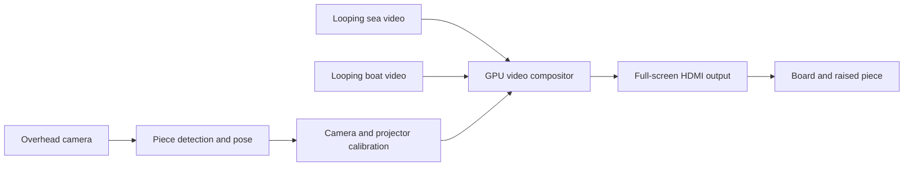

# ProjectTabletop

## Unreleased: Duck Hunt

The miss-and-middle-stage update passes all 940 offline tests with no failures or skips, plus 1,994 native assertions and clean Debug/Release builds. Landscape, square, portrait and 4K checks cover independent miss closures, five sequential middle targets, their full three-second windows, attached punctures through the turns, frame clipping, pause/replay cleanup and unchanged controls. The production click-photo path accepts a fresh frame taken just before the deadline even after rendering starts the turn away, and does not register a hit from a frame at the deadline. The fine paper rings remain smooth throughout the turn. A ten-second preview contains 600 native frames at a simulated 60 Hz clock; this is not a live projector performance measurement. No camera, microphone or app session was opened. Live tabletop acceptance remains pending.

The yellow skull-eye hover update passes Debug and Release builds with zero warnings or errors, 176 focused Duck Hunt/laser tests, and 138 new native assertions including 118 optical checks. At 1080p and 4K, only the aimed skull's eye sockets change; moving away, expired observations, input resets, pause and shattering clear the effect. Synthetic red and magenta/clipped lasers remain detectable on the forehead and both illuminated eyes. The unchanged scene itself produces candidates under some synthetic exposure/white-balance transforms, including boosted 4K highlights; comparisons verify that the eye overlay does not increase those counts or create a false single aim. Normal rendered frames remain clear. The 120-frame preview uses a simulated 60 Hz clock; live camera/projector acceptance remains pending. No capture hardware or app session was opened for these checks.

The animated side-lamp follow-up passes Debug and Release builds with zero warnings or errors and 135 additional native assertions (1,530 total across the gallery and preserved Duck Hunt checks). It verifies independent movement before PLAY and during the round, exact pause/resume behavior, stationary control captions and neighboring wood, unchanged paper-texture caches, and correct additive crossfades. Thirty varied-phase optical checks produce no false aiming-dot candidates after balancing the blue flame bases against the warm glass. A three-second preview contains 180 native frames at 60 fps, with a separate 4K still; these use a simulated clock and are not a live projector performance measurement. Live tabletop acceptance remains pending at the user's request.

The simultaneous paper-and-crystal gallery passed all 921 offline tests with no failures or skips, including 135 focused Duck Hunt tests. The stronger crystal-burst follow-up passes Debug and Release builds with zero warnings or errors, plus 1,395 native assertions: 344 gallery rendering/optical, 23 burst-motion, 33 production click-photo input, 642 mode/navigation/caption, 333 HUNT rendering/flight and 20 HUNT input checks. The burst checks measure rapid outward expansion, separated visible fragments, shelf contact and stable resting debris, and capture 180 native frames at 60 fps for a three-second preview. These are simulated-clock frames, not a live projector performance measurement. Landscape, square, portrait and 4K checks cover the rising upper backdrop, flickering crystal reflections, shattering and settled glass, independent row completion, replay cleanup, and unchanged EXIT/BACK controls. Synthetic lasers are detected on the crystal forehead; checked reflection and fragment frames produce no false red-dot candidates. The native runner creates no app window, camera, microphone, projector output or control pipe. Live tabletop acceptance remains pending at the user's request; the Release build is ready for that later check.

The preceding paper-gallery update passed all 909 offline tests with no failures or skips, including 123 focused Duck Hunt checks. Final Debug and Release builds have zero warnings or errors. Native checks pass 224 gallery rendering/optical assertions, 27 production click-photo input assertions, 642 mode/navigation/caption assertions, and the preserved 333 HUNT rendering/flight plus 20 HUNT input assertions. Landscape, square, portrait and 4K output checks cover the 95-degree flap, both one-second waits, five round paper targets, paper-only hits and clipped punctures, supported deck/roller movement, continuous release into falling, replay cleanup, and EXIT/BACK. Synthetic lasers are detected on the paper, central + and both rings; the checked clear scenes produce no red-dot candidates. The native runner creates no app window, camera, microphone, projector output or control pipe. Live acceptance of the saloon gallery remains pending at the user's request; the Release build is ready for that later check.

Local app builds used a temporary /parallel- compiler response file after native compiler crashes. After another internal CLR crash, the final Debug verification build passed with a restarted compiler and tiered compilation disabled for that build process only. Repository build defaults and app runtime settings were not changed.

The preceding Hunt flight update passed all 899 offline tests with no failures or skips. Final Debug and Release builds have zero warnings or errors. Native checks pass 333 flight/rendering/optical assertions, 20 production snapshot-input assertions, 642 mode/navigation/caption assertions, and the existing 34 Target Practice input and 414 gameplay/rendering assertions. Landscape, square and portrait checks cover shot-only START, ten-bird scoring and escapes, photographed-pose hit testing, frozen blinking, replay, wing silhouettes, red-dot detection on START and the bird, and zero clear-scene red-dot candidates. The native runner creates no app window, camera, microphone, projector output or control pipe. Live HUNT acceptance remains pending at the user's request; the new Release build is ready for that later check.

The BACK-button follow-up passes all 883 offline tests and final Debug/Release builds with zero warnings or errors. Native checks pass 642 mode/navigation/caption assertions, 34 calibrated-input assertions and 414 gameplay/rendering assertions. They exercise real rendered BACK caption holds from both modes across three aspect ratios, clear prior round/shot state on returning to the welcome screen, preserve EXIT to the main menu, and verify the standard gaps between EXIT, BACK and result-only PLAY AGAIN. Live acceptance passed on the final Release build: the user confirmed BACK returns to the Duck Hunt welcome screen from both modes and the spacing beside EXIT looks good.

The mode-selection update passes all 880 offline tests with no failures or skips, and final Debug/Release builds have zero warnings or errors. The shared main-menu thumbnail checks also pass. Native checks pass 354 mode/navigation/caption assertions across landscape, square and portrait boards, 34 calibrated-input assertions and 405 preserved gameplay/rendering assertions. They verify actual rendered caption holds, input isolation between views, unchanged walking/replay behavior, the original EXIT-only Hunt drawer, and return to the originating second menu page. These checks create no app window, camera, microphone or projector output. The new images are 1672 × 941 native pixels, not 4K; see the artwork notes for generation provenance. Live acceptance of the original mode-selection Release build passed: the user confirmed both mode buttons and controls work, TARGET PRACTICE plays normally, and HUNT shows the field with its then EXIT-only arrow drawer.

The second-page Duck Hunt tile and main-app button now open an arcade welcome scene with the title Duck Hunt and equal-sized TARGET PRACTICE and HUNT long-press buttons. TARGET PRACTICE opens the saloon shooting gallery. HUNT opens a sunny, sky-facing field with grass and trees on both sides, with the bottom-left arrow opening EXIT and BACK. Hunt now offers a central, laser-and-click-only START target and ten sequential birds from random left, centre and right launch positions. Side birds rise diagonally toward the opposite trees; centre birds choose either side. Hits freeze and blink the bird, remove it and award one point. Escapes earn no points. Shooting START after the result begins another round. Both modes place BACK beside EXIT with the standard gap; BACK clears the round and shot marks and returns to the Duck Hunt welcome screen with its drawer closed. The welcome screen stops gameplay input and microphone listening; both play modes use the selected microphone and fresh red-dot images; independent click learning remains available. EXIT restores the originating menu page. Mode transitions invalidate old shot work.

In **TARGET PRACTICE**, shoot the central **PLAY** target with the red dot and learned click to start both saloon shelves together. PLAY ignores hand holds and laptop clicks. The lower beige panel opens upward on side hinges to 95 degrees, revealing five evenly spaced round paper targets in steampunk metal holders. The textured paper faces have inner and outer printed rings and a central **+**. After one second, the conveyor brings the row forward to its front edge and stops. Shoot every paper target at least once; each hit leaves a black puncture with grey torn edges and inward paper fibres attached to that target. Only the round paper counts as a target, not its holder or the space around it. Repeated hits add holes without counting the same target twice. Once all five papers have been hit, the belt waits one second and restarts. A shot that misses the paper and lands on the exposed dark backdrop or conveyor starts clearing that row immediately instead. The holders ride on its top deck, tip forward as their bases follow the front roller, then fall away before the lower flap closes. Shots on the metal holders or cabinet trim do not close the row.

At the same time, the upper beige backdrop rises vertically into its arch to reveal five crystal skulls with flickering warm reflections from the side lights. A hit bursts a skull into 128 small crystal shards with a sharp outward impulse, then air drag, gravity, tumbling and two short shelf bounces. The scattered fragments settle and remain on the shelf. Once all five skulls have been hit, the backdrop waits briefly for the last fragments to settle, then lowers. Missing a skull and hitting its exposed dark backdrop lowers that curtain immediately. The two rows are independent: choose either row and shoot in any order, including while the other mechanism is moving or already closed. Shots on closed or moving rows are ignored.

After both rows close, the middle backdrop rises to reveal a five-target challenge. Each target uses the same round paper and steampunk holder as the conveyor targets. It travels from the right edge to the centre while edge-on, turns 90 degrees to face the player, and remains shootable for exactly three seconds. Hits leave punctures without shortening that window. It then turns edge-on again and exits left before the next target arrives. After all five passes, the curtain lowers and PLAY returns. The next cycle clears every puncture and glass fragment. This stage has no scoring yet.

Both side lamps have photographic flame animation anchored to their wicks, with independent flicker and matching warm reflections on the crystal skulls. The flames keep moving while the gallery waits for PLAY and while either shelf is active; they pause with the gallery when input readiness is lost. The original baked flames are replaced only inside the glass chimneys, preserving the rest of the saloon artwork.

Aiming the live red laser dot at an intact, revealed skull makes its eye sockets glow warm yellow. The eyes return to normal when the dot moves away or is lost, and disappear immediately when the skull shatters or input becomes unavailable. This is aiming feedback only; a trained click is still required to hit the skull.

The former walking duck, animated feet, feather bursts and latest-shot dot/circle are replaced by the gallery. Missing or ambiguous red dots are ignored. Each row accepts hits only when fully revealed and stationary; a moving or closed row does not block the other row. Hit testing uses the photographed frame time and excludes empty space around the paper or skull silhouettes. Changing microphone, learning a click, or losing camera/audio readiness pauses every mechanism and the middle target timer, and invalidates old shot work. The bottom-left arrow retains the standard long-press EXIT and BACK controls. Artwork is cached per graphics device; the approved saloon background is 1672 × 941 native pixels, not 4K.

The projected up-arrow drawer reveals EXIT, which restores the originating menu page. Microphone selection is a dropdown beside Duck Hunt in the main app window, sharing its device list and saved preference with Click learning. The list refreshes on opening and retries a reconnected selected input when capture is stopped; both selectors are disabled during learning. Switching an input clears old shots and pauses movement until audio is ready. Exact endpoint preferences persist; an unavailable chosen input does not silently fall back. No microphone picker is projected. Hand inference/search spotlights and swipe hiding are disabled for this board.

**BOARD CONTROL → Click learning**, directly beneath **Marker setup**, guides three seconds of quiet baseline, six learning clicks, three held-out validation clicks and a three-second quiet check before explicit **Save learning**. Timing is red and click collection is green, including the empty track and prominent WAIT/CLICK NOW heading. Training needs no camera, red dot or calibration, and pauses the Duck Hunt round and measurements. **Cancel** preserves prior learning. Profiles contain only numerical sound features, keyed by the actual microphone endpoint even when SYSTEM DEFAULT is selected; other microphones retain their own profiles, and untrained inputs use the ordinary detector. No audio is retained. During play, the listener requires TARGET PRACTICE or HUNT and a ready calibrated camera; training can run independently.

Learning and trained detection can complete a dominant click after a sustained 10 ms fall from its peak, allowing a quieter microphone/room tail; the ordinary untrained detector is unchanged. Nonmatching validation follow-ups below both learned peak and RMS minima are ignored, while louder mismatches still reset validation. Weak noise cannot overwrite accepted-click, clipping or inconsistent-click feedback for 1.5 seconds.

Before click learning, all 759 offline tests, Debug/Release builds and native rendering, calibrated-input, drawer/selection, EXIT, menu-thumbnail and shared menu/Paint checks passed. The magenta-camera correction found seven captured dots and rejected four clear frames. Live microphone selection saved the Sony WH-1000XM4 endpoint and registered eight hits in eight accepted shots. The initial learning build passed all 802 offline tests with no failures or skips, Debug/Release builds with zero warnings/errors, 29 native calibrated-input assertions including the training shot pause, and 198 native rendering/drawer assertions. Its first live Amazon-microphone training check missed clicks.

A separately authorized 60-second Amazon-microphone recording now replays three of three intended clicks, versus zero before the tail correction. The replay-derived profile produces exactly three shots and rejects four other completed transients, confirming clicks 55–60 ms after onset. Six learning and three validation inputs reused the same three source clips; this is not fresh held-out or live validation. That audio correction passed 27 focused tests and all 808 then-current offline tests. Fresh live learning on the Amazon USB Streaming Mic reached Checks passed and was explicitly saved: six examples, three validation clicks, nine completed transients, and zero timeouts, weak/clipped/inconsistent samples or validation rejections. Status confirms the saved profile is active. Gameplay with the previous continuous-visibility shot gate still missed shots: a live capture recorded 20 microphone clicks but only three accepted shots/hits, with frequent ambiguous red-dot observations.

The preceding shooting path used one image selected at click confirmation, without a prior-visibility requirement or another frame wait. The image must fall between sound onset and confirmation, and image/audio freshness stays bounded to 150 ms. Continuous dot feedback remains a hint only. Each onset is consumed once, including a missing-dot result; reset, navigation, MIC and learning invalidate in-flight work. Hit testing uses the image time to prevent a pre-respawn photo hitting the replacement duck. All 30 focused snapshot/game tests pass.

The preceding shooting build's optical correction joined a compact spot's clipped white centre and nearby dim fringe without letting those pixels seed candidates. Across 820 recorded images, single-dot results increased from 214 to 245 and ambiguous results fell from 32 to four: 29 original ambiguities resolved, one previously single result became ambiguous, and three missing dots were recovered and visually checked. No previously single result became missing; all 40 final dot-off images remained clear. All 11 earlier captures and 23 focused optical tests pass. Repeated frames allocate no managed memory. Concurrent-build timing indicates a small CPU cost, with medians increasing from 1.36–2.00 ms to 2.03–2.95 ms, not a performance gain.

The preceding shooting build passed all 816 offline tests with no failures or skips, Debug/Release builds with zero warnings/errors, 31 native calibrated-input assertions and 198 native rendering/drawer assertions. Native checks opened no app window, camera or projector output. Fresh live testing confirmed reliable moving-aim shots and rejection of a no-dot click: 12 recognized clicks produced 11 accepted snapshots, 11 shots and 11 hits, with one missing-dot image ignored and no busy-worker drops. This acceptance applies to the current tabletop setup; four ambiguous images remain in the recorded replay. Duck Hunt is not part of the published 1.3.1 release.

The preceding coordinate-comparison update passed all 848 offline tests, including 38 focused red-dot detector tests, with zero warnings or errors in final Debug and Release builds. Native checks pass 31 calibrated-input assertions and 225 rendering assertions covering the stationary photo, physical circle geometry, 20-pixel dot, five-pixel stroke, cleared reset state and unchanged drawer captions; the native clear board has zero candidates. Live camera captures exposed reddish photographic feet and feather edges that could be mistaken for the laser or pull its coordinates away from the bright centre. The detector now isolates bounded clipped centres before evaluating their red/pink fringe, retaining their exposure centroid even when movement forms a short streak. It reuses its existing mask and flood queue. Replay finds all 23 visibly confirmed laser frames on the new duck at independently checked core positions and rejects all 417 new-photo clear frames. The older 820-frame replay produces 257 single detections versus 245; one removed result was a verified false detection on title lettering, all 13 recovered positions were independently checked against visible laser spots, and the final 40 dot-off images remain clear. Warm concurrent-build checks observed no per-call allocations and roughly 0.3–0.4 ms additional detector time; this is not a controlled performance or end-to-end latency benchmark. Native checks create no app window, camera or projector output. Live acceptance passed on the final Release build: the user confirmed the dot and circle work, the realistic duck stays in place, and a no-dot click leaves the last measurement unchanged. The 669-sample status recording contains 13 completed coordinate pairs with correct old-before-onset/new-after-onset ordering, no busy click drops, a stationary duck throughout, and an unchanged final pair after live aim clears. Old points were 1.4–22.7 ms before onset; new frames were 73.9–114.1 ms after onset, reflecting sound recognition timing. Measurement processing after recognition took 2.3–6.2 ms. No separate no-dot microphone event appeared in that recording; its unchanged visible outcome is user-confirmed and the rejection behavior is covered offline.

The preceding walking-round update passed all 862 offline tests with no failures or skips, including 41 focused red-dot detector tests. Final Debug and Release builds have zero warnings or errors. Native verification passes 34 calibrated-input assertions and 315 rendering assertions across landscape, square and portrait boards. These checks cover walking and turning artwork against the red-dot detector, fixed latest-shot marks and no-dot retention, animated feet with an unchanged upper body, both winner screens, replay, and the existing microphone/EXIT barriers. The native clear board produces zero red-dot candidates. A white feather highlight with a dim warm-brown fringe was initially mistaken for the laser; requiring pink or strongly red local fringe support removes that false candidate. All 1,260 previously captured frames retain exactly their prior detector results: 257 single detections in the older 820-frame set and all 23 confirmed laser frames in the newer movement capture, with the recorded clear frames still rejected. The native checks create no app window, camera, projector output or control pipe. Fresh live acceptance passed: the user confirmed the walking motion and hit reversals and reached ten hits. The 774-sample status capture records an initial no-shot round escaping after 22 seconds, PLAY AGAIN starting a fresh round, and the next round reaching PlayerWon with ten shots and ten hits. It contains nine hit reversals, ten distinct latest measurement pairs, no busy-worker drops, and a constant vertical position of 0.48. Both recorded rounds entered from the right; random entry from either side is covered by offline checks, not this live recording. The stationary live evidence above belongs to the preceding coordinate-comparison build.

The feather-effect update passes all 871 offline tests, including 85 focused Duck Hunt tests, with zero warnings or errors in final Debug and Release builds. Native verification passes 34 calibrated-input assertions and 360 rendering assertions across landscape, square and portrait boards. It verifies visible airborne and settled feathers, continued scene rendering after the tenth hit, persistence on both winner screens, replay cleanup, and zero false red-dot candidates from the effect. The existing click, measurement, microphone and EXIT checks still pass. Visual inspection of the native airborne and settled player-win images confirmed the effect's scale and placement. Live acceptance passed on the final Release build: the user confirmed that the feathers look good, remain on the ground, and clear on replay. This is user-confirmed acceptance; the earlier walking-round recording predates the feather effect.

## Version 1.3.1 release scope

Version 1.3 includes Stryker's Run, the guided double-bar trainer, marker-only Paint with RESET/SAVE, Football multiball, Water Garden rendering/audio improvements and the NASA Globe. Globe now has ZOOM/PITCH rails, a toggled CLOUDS/NO CLOUDS/NIGHT model row and SAVE to local `Pictures\Globe`. Reaching across MODEL or SAVE to disturbed model choices cancels those lower holds; both model selections and the absence of accidental saves passed the latest physical check. Paint and Photo Copy also save to their own local Pictures folders.

Version 1.3.1 adds corrections for Globe caption-hold recovery, Football markers on dim turf and goal markings, false search spotlights from disabled controls during Roulette animation, Blackjack EXIT when reaching over its wagers, and Photo Copy's white-light edge fringe being mistaken for object movement. The temporary Blackjack guaranteed-win recording code has been removed.

The release source passed all 688 offline tests with no skips. Photo Copy also passed eight focused offline groups, its full object regression console suite, four native application checks, and Debug/Release builds without warnings or errors. Recorded replay retained all 31 illuminated-card frames and rejected all 22 removed-card frames. The user confirmed steady lighting and release after removing the card in the corrected live build. Football's updated live tracking was reported approximately 99% reliable, and Blackjack EXIT returned to the menu without changing the wager. The release pipeline performs its own full regression run and installed-app smoke checks before publication; those results must be checked separately. See [1.3.1 release notes](docs/releases/1.3.1.md), [1.3.0 release notes](docs/releases/1.3.0.md), [installation](docs/INSTALL.md), and the [README](README.md) for current behavior and remaining physical-validation limits.

## Development record before 1.3

The following entries preserve measurements and investigations from individual development builds. References to then-pending checks, older rotation speeds, rejected artwork or experimental behavior describe that build, not the final 1.3 state. The release scope and README take precedence for current behavior. The original projected-piece proposal below remains a separate research plan, not a claim that its physical acceptance criteria have been met.

**Menu-arrow correction:** A live up-arrow press correctly damaged the glyph but was intermittently vetoed as a disturbance elsewhere. Replay locates that false obstruction at a saturated colour boundary in the untouched Paint thumbnail. The whole-board veto now accepts camera mixtures between two colours already present in the same small rendered neighbourhood. Its caption comparison, obstruction thresholds and hold timing are unchanged. A separate regression also reproduces the entering finger's tail vetoing its own arrow below the plate; both paging arrows now exclude the narrow approach directly to the bottom edge. Caption shape, the full-second hold, fresh release after a genuine veto, and obstructions above or beside the approach retain their checks. Generated down-arrow and recorded up-arrow approach tests pass, and the native menu fixture now models fingers entering from the bottom edge. The colour-boundary correction removes all four false vetoes across 223 saved camera frames, with identical caption observations. All 640 offline tests pass; the final equivalent bounds shortcut additionally passes 11 focused checks. Eighteen synthetic thumbnail obstructions (including the failing colour boundary) still veto when cold or already stationary. A warmed 24-sample replay measured held-arrow medians of 24.66 ms before and 24.79 ms after; a large synthetic reach measured 78.16 ms and 88.47 ms. These are offline detector timings, not physical input-latency measurements. Final Debug and Release builds pass with zero warnings or errors. Native menu scrolling (both arrows, bottom-edge finger entry, genuine-veto rearming and exact first-page restoration) and shared-swipe checks pass. The single updated Release is calibrated on the menu with fresh Facecam frames. On October 18, 2026, the user confirmed that both down-arrow and up-arrow holds work reliably in the live check.
**Globe rotation and swipe correction:** Globe's NASA sky rotates at the user-approved 0.03 degrees per second (one turn in 12,000 seconds). The remaining swipe misses were traced to gradually fading stars leaving stale optical losses across the band. The shared detector now requires a rapid detail-loss onset, retains that evidence briefly while the hand crosses it, and retires fading residuals using recent luminance references. These references update after classification in the same exposure-compensated space; they add no completion wait or camera-frame copy. Filled-surface detection, caption holds, marker exclusion and the gesture's travel, direction and timing guards retain their existing behavior. Gap recovery also checks vertical drift across the missing interval before anchoring further confirmation at the reacquired point.

In the 1,776-frame difficult-position recording, the refined optical replay completes 15 visually confirmed hand passes versus three before, retaining all three earlier successes. Its 896 clear frames contain no disturbance observations, partial traversals or toggles. This recording samples below live detector cadence, so these counts are not a live reliability or latency measurement. Independent simulated slow fading-star sweeps, moving scenery, competing disturbances, exposure changes and redraws produce no toggle. Final Debug and Release builds pass with zero warnings/errors, and all 640 offline tests pass, including 22 new detail-loss regressions. Native 4K Globe, shared-swipe and menu-navigation checks pass. At five sky orientations, all 20 moving-sky and 20 static-sky simulated swipes complete once each, with moving/static completion differences within one 31 Hz replay frame. All 9,305 moving-sky quiet frames produce zero observations, traversals or toggles. The detector reuses 81 KiB of additional reference state; its 300-update allocation check reports zero managed allocations. These checks do not measure physical end-to-end latency. In the sampled difficult recording, two earlier completion timestamps stay unchanged and one completes 131 ms later; no fixed delay was added. The older NASA recording retains all five successes at identical timestamps and remains quiet through 781 clear frames. Another older recording improves from zero to two completions; one slow pass still loses optical evidence for over 600 ms and is deliberately not joined. The corrected Release passed offline validation; the user subsequently reported that swiping works great on the tabletop.

**Earlier Globe swipe investigation:** The latest live failure was captured at 0.02 degrees per second, with 816 unique camera frames and no applied toggles. Most of the left five-eighths of the bottom band is recorded as black; sparse detail in the brighter right side is also rejected when distant star residuals expand its bounds. A targeted locality correction now allows one distant star residual of at most four cells in a 3 by 3 footprint, only when a compact cluster supplies at least eight qualified losses and 80% of the evidence. Existing photometric gates, bright-board behavior and gesture timing are unchanged. All 36 disturbance checks pass; replay observations increase from 31 to 39, but no complete traversal is recovered in this underexposed capture. All 532 offline tests pass. At 0.02 degrees per second, all 20 moving-sky and 20 static-sky synthetic swipes complete with timestamps unchanged from the prior renderer; 9,305 quiet frames contain 45 observations but no traversal or toggle. The eight additional observations in the real capture are not confirmed hand detections and include clear frames, so physical swipe reliability remains unresolved. The locality correction and read-only camera query pass Debug/Release builds and the native Globe, shared-swipe and menu-navigation fixtures. The stronger dark-threshold and noise-learning experiments have not been promoted. The query confirmed compatible Facecam brightness/contrast controls. Automatic camera picture profiles are now implemented in source: Default retains the original per-device settings; Dark scene lowers contrast on Globe, with Default restored for other boards, calibration and camera release. Brightness, exposure, ISO, white balance and frame rate remain unchanged. Defaults are atomically saved before an override; unsupported controls or failed storage leave the camera alone. Superseded requests are cancelled, writes are verified and partial failures roll back. A 220 ms settling interval applies only after a setting write, with stale detector evidence cleared and ongoing board animations preserved. The initial profile builds pass with zero warnings/errors; all 592 offline tests and native Globe, shared-swipe and menu fixtures pass. The first live check confirmed Default brightness 2 and contrast 116, but exposed a cancelled-before-write cache invalidation. Source now retains known controls when a cancelled request never read or wrote them, and deduplicates the deferred navigation event. The corrected Debug/Release builds pass with zero warnings/errors, and all 11 coordinator lifecycle tests pass, including the cancellation and unknown-readback regressions. The live Facecam now switches contrast 116→100 for Globe and restores 116 on the menu and Water Garden. Brightness 2, the reported exposure value, white balance 3400 K and negotiated 1080p/60 NV12 remain unchanged. The sampled bottom region gains faint camera detail (median luma 0→6); this comparison is not a signal-to-noise or recognition benchmark. The 180-second status recording contains 11 visibility transitions, no detector errors or camera-health warnings, and no marker waits. The user reports that quick sweeps sometimes miss. A confirmed four-pass recording contains three toggles and one fragmented traversal; its sampled centroid briefly reverses just beyond the existing guard. Fast status polling measures 20.00 swipe checks per second (median 50 ms) despite about 40 incoming camera frames per second. The shared swipe admission interval is now 16 ms instead of 32 ms, retaining intermediate positions when the independent worker is free. Busy arrivals are still dropped without copying or queuing; gesture thresholds, marker checks and caption rules are unchanged. All 177 focused swipe, disturbance, worker and camera-profile tests pass. The updated Debug/Release builds and native Globe, shared-swipe and menu fixtures pass. A 35-second live clear-board check measures 38.97 swipe checks per second (median 25.01 ms), with no toggle or error; partial central-noise traversals predate the cadence change. Quick live sweeps still sometimes miss: a continuous hand can disappear optically for 400 ms, then its larger displacement trips the fixed jump guard. A narrow gap bridge now preserves an established directional path across actual missing observations, within the existing 600 ms gap and three-second duration limits. It requires at least four distinct pre-gap positions and .15 travel, plausible velocity, close vertical alignment, and .035 further movement after reacquisition before completion; it adds no wait to ordinary continuous swipes. Optical noise gates and normal jump rejection remain unchanged. All 612 offline tests pass, including 18 new captured-path and negative cases. Exact full-rate coordinate replay recovers the confirmed missed pass and preserves the existing successful completion (one to two toggles); both quiet recordings remain at zero toggles across 2,793 frames. Sparse snapshot status omits enough intermediate positions that baseline and corrected replay both miss its live event; it is not an equivalent end-to-end test. Final Debug/Release builds pass with zero warnings/errors, and native Globe, shared-swipe and menu-navigation fixtures pass. The final Release build is deployed with PREVIEW off. The user confirms all tested quick and relaxed sweeps respond promptly, including through the middle. The final status recording observes four visibility transitions, no detector errors or camera-health warnings, and no marker waits. This is live acceptance on the current setup, not a guarantee under every lighting condition. The approved Earth-only anti-aliasing, star rendering and five-hour sky rotation were preserved for that accepted 0.02-degree-per-second build.

**Globe sky development:** Globe now uses NASA Deep Star Maps 2020: a full 16384 × 8192 galactic-coordinate panorama in four lossless PNG longitude tiles, with real catalogue stars and no synthetic star overlay. The GPU views it from inside a celestial sphere using the approved opening projection and rotates it at 0.03° per second, one turn every three hours and twenty minutes. The longer comet paths and tails remain independent. The NASA background displays at its prepared brightness across the whole board, with no regional dimming or transition dithering. The preparation script, checksums and NASA/ESA credits are documented in the bundled [sky provenance](src/ProjectTabletop.App/GlobeRendering/Assets/SKY.md). The generated-sky baseline was committed and pushed as `3c79e30` before this experiment; the NASA replacement is retained as the user-approved source update. The NASA Debug and Release builds pass with zero warnings or errors, along with 27 focused regression checks and the native 4K fixture. Fine star cores pass in all eight lower-sky sections; the cache is reused and comet motion leaves the bottom quarter and Earth unchanged. For the initial NASA appearance check, the single Release app was restored on the projector with the NASA asset hash verified, calibration complete and fresh 1080p/60 Facecam frames without a camera-health warning. The user approved the NASA sky appearance, but reported unreliable bottom-row swipes in that initial build. The first live capture recorded only 15 disturbance observations in 902 frames and no control toggles. The shared swipe detector now preserves the brightest real camera pixel in a bounded 5 by 3 neighbourhood and combines local losses of fine star detail before connectivity filtering can discard them. Two qualified samples supply a position; the existing four-position movement vector, travel, noise, contrast and spatial-extent checks still decide the gesture. No wait or gesture timing change was added. The final correction passes all 525 offline tests, including 91 focused swipe checks, and replays five of six recorded directional passes, with no observations during the first 535 or final 246 clear frames. Only individually qualified lost pixels contribute the reported position; larger features retain their original validity gates. Offline checks measured about 0.35 ms per update with zero managed allocations over 300 updates. The recording sampled at approximately 10 frames per second, below the live detector cadence; the corrected Debug and Release builds pass with zero warnings or errors, and the native shared-swipe and main-menu navigation checks pass. The corrected Release was calibrated on Globe with fresh camera frames. The user confirmed that relaxed and quicker sweeps both toggle promptly. The 120-second live capture sampled at 20.8 frames per second and recorded 14 applied hide/show toggles, with no marker waits or detector errors. Its initial 48-second clear-board interval contained 1,101 samples with no disturbance observations or toggles. This confirms the live acceptance check; it is not an end-to-end latency benchmark. The subsequent user-requested removal of sky dimming passes Debug/Release builds with zero warnings or errors and the native 4K Globe fixture. Same-pose comparisons across four aspect ratios show approximately 2.01 times the previous central-sky RGB brightness, while outer quarters and opaque Earth interiors differ by at most one 8-bit level. The atmospheric-rim fixture measures added blue light relative to its sky reference, avoiding dependence on background colour. The undimmed Release is calibrated and running with fresh camera frames; the live view confirms the brighter centre. The final rotating-sphere Debug and Release builds and native 4K checks pass, including four aspects, sharp lower-sky stars, stationary captions, Earth/comet occlusion and ten-hour wrap continuity. At the selected 0.01°/s rate, all 20 synthetic swipes complete and 9,305 quiet replay frames contain no observations or toggles. Timing differences range from −64.5 to +64.5 ms; one orientation misses the strict one-frame comparison. No detector thresholds or waiting behavior changed. The final rotating Release was recalibrated on Globe, and the user confirmed the appearance and both swipe speeds. An approximately 90-second status-only capture recorded four applied toggles, no detector errors or camera-health warnings, and no marker waits. This confirms live acceptance, not an end-to-end latency benchmark. The requested speed increase doubles sky rotation to 0.02°/s (one turn in five hours). The earlier live acceptance above describes the ten-hour version. At the doubled rate, all 20 synthetic swipes complete, matching the 20 stationary-sky successes, with completion differences from −64.5 to +32.3 ms. The 9,305 quiet frames contain 45 disturbance observations but no traversal starts or toggles. The strict one-frame timing comparison remains false because two sweeps finish two frames earlier. The five-hour Debug and Release builds pass with zero warnings or errors, and the native 4K Globe fixture passes, including rotation wrap and unchanged control captions. The single five-hour Release is recalibrated and running on Globe with fresh camera frames and no camera-health warning. Later live checks with automatic camera profiles and the shared swipe corrections confirmed prompt quick and relaxed swipes at 0.02 degrees per second. See [Globe](README.md#globe).

**Current Earth anti-alias update (development build):** Earth now uses four native subpixel samples for its surface, clouds, silhouette and blue atmosphere. The original blue scattering colour and falloff are retained, including the faint outer tail. The surface renders at destination-pixel resolution with premultiplied coverage, followed by additive atmospheric scattering. The sky and comets retain their approved rendering footprint in a separate draw, preserving gesture reference detail; no extra application-owned bitmap or full-screen blur is introduced. The caller transform and blend mode are restored afterward. An initial whole-frame resolution correction improved Earth but regressed the moving-sky swipe replay, so the final implementation limits that correction to Earth and its atmosphere. Final layered Debug and Release builds pass with zero warnings or errors. Independent 4K comparisons against an 8K reference confirm smoother Earth surface and limb at 0.6x and 1.8x. The atmospheric glow retains about 97% of its measured blue energy after 8-bit compositing, and the approved sky differs by at most one channel level in fewer than 0.04% of far-sky pixels. Offscreen 4K draw-plus-readback medians are 0.92/1.22/1.78 ms at 0.6x/1.5x/3x zoom; these are not live frame-rate measurements. The final native 4K Globe fixture passes, including controls, four board aspects, atmospheric silhouette and comet occlusion. All 20 moving-sky and 20 static-sky synthetic swipes complete; observation counts, traversal counts and toggle timestamps match the previously approved five-hour renderer exactly. Its 9,305 quiet frames contain 45 observations, no traversal progress and no toggles. The strict one-frame moving/static timing comparison remains false for the same two earlier completions; no delay or detector threshold changed. The single Release app is recalibrated and running on Globe with fresh 1080p/60 camera frames and no camera-health warning. A projection snapshot confirms the native Earth and blue rim; the user approved Earth's appearance but reported that live swipes need attention. The requested 0.04-degree-per-second experiment was withdrawn before deployment; that build retained 0.02 degrees per second. The subsequent camera-profile and shared swipe work passed live acceptance, as recorded above.

**Current source performance update (development build):** Water Garden caches fountain pressure calculations and fixed stone geometry while retaining its established rendering path, 120 Hz physics, native detail and ducks. Shared board-selection reads avoid waiting on rendering; scene mutation and input validation stay synchronized. Exact physics comparisons, final Debug/Release builds, all 521 offline tests and five focused native checks pass. Live Release captures with preview off generated 38.45 water frames/s before and 38.10 after, so no measurable animation speed-up has been established. The user confirmed that the final build feels smoother and that the double-bar marker and controls work; this subjective improvement is separate from the unchanged average frame rate. See [Water Garden](README.md#water-garden).

**Released scope, version 1.2.0, October 12, 2026:** The launcher has nine boards: Dragon Slots, Photo Copy, Blackjack, Paint, Crown & Deed, Globe, Roulette, Water Garden and Football. Six cards fill the first page, including Football at the top right and Water Garden at the middle right; a fresh sideways-index or pinch selection on the down arrow reveals Roulette, Paint and Photo Copy on the second page.

Football supports two human players or one human against AI, using a learned single black bar, a double-bar marker with two matching parallel strips, a cardboard T with a black crossbar and uncoloured stem, or one index fingertip per half. Bars about 1 cm thick and 5–6 cm long are recommended, with about a 1 cm gap for a pair. Learning a pair records its spacing and requires both strips for acquisition. Recent measured position and angle guide continued tracking, including up to 350 ms of recovery from one visible strip after a complete pair; complete markers allow fast shots and reversals, while conflicting partial measurements are skipped. Existing single-bar profiles remain supported. Identical markers are assigned by their calibrated field halves, including the surrounding grass behind the goal lines, with player 1 on the left and player 2 on the right; multiple matching markers in one half are rejected. Football profiles are camera-specific and separate from Water Garden.

Football opens with **PLAY** and lets players position their kickers before starting. The controls disappear during countdowns, play, brief tracking recovery and goal celebrations. Short input losses quietly freeze the ball and AI after 250 ms and resume immediately on fresh input within 750 ms. Longer losses bring the controls back with **RESET** for a fresh 0–0 match; returning the marker without pressing it resumes the existing match through a countdown. Ambiguous input and camera or calibration resets disarm immediately. Car-front, glove, frying-pan and boot kickers share the same contact radius and physics. The default white car fronts have red stripes for player 1 and blue stripes for player 2. A bar-controlled kicker sits ahead of the whole marker with a clear gap, pointing perpendicular to it toward the opponent's half and following its calibrated position and angle. Kickers stay inside the playing lines, and only fingertip kickers have the neutral platinum centre. The spherical football has a height-dependent shadow, lively capped-speed rebounds and first-to-five scoring. After a ten-second confetti celebration over the winner's half, the controls slide back with **PLAY** for another match. Stadium ambience, whistles, side-specific goal cheers, quieter alternating crowd chants and a victory celebration play through the selected display's speakers when display audio is enabled.

Camera Input offers **30, 60 and 100 fps** preferences saved separately for each webcam, falls back to an available format and shows the negotiated rate. Independent shared input workers discard busy arrivals rather than queue stale frames. The five-dot board setup also estimates camera latency after subtracting the configured projector delay, with the result shown only on the laptop. Higher capture rates do not guarantee the same tracking or projector frame rate.

Water Garden opens with a three-second move into a close oblique view, followed by white handwritten titles on the sand. Its native water simulation includes a three-dimensional rock cascade and floating rubber ducks. A learned coloured tip maps through board calibration and the garden camera to stir the water and push ducks, with stronger waves and direct stick contact in this release. A bottom-left drawer holds Exit, Reset and Duck+ caption-hold controls; Duck+ repeats every second while its lettering stays broken, dropping ducks into the pond up to twenty. The controls are disabled while the stick is detected over the water. Settings contains the Hand-Tracking test. Crown & Deed is the project's property-trading board for human and AI players, with resumable local games. Photo Copy captures an object or the other hand on a grey surface; its bottom controls use caption holds for Swirl, Copy, Clear, Save and Exit. Other controls use their board's gesture or hold policy. The local hand models and board calibration do not establish physical touch. The card-focused design below is retained as a later phase; [README.md](README.md) describes the current controls and setup.

**Current source setup update (development build):** Water Garden uses the same physical black double-bar detector as Football. **SETUP → BOARD CONTROL → Marker setup** now guides the shared Water Garden / Paint double-bar marker or either Football player through neutral-target measurement, five real-scene positions, tracked movement between two rings in both directions and a lift-off check before explicit **Save marker**. **Cancel** preserves the previous profile; **Recheck saved marker** validates its existing geometry. Profiles remain camera-specific and separate by controller. On first use without a saved marker, the board opens the trainer after camera and calibration are ready. Football skips finger-input players and trains the second marker only for two-human play. Cancel dismisses it for the current board visit; saving stops subsequent automatic prompts. The old manual marker-training controls and **Physical pieces** panel are removed from the interface; colour matching and training are removed from source. All long presses use actual caption or arrow-glyph corruption without requiring additional whole-button coverage. Water Garden keeps its navigation arrow available while the marker is in the water; pond actions retain their interlock. The guided UI has offline and native rendering tests. The earlier Water Garden walkthrough through five positions and lift-off passed a live check on 2026-10-15, with its saved profile separate from Football’s; Water Garden’s added movement step still needs physical-tabletop acceptance. On 2026-10-16, the user completed fresh Football training from the projected instructions, including both movement crossings, lift-off and **Save marker**. The movement stage required retries before passing, so this confirms self-guided completion rather than first-attempt success. The version 1.2.0 summary above describes the installer published for 1.2.0. See [current marker setup](README.md#marker-setup).

**Historical implementation note, September 26, 2026:** The initial card prototype targeted **multiple simultaneously tracked white cards** with distinct camera-visible bright patterns. It captured full webcam snapshots for labeling or offline review, trained a local multiclass shape/pattern model, and supported a separate media assignment for each card. Synthetic two-card recognition and calibration math checks passed. On that setup, the phone appeared as **Android Webcam** at 1920 × 1080, 30 fps; the app captured the projected grid and the projector showed looping local video with black margins. A ten-minute 1080p/30 test clip completed, without measuring displayed/dropped frames or 4K/60 decoding. These are historical observations, not current card-tracking acceptance. No real card was labeled or tracked in that trial; optical alignment and multi-card tracking still need physical testing.

**Status:** Interactive board apps are implemented; broader physical acceptance remains pending. The remainder of this document retains the original card-tracking concept and acceptance criteria, not the current product specification or a release checklist.

**Date:** September 24, 2026.

**Repository name:** ProjectTabletop.

## The idea

Turn a plain white tabletop into an animated game world. An overhead projector shows a moving sea on a **21 × 21 inch** white play area. A player moves a small white piece on that surface. An overhead camera finds the piece, and the projector draws a separate animated boat video precisely on its top. The boat image follows the physical piece when it moves or turns.

The physical piece remains something the player can pick up and move. The projected image supplies its appearance and animation. This first demo is meant to prove that those two things can stay visually aligned during real play.

## Short-term demo

1. Run a local Windows C# application on the laptop.
2. Connect the existing **JMGO N1S Pro 4K** projector to the laptop by HDMI and use it as a second Windows display. Keep a control window on the laptop and a borderless projection window on the projector.
3. Project a high-quality, looping, overhead sea video into the 21-inch square. Keep the rest of the projector's wide image black.
4. Use an overhead camera to locate one movable, slightly raised white piece and determine its position and orientation. Test a small retroreflective bead pattern as a camera-readable code.
5. Render a separate looping boat video onto the visible top of that piece. Mask the boat image to the piece's outline so it does not spill onto the sea.
6. Move and rotate the piece by hand. Its projected boat appearance follows it and recovers after a brief loss of view.

The first optical validation needs **one piece**, followed by a finished app that can recognize and project onto **multiple distinct pieces at once**. Game rules and interactions can be considered after the visual effect works reliably.

## Physical setup and assumptions

| Part | Initial plan |
|---|---|
| Play area | Smooth, matte white 21 × 21 inch board or paper, flat and fixed in place. |
| Piece | One asymmetric white cutout with a mostly matte top. Bond white paper to rigid card or foam board so it stays flat. Its small, measured lift above the board makes it easy to move and gives the top a consistent projection plane. Test sparse bead patches near the edge while preserving a clear central area for the boat image. |
| Projector | Existing JMGO N1S Pro, connected by HDMI. On September 26, its lens was positioned pointing straight down, **49 inches from the board/floor**. The projected image measured about **40 × 23 inches** on the floor, close to the roughly 41 × 23 inches predicted by its 1.2:1 throw ratio. A centered 21-inch square leaves about 1 inch of margin above and below. |
| Camera | The intended camera is the phone on a boom across the board from the projector, mounted lower and angled down. Its previous 33-inch height is a reference, not a required height for this smaller stage. Keep the entire play area in view and provide its live feed to Windows as a camera source. |
| Laptop | Windows 11 laptop running the C# application locally. No cloud service is needed to play the demo videos or track the piece. |

The projector and camera cannot occupy the same vertical line at different heights: the lower device would block the upper one's view or light. In the photographed setup, the projector is higher and to one side, while the phone camera looks down from the opposite side. Separate board and raised-top calibrations map this geometry, but card recognition across the oblique camera view still needs testing. The mount must hold the projector steady, keep its vents clear and aim the lens perpendicular to the board. The straight-down position is now achievable; the next physical check is to project a measured 21-inch square and inspect focus, image size and stability at the center and corners. JMGO documents ceiling mounting with a dedicated bracket, but its published material does not explicitly confirm continuous straight-down operation; verify that orientation before relying on it.

JMGO's Smart Eye Protection can turn off the image when someone enters the projection area. Check its behavior while a player reaches in to move the piece, and keep the physical setup safe for people at the table.

### Surface and reflectivity test

A piece that reflects more light than the board may be easier for the camera to find, but the type of reflection matters. A bright **matte** white top can remain readable from several player positions. A glossy or mirror-like top can create a hotspot or wash out the boat video. Retroreflective film sends much of the projector's light back toward the projector, so the separate camera may not receive the expected bright return. These are material choices to test, not assumed solutions.

Make a few pieces with the same shape and height: bright matte white, satin or glossy white, and matte white with a narrow white retroreflective perimeter. At the actual camera and projector positions, lock the camera exposure and record each piece under a white test image, dark and bright sea frames, and moving sea video. Compare edge visibility in the camera, saturation or glare, and how the boat image looks from seats around the table. Select a finish that supports both tracking and projection.

### Bead-coded piece trial

The proposed [loose glass beads](https://www.amazon.com/dp/B08466BZY4) come in three size ranges, approximately 0.09–0.15 mm, 0.30–0.59 mm and 0.84–1.68 mm. Individual beads may be too small to read reliably at the full-board camera scale. Make several distinct, asymmetric **patches** of beads near the piece's rim and leave its center matte for the projected boat. Start with patches about 5–8 mm across, then size them from actual camera frames. A pattern should identify the card and establish its orientation; first validate one card optically, then several together.

For the first sample, place beads into small wet patches of opaque white paint or another white binder so they are partly embedded and their upper surfaces remain exposed. Do not coat the whole bead with clear glue. Traffic-marking glass beads depend on the backing and embedment depth for retroreflection, so a bead merely glued on white paper may be weaker than expected. Mount the paper on rigid white card to keep the pattern's shape and piece height fixed. Compare it with a plain matte piece and a small piece of commercial retroreflective tape.

Test each sample with the projector alone, then with a small light close to the camera lens. Retroreflectors return light mainly toward its source, so the offset projector may illuminate the camera poorly. Record whether each pattern is read correctly while the sea and boat videos run, with the piece at several board positions and orientations. Check that any bright patches do not spoil the projected boat for players. This is a promising identity method, not yet a verified tracking result.

## Application design

### Video and display

- Output at the projector's actual negotiated HDMI resolution, aiming for **3840 × 2160 at 60 Hz**. Verify this on the laptop and projector rather than assuming it from the product label.
- Decode local video with a Windows media path that can use the GPU, then composite the sea and masked boat into one projector frame. The app must not move full 4K frames through C# pixel arrays on every refresh.
- Begin with known local video files and a seamless sea loop. The sea is the full-stage background; the boat is an independently positioned and rotated video layer.
- Use a render path that can clip the boat layer to the detected physical outline. Test the clip's edge quality on the real piece. A rectangular boat video without a mask would illuminate the board around it.
- Keep automatic projector image repositioning, screen fitting and keystone changes from altering calibration during a session. Align the projector physically first, then calibrate the remaining mapping.

**Current implementation path:** The .NET 10 C# app uses WinUI 3 for the laptop controls and projector window, `MediaFrameReader` for camera capture, `MediaPlayer` frame-server decoding, and Win2D for GPU surface composition and masking. A 1080p/30 local clip looped for over ten minutes on the projector with the webcam active. Actual displayed/dropped frames, 4K/60 decoding, hardware-decoder use, and moving-card masking have not yet passed physical tests. If testing finds a renderer limit, evaluate a lower-level Direct3D/Media Foundation path.

### Piece detection and projection mapping

- Calibrate the camera view to the four corners of the fixed play area. Calibrate projector pixels against known points on the board. Store both mappings for the session and recalibrate when either device moves.
- Track the piece's center, orientation and top outline, not only its approximate bounding box. Use an asymmetric piece so orientation is observable.
- Treat the **board surface** and the **raised piece top** as different planes. A mapping measured only on the board can place the boat video beside the raised piece because the camera and projector view it from different positions. Measure the piece height and calibrate its top plane separately.
- Mask the boat video slightly inside the piece's detected edge. Smooth small detection jitter without making the image visibly lag behind a moved piece.
- The intended result is a **mostly white piece with a clean area for the boat video**. Test whether sparse retroreflective bead patches can provide position, orientation and an identity code for later pieces. A temporary printed marker may be used during development to prove capture, pose and rendering independently; it is not the intended finished method. A recognition model trained for different physical objects should not be assumed to recognize this piece.
- With projected imagery running, reliable detection is the main technical risk. Compare the plain piece's outline and motion with the bead-coded sample under actual lighting. If the beads do not work, evaluate a different camera/lighting method or a trained detector. Do not claim this problem solved until the moving projected piece is demonstrated.
- The current classifier compares outlines and bright patterns in raw camera pixels. Capture labeled examples near the center and edges of the stage, at several orientations, because the angled phone view may change their apparent shape. If that variation causes errors, rectify candidates to the calibrated card-top plane before classification.

## Build sequence

| Step | Deliverable | Check |
|---|---|---|
| 1. Optics | With the projector lens 49 inches above the board, project a 21-inch square calibration grid. The full image has already measured about 40 × 23 inches. | The square fits in the full image; focus is acceptable at center and corners; the mount and orientation remain suitable during a test run. |
| 2. Video output | Windows app sends a looping sea scene to the HDMI display. | Correct display selected; square centered; smooth, sharp playback on the actual projector. |
| 3. Registration | Camera sees the stage; a projected grid is mapped to physical points. | Grid corners and center land where expected after calibration. |
| 4. Tracked video | A temporarily marked test piece drives a masked boat clip. | Moving and turning the piece moves and turns the projected boat without obvious spill. |
| 5. White piece | Compare plain and bead-coded finishes, remove the temporary printed marker and track the intended white piece while the sea and boat videos run. | The chosen finish and lighting provide reliable tracking, correct code reading if beads are used, and a clean projected boat image; alignment meets the demo checks below. |
| 6. Complete demo | Package a repeatable setup and record a short demonstration. | A fresh app launch and calibration reproduce the effect without code changes. |

## Definition of a successful tech demo

- The 21-inch play area shows a clear animated sea with a smooth loop. The laptop can still show controls while the projector shows only the demo output.
- HDMI output is confirmed at the chosen resolution and refresh rate. A ten-minute run shows no sustained stutter, visible tearing or growing playback delay. Record the actual output and dropped-frame measurements; **4K/60 Hz is a target**, not a claim that the current hardware has passed this test.
- With the sea running, the camera finds the intended white piece at the center and at four other locations across the play area, including at two orientations. If a bead code is selected, it reads the same identity at every test location.
- For the expanded multi-card build, show at least two differently patterned white cards at once, each retaining its own identity and assigned image or video while the cards move and cross paths. Record identity swaps, missed detections, and false overlays during this run.
- Once a moved piece settles, the boat video is visibly centered and oriented on its top within **200 ms**, with its rendered edge within **5 mm** of the piece edge at those test locations. These are initial engineering targets to measure and revise after the first physical trial.
- Moving a hand across the camera view or briefly lifting the piece does not leave a permanent boat image behind. When the piece is visible again, the video returns to it without restarting the application.
- The finished demo works locally with the HDMI projector, webcam and supplied media files. It does not depend on an internet connection.

## Outside the first demo

This first build does not need board-game rules, AI opponents, multiplayer networking, sound, a game editor or a library of projected worlds. The sea and boat are the initial test scene; users can choose other local media for the background and each recognized piece. A full game can follow once the core visual registration has been demonstrated.

## Reference material

- [JMGO N1S Pro specifications and mounting FAQ](https://global.jmgo.com/pages/support-center-n1s-pro): 4K output, 1.2:1 throw ratio, 40-inch minimum rated image size and dedicated suspension bracket guidance.
- [JMGO N1S system manual](https://global.jmgo.com/cdn/shop/files/N1S_Series_GTV_System_Manual.pdf?v=9249783432248036449): focus, keystone, image fitting and projection settings.
- [Edmund Optics: illumination and surface reflections](https://www.edmundoptics.com/knowledge-center/video/eo-imaging-lab/eo-imaging-lab-introduction-to-illumination-concepts/) and [3M: how retroreflection works](https://www.3m.com/3M/en_US/scotchlite-reflective-material-us/industries-active-lifestyle/active-lifestyle/how-retroreflection-works/): why bright, glossy and retroreflective finishes behave differently for an offset camera.
- [FHWA: glass beads in reflective markings](https://www.fhwa.dot.gov/publications/research/infrastructure/pavements/12048/005.cfm): the effect of binder, bead embedment and light-source geometry.
- [Microsoft: process camera frames with MediaFrameReader](https://learn.microsoft.com/en-us/windows/apps/develop/camera/process-media-frames-with-mediaframereader).
- [Microsoft: MediaPlayer frame-server mode](https://learn.microsoft.com/en-us/windows/apps/develop/media-playback/play-audio-and-video-with-mediaplayer#use-mediaplayer-in-frame-server-mode).
- [OpenCV: camera calibration](https://docs.opencv.org/4.x/dc/dbb/tutorial_py_calibration.html) and [homography](https://docs.opencv.org/4.x/d1/de0/tutorial_py_feature_homography.html).
