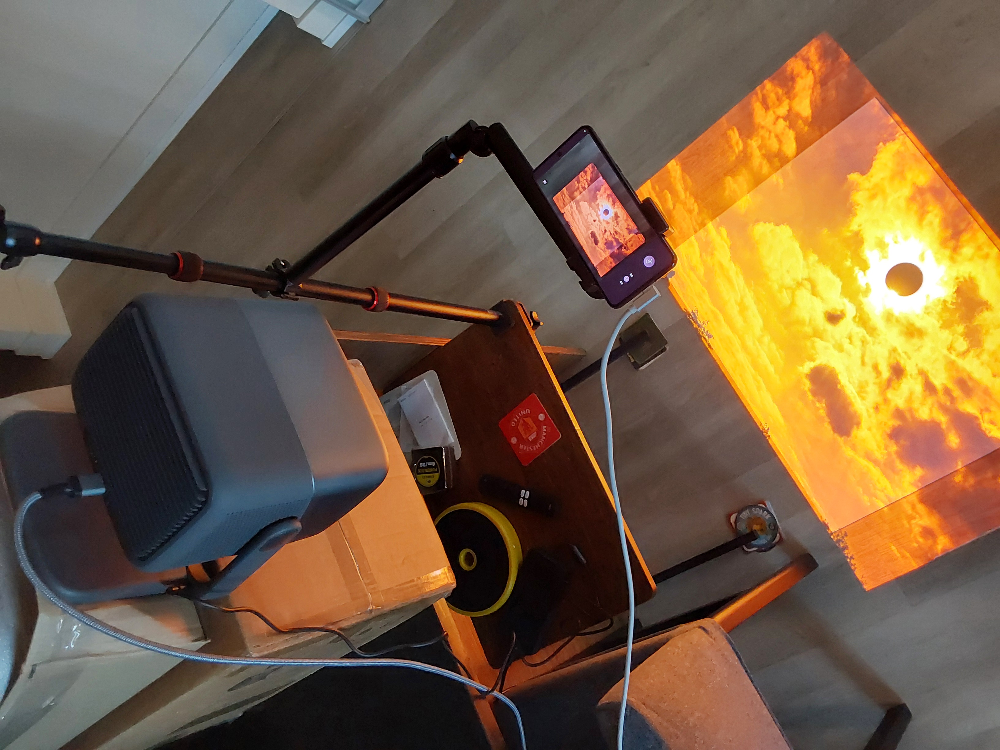

# ProjectTabletop

ProjectTabletop is a local Windows C# app for an interactive projected tabletop. A laptop window handles camera selection, board setup, fingertip tracking, media, and calibration. A separate window sends the scene to the projector.

## Quick start



1. **Position the projector.** Aim it down at the floor. Position both the projector and webcam about 110 cm (43 inches) above the ground.
2. **Position the board.** Center the board within the projector's image.
3. **Position the webcam.** Aim it at the same location. The webcam preview should show the entire board, with a small margin around all its edges.
4. **Adjust the picture.** Set the projector's brightness to its minimum setting, then increase saturation to taste.
5. **Start the app's board setup.** Click **Start camera**, then **Open output**, then **Start board setup**.

## Install on Windows

Download **ProjectTabletop-1.2.0-win-x64-setup.exe** from [GitHub Releases](https://github.com/abiemann/ProjectTabletop/releases/tag/v1.2.0). The setup targets Windows 11 on an x64 PC and includes .NET, the Windows App SDK, native camera-analysis dependencies, artwork and hand models. Visual Studio and a separate .NET installation are not required.

Setup installs for the current user without administrator rights and adds a Start menu shortcut. Updates preserve your settings, saved games and exported pictures; these also survive uninstall. The installer is unsigned, so Windows may display an unknown-publisher warning. See [installation and first-run instructions](docs/INSTALL.md), [1.2 release notes](docs/releases/1.2.0.md), and [the release process](docs/RELEASING.md).

Version 1.2.0 adds [Football](#football): a bouncy projected football game for two people or one player against the computer, controlled with a learned single or double black bar, a cardboard T's black crossbar or an index fingertip. Select **PLAY** to begin a first-to-five match with red and blue car-front kickers, victory confetti and stadium sounds.

The release also adds **30, 60 and 100 fps** camera preferences with automatic fallback to an available rate, plus an **Estimated camera latency** readout during board setup. Independent input workers keep fresh hand and marker observations moving without queuing old frames. See [First setup](#first-setup) for camera controls and [Water Garden](#water-garden) for the improved stick contact and waves.

The [Windows workflow](.github/workflows/windows.yml) builds and tests on pushes and pull requests, creates a setup, and checks installation, startup, board navigation, a GPU preview, shutdown and uninstall on a hosted Windows runner. A matching version tag publishes the verified setup, SHA-256 checksums and a payload manifest to GitHub Releases.

## License

ProjectTabletop's original code, documentation and artwork are available under
the custom [ProjectTabletop Noncommercial License 1.0](LICENSE). Noncommercial
use, modification and redistribution are permitted subject to its terms.
**Commercial use requires a separate written license from Alexander Biemann
before use begins**, including business operations, paid venues and commercial
products or services. To request a commercial license, contact the
[repository owner](https://github.com/abiemann). This is a source-available
project with a commercial-use restriction.

Third-party components and imagery retain their own licenses; see
[THIRD_PARTY_NOTICES.md](THIRD_PARTY_NOTICES.md) and the accompanying model and
package notices. The project license does not claim rights in users' imported
media, captured photos or other created content. The license ships with both
the app and the standalone local-control executable.

Open **Settings**, then select **Licenses and notices** in its laptop panel or
**Licenses** on the projected Settings board to read the
project license, third-party credits, hand-model licenses and the installer's
collected dependency texts. The document selector includes each packaged notice;
the viewer opens on the laptop, where you can select and copy its text or open the notices
folder. Formatted HTML/PDF documents identify their file within that folder.
Source builds also show the project and model documents when the
installer's collected dependency folder is absent.
Selecting **Licenses** on the projected Settings board also displays
**Please view the licenses in the main app window.** The message stays visible
until you leave Settings.

## Build and run

Use Windows 11 x64 with the .NET 10 SDK and Visual Studio 2026's **WinUI application development** workload, including the Windows SDK for target `10.0.26100.0`. The current development setup uses .NET SDK 10.0.401. The first build restores public NuGet dependencies and needs access to NuGet.org unless those packages are already cached. Open `ProjectTabletop.sln`, select **x64**, and start `ProjectTabletop.App`, or use a terminal:

```powershell
dotnet build ProjectTabletop.sln -c Debug -p:Platform=x64
dotnet run --project src/ProjectTabletop.App/ProjectTabletop.App.csproj -c Debug -p:Platform=x64
```

The app and local-control executable include the .NET and Windows App SDK runtimes. The installer pipeline additionally bundles the app-local Visual C++ runtime needed by OpenCV and collects dependency notices; distribute its output instead of copying an arbitrary build folder. Hand models and their licenses are tracked in the repository and need no runtime download. [global.json](global.json) pins .NET SDK 10.0.401, and committed NuGet lock files record the solution's dependency graph; CI restores in locked mode. Windows CI uses the explicit Visual Studio 2026 runner and verifies its package on that hosted image. See Microsoft's [WinUI setup guide](https://learn.microsoft.com/en-us/windows/apps/get-started/start-here) and [self-contained deployment notes](https://learn.microsoft.com/en-us/windows/apps/package-and-deploy/self-contained-deploy/deploy-self-contained-apps).

Run the offline checks with xUnit, from the repository root or Visual Studio's Test Explorer:

```powershell
dotnet test tests/ProjectTabletop.Tests/ProjectTabletop.Tests.csproj
```

`tests/ProjectTabletop.Tests` reports each Interaction, Calibration and Vision check group as its own test, including the Vision board cross-check, Photo Copy camera-image and hand-tracking diagnostics groups that the console run reaches only through flags. `dotnet test ProjectTabletop.sln` also works, but builds the app first. The same groups remain available as console entrypoints; each stops at its first failed check with a non-zero exit code:

```powershell
dotnet run --project src/ProjectTabletop.Interaction/Verification/ProjectTabletop.Interaction.Verification.csproj
dotnet run --project src/ProjectTabletop.Calibration/Verification/ProjectTabletop.Calibration.Verification.csproj
dotnet run --project src/ProjectTabletop.Vision/Regression/ProjectTabletop.Vision.Regression.csproj
```

Vision verification uses the bundled Windows native OpenCV dependency. The xUnit suite also links the production diagnostic recorder and its encoder verification, checking built-in MJPEG recording and decoding without the optional FFmpeg plugin. These checks do not replace physical camera/projector acceptance.

The app uses WinUI 3, Win2D, ComputeSharp Direct2D pixel shaders, Windows MediaPlayer frame-server video, MediaFrameReader, and OpenCvSharp. Video frames are copied to reusable Direct3D surfaces for composition; camera frames are copied to a preallocated CPU buffer pool for recognition. Capture prepares up to 24 full-resolution buffers before starting, bounded to 768 MiB (about 190 MiB at 1080p or 760 MiB at 4K). Detectors, previews, calibration references, and recording hold explicit leases; a buffer is reused only after its final reader releases it. Pool exhaustion drops an arrival instead of allocating another large array, blocking capture, or overwriting a reader. Scene-dependent scheduling runs off the camera callback, retaining at most the active frame and one newer pending frame. Caption holds on ordinary boards have their own worker and publish without waiting for hand inference or the laptop UI. Photo Copy retains its shared hand/caption frame for capture. Paint uses the independent caption worker for its existing long-press controls and saving, with hand inference disabled. Caption workers still reject results older than 350 ms, departed board contexts, and frames captured before navigation; intact lettering cancels a hold. Explicit snapshots still make an independent copy. Camera diagnostics report pool capacity, outstanding buffers, and exhaustion drops. Choose local Windows-decodable video or PNG/JPEG image files. H.264 MP4 is the recommended first video format. No media files or trained card images are bundled. Paint adapts David Li's MIT-licensed Fluid Paint, and Water Garden adapts Evan Wallace's MIT-licensed WebGL Water wave simulation into native shaders; source attributions and license texts are in [THIRD_PARTY_NOTICES.md](THIRD_PARTY_NOTICES.md).

After a successful cardboard scan, the app uses the detected projector-space corners as a GPU clip for the background, test grid, calibration marks, and piece overlays. The media fills the board's bounding rectangle, then the four-corner mask makes every pixel outside the safe inset black. Wide background media is center-cropped to that rectangle to avoid stretching. Piece media is center-cropped to its fitted outline before clipping; some source edges may be omitted. Playback stays black until a successful scan. Starting a new scan, restarting or losing the camera, changing the camera or projector, changing output mode, closing output, or requesting black output invalidates the mask. Rescan after moving the cardboard or any of that hardware. The full-field white illumination used *during* board detection is a temporary setup step.

Pending calibration reads are discarded after camera/board/output resets, a newer calibration request or shutdown; hardware is checked again when a read completes. Piece recognition serializes result publication with reset, so an older worker cannot restore cleared overlays or overwrite current error status. Replacing a vision profile also rejects results from the previous engine. Manual profile loads use the newest request and dispose obsolete loaded engines.

## Rendering resolution

The switch at the right of the laptop's **PROJECTION PREVIEW** heading turns its board preview on or off. The same switch appears in each game's preview heading and keeps its setting when changing boards. It starts on each app session. Turning it off pauses preview rendering and shows **Preview is off**; projector output, camera preview, tracking and audio continue. Hidden board-preview canvases also pause automatically.

Board interfaces render at the physical pixel density of their calibrated projector footprint, including rotation and perspective. The 1000 × 1000 coordinate system is only a logical layout for drawing and gesture hit testing; it is no longer a fixed bitmap resolution. Menus, buttons, text, static cards, animated cards, and Photo Copy staging use appropriately sized GPU textures. The app declares per-monitor DPI awareness so Windows does not enlarge a low-resolution window on high-DPI projectors. Photo Copy retains native camera pixels and uniformly scaled photographs; increased rendering density cannot invent detail absent from a photograph or video.

Textures stay at the highest required density until alignment/output resets, so smaller laptop previews cannot reduce projector detail or repeatedly reallocate textures. Each texture is bounded by the GPU dimension limit and a 64 Mi-pixel allocation budget. Shared button acquisition receives a separate 1000 × 1000 analysis reference to keep readback and inference costs bounded. `get_status.boardResolution` reports board/card texture dimensions, while `outputRendering` reports the actual fullscreen drawing surface's DIPs, DPI, and physical pixels. Projection snapshots use the selected display's physical resolution. Debug `verify_board_resolution` compares genuine 4K vector detail with an enlarged 1000-pixel baseline and checks DPI, perspective, rotation, hit geometry, and card layers.

Paint's fluid transport uses a separate 32-bit floating-point grid with a maximum 1024-pixel long edge and the board's physical aspect ratio, keeping the repeated GPU solver passes bounded. Wet-surface shading, floating controls, projection and saved images use the native calibrated board raster.

## Local control without a screen overlay

The optional `ProjectTabletop.ControlMcp` console exposes local MCP tools over standard input/output: `get_status`, `start_board_scan`, `rescan_board`, `black_output`, `capture_raw_frame`, `capture_projection_preview`, `stop_scan`, `start_camera` (optional `deviceId` selects an exact enumerated camera), `stop_camera`, `open_output`, `set_background_media` (absolute local image/video path), `set_hand_tracking` (boolean `enabled`), `show_test_grid`, `show_board_menu`, `show_settings`, `show_hand_tracking_test`, `show_slots`, `slots_action` (string `id`: `slot-spin`, `slot-bet-up`, `slot-bet-down`, `slot-buy`, `slot-refill` or `slot-exit`), `slots_demo` (string `feature`: `Respins`, `FreeSpins` or `Vault` makes the next spin land that feature), `capture_slots_preview`, `show_photo_copy`, `show_blackjack`, `blackjack_action` (string `id`, such as `bj-deal`), `capture_blackjack_preview`, `show_crown_deed`, `crown_deed_action` (string `id`), `capture_crown_deed_preview`, `show_paint`, `show_water_garden`, `get_water_garden`, `water_garden_action` (string `id`: `water-drawer-open`, `water-drawer-close`, `water-garden-exit`, `water-garden-reset`, or `water-garden-duck-add`), and `shutdown`. Build the solution, start `ProjectTabletop.App` in an interactive Windows session that can access the webcam, then configure an MCP client to launch `src\ProjectTabletop.ControlMcp\bin\Debug\net10.0\win-x64\ProjectTabletop.ControlMcp.exe` with no arguments. The app and tool process must run as the same Windows user. This uses a current-user-only named pipe between processes; it needs no network service or credentials. Controlling the app this way avoids the blue Computer Use overlay in camera captures. Status includes `boardApp`, `boardAppTitle`, and the current `blackjack` snapshot, which conceals the dealer's hidden card. Projection snapshots save the compositor scene under the app data directory's `ProjectionSnapshots` folder; `capture_blackjack_preview` saves the full casino table without requiring board alignment or opening output.

For direct diagnostics without an MCP client, run `dotnet run --no-build --project src/ProjectTabletop.ControlMcp/ProjectTabletop.ControlMcp.csproj -- --once get_status` (or replace `get_status` with another tool name). It prints a single JSON response; `capture_raw_frame` returns the absolute PNG path. For media, pass a JSON object such as `--once set_background_media '{"path":"D:\\Media\\sea.mp4"}'`, then use `--once show_test_grid` to return to the grid. `black_output` keeps the webcam running while making the projector window black; use `start_board_scan` or `rescan_board` to restore the white scan. Launch the app and the diagnostic command in a context with the same Windows access rights; sandboxed commands may be denied camera or pipe access.

For card animation diagnostics, `get_status` includes `blackjackAnimation`: HIT flights plus the DEAL clearing/dealing phase, landed-card count and moving cards. It includes the animation durations, progress, positions, rotations and landing rectangles.

After the final center alignment spot passes validation, its black circle expands across the projector field while the selected board grows outward from the same center over 1.3 seconds. The menu appears on the first scan; rescans restore the board already selected. The content grows uniformly without changing its proportions and stays inside the detected board boundary. Hand selection, spotlights, and Photo Copy acquisition wait until the reveal finishes. A new scan, black output, loss of alignment, or a board switch cancels the animation. Local-control status exposes its progress through `boardReveal`.

The ambient scan requires visible edge support along each of the four proposed sides. This rejects floor seams that extend one contour corner beyond the board even when the other three sides look correct. The separate white-light scan and black/white corner-agreement check remain unchanged.

## First setup

Board setup remembers which way the interface faces in projector coordinates, separately from the webcam's rotation. The five ordered spots establish the camera mapping; rescans keep the saved facing direction even if the camera is turned sideways or upside down. This applies to every board, media, and their shared hand hit testing. A new output initially uses the projector's upright direction, regardless of the first scan's camera rotation. **Rotate board 90°** under **Projection output** changes it and saves it per output/mode. Press twice to face the opposite side. A plain board and calibration spots cannot identify where the viewer is standing. Moving or rotating the camera still requires a new scan. Changing the facing clears in-progress Paint artwork, Water Garden disturbances and Photo Copy capture state. Local control exposes `projectionSetup.boardFacingDegrees` and accepts `set_board_facing` with a finite `degrees` value.

A facing change reports **saved** only after its settings file is successfully replaced. If saving fails, the new direction applies to the current session and the app displays the actual error. Local control returns `saved` and `settingsError` for `set_board_facing`; `projectionSetup` exposes the settings path, active profile key, initialization state and error for diagnosing relaunch differences. The existing `profileSavedPerOutput` field identifies availability of a persistent display identity; it does not establish that the latest write succeeded.

**Projection output** reads the selected display's Windows name, physical pixel mode, aspect ratio, orientation and preferred pixel dimensions when the driver supplies them. Enter the optional **Lens height above board (cm)** and **Throw ratio**, using the ratio before `:1` from your projector's specifications. Both fields start blank for a new output; leaving either blank or invalid hides the optical estimate. Values are saved in `projection-setup.json` separately for each identified output and mode. If a stable display identity is unavailable, values apply only to that session and mode. An older profile migrates its entered height only when its saved display matches; it does not supply a projector model or throw ratio.

With both values supplied, the app estimates the full projected image from height divided by throw ratio and the output aspect, accounting for Windows rotation. When a preferred pixel aspect is available, a mismatched output aspect suppresses the estimate because it may introduce borders or cropping. These optical estimates assume the lens points perpendicular to the board, the full native image is used with its proportions preserved, and digital zoom, keystone and screen-fitting correction are off. Windows display metadata does not measure projected centimetres or reveal the actual lens ratio, throw distance or projector zoom.

After board setup, the optical estimate uses the detected physical board corners before the safety inset. **Hand-Tracking** displays estimated short-side × long-side dimensions in centimetres; the projection settings panel also reports them. Before alignment, that panel can show the estimated full image size, which is separate from the cardboard size. Rotating the board preserves its estimated proportions. Check the approximate result with a ruler. On the current setup, the user measured a 56 × 72 cm board; the optical estimate was 57.3 × 72.7 cm, about 2.3% and 1.0% high respectively. This comparison does not establish a correction for other projectors.

If you know the board's actual size, expand **Measured board size (optional)** and enter its short and long sides in centimetres. A complete valid pair takes priority, independently of the optical inputs. Hand-Tracking labels it **Measured board**, with **User-supplied board dimensions** underneath; the settings panel retains the optical estimate for comparison. These are supplied reference dimensions, not a new automatic measurement. The pair is saved for the selected output/mode; update or clear it when replacing the board. Clearing either measured side restores the optical estimate when available. Losing alignment hides either source from the projected board until setup completes again. Editing sizing inputs never alters image proportions, camera pixels, or projection alignment.

`get_status.projectionSetup` reports the selected dimensions in `boardSizeEstimate`, their `estimateSource`, and the independent `opticalBoardSizeEstimate`, as well as output metadata and all entered inputs. The local CLI's `--once set_projection_size` accepts optional `lensHeightCentimeters`, `throwRatio`, `measuredBoardShortSideCentimeters` and `measuredBoardLongSideCentimeters` properties, including `null` to clear a field. Supplied reference dimensions are available for future physical object measurements; Photo Copy does not yet report object dimensions.

Full-screen projector output stays above ordinary desktop windows so a laptop window's border cannot overlap it at the shared display edge. This does not activate the projector window. Switching output to windowed mode removes this protection. Output closes if a display-change or window-position notification reveals that it is no longer on the selected separate display. Other always-on-top windows and system overlays can still cover it.

1. Connect the projector as an extended Windows display. Choose it under **Projection display**, open output, and keep it full screen during calibration and play. Output must use a different display from the laptop controls. Before showing output, the app resolves the selected display again, rejects empty desktop bounds, positions the hidden window on that display, and verifies its actual location. It lets the first window show finish, then waits for the requested fullscreen presenter to settle before starting camera-based calibration. A failed or interrupted transition hides or closes output and does not start a scan. It does not fall back to the controls' screen. If Windows is duplicating displays or the projector disconnects, use **Extend**, then refresh displays. The picker shows the physical display mode and Windows desktop bounds; calibration uses the fullscreen canvas in device-independent units, while rendering accounts for its DPI to use the physical pixels.
2. Choose **Android Webcam** for the phone on the boom. The app shows its negotiated camera resolution and frame rate after it starts. Confirm the whole board has margin in the preview and that the image changes when the scene changes. Three seconds without a fresh frame or eight seconds of byte-identical images pauses camera-driven input; during board setup the projector also goes black. A newly started camera gets up to ten seconds for its first frame: input waits meanwhile, and the first frame clears the warning without a restart. Recovery requires **Stop**, then **Start camera**. There are no automatic reconnect loops, and returning frames alone cannot clear the pause.
3. Press **Start board setup**. The projector first goes black while the webcam looks for the cardboard's four physical edges in room light. After three stable views, the projector turns fully white and checks those edges against the larger projector light field; if both black and white corner sets are visible but disagree, setup stops for a rescan. The black-light corners are the ones used. Where the cardboard nearly fills the light, a white-lit edge merges with the edge of the light itself, so a corner within twice the tolerance of one light edge is compared only along that edge, and a corner near two light edges is not compared. If the white scan cannot see an edge, it can use stable ambient corners after checking that the projector field contains them. If room light does not reveal the cardboard within six seconds while changing webcam images arrive, the app continues with a clearly labeled white-only scan. As soon as the corners are known, four orange arrow tips (no shafts) fly from the board's centre and land flush in them as solid corner brackets, and television test-card strips (colour bars, gratings, grey steps and checkers) run along the four edges; they stay through the dots. This is decoration. Before the dots have measured the projector, the corners are placed from the white field's camera outline, oriented by the last successful alignment saved for this output and camera. The dots' white reference is taken after the corners land, so they cannot be mistaken for a dot. Without a saved alignment (a first scan, or a different camera or resolution), the same flight plays after the dots instead. Keep the cardboard still while five small dark spots then appear in sequence, targeting about one second with 200 ms per dot: four ordered spots establish the camera-to-projector map, and a center spot independently checks it. Delayed or unclear camera observations keep the current dot visible until it is detected; the app never skips a measurement to meet the timing target. Black/white exposure settling and the decorative corner/reveal animations retain their separate timing. This shorter sequence omits the former four-spot edge refinement, so lens distortion can affect edge accuracy more. Only after those checks pass does the app replace the white field with the selected board scene, initially the six-button menu, perspective-fitted inside the detected cardboard. The center check must be within 0.015 of the normalized projector canvas; the status shows the measured error and grid inset. If a physical corner reaches the projector's drawable boundary, the app warns that the board is too close to that boundary. Move the cardboard slightly toward the projected center and press **Scan again**; the preview clips to the same drawable area as the projector. On a subsequent **Scan again** with the same webcam and resolution, the app can infer one missing black-frame board edge from the last successful four-edge scan. When white edges are visible, the inferred corners must also agree with them. If the cardboard or camera moves, press **Scan again**. Setup ends automatically after successful alignment. Use **Board menu** to return to the launcher, or choose an image/video or **Test grid** for media output.
4. Leave **Hand tracking and spotlight** enabled and point with your index finger in the camera view. A small white ring follows the detected fingertip without card training; after board setup, a fitted white spotlight illuminates the detected fingers on the board. Keep your hand close to the board for projection alignment; lifting it introduces parallax. Tracking pauses during black/white/spot measurements. Open **Hand-Tracking** to test an execute signal: bring thumb and index fingertip together and hold briefly for a one-second red fingertip circle in the camera preview and projector output. Other boards accept the same pinch without drawing a red circle. Separate the fingertips before pinching again. The tester automatically logs every completed detection for diagnosis, including empty or discarded results.
5. For a Water Garden wand or Football controller, open **SETUP → BOARD CONTROL → Marker setup** and follow the [guided marker setup](#marker-setup). No camera-preview click is needed. The former manual marker-learning controls and **Physical pieces** panel are removed from the current interface.

Only one Project Tabletop instance may run at a time, including different builds. A second launch exits before opening its main window or camera. Updated builds also claim the selected camera across processes before opening it and keep that claim until capture has been disposed. Repeating **Start camera** for the same running camera and frame-rate preference leaves capture and board alignment in place; identical requests during startup share the pending start. Close other camera apps before starting: Windows exclusive format control does not provide a universal check that every other app has closed the camera. The app requests exclusive format control and does not fall back to a shared stream. If the camera is busy or initialization fails, it stops trying; close the competing app or resolve the reported problem, then press **Start camera** to retry. An established stream that disconnects or stalls instead requires **Stop**, then **Start camera**; the input pause stays latched even if frames resume before that explicit restart. Stall handling does not change the requested capture rate or format preference and never repeatedly closes and reopens the camera automatically.

When an established stream disconnects or stalls, the projector and laptop projection preview show **Check Camera** on black instead of the board. Game previews switch to this same warning. The message clears on an explicit camera reset; rescan the board after restarting capture. Intentional black output and normal calibration do not show this warning.

`get_status.cameraCaptureDiagnostics` reports approximate capture counters and timestamps through the read-only `CameraCaptureService.GetDiagnostics()` snapshot, without querying the driver or taking capture locks. It distinguishes frame callbacks, native acquisition/copy stages and downstream consumers, and retains its counters after Stop. These observations can help locate a stopped stage during the continuing stalls; they do not establish a root cause or a fix.

`cameraCaptureDiagnostics` retains `ReaderOutputSubtype` and `SourceBitmapPixelFormat` after Stop. With `set_hand_diagnostic_logging` enabled, DEBUG `capture_strykers_run_input` saves the exact processed `camera.png`, `camera.bgra` and `snapshot.json` under `StrykersRunInputSnapshots`, including the original and effective mappings, optical fit and all 98 mark measurements. These diagnostics preserve detector thresholds and the manual-restart policy. A temporary NV12 reader-output comparison has been removed after it also stalled; capture continues to request BGRA reader output at the selected source resolution and rate.

**Camera Input → Frame rate** offers **30, 60 and 100 fps**, defaulting to 30 and remembering the preference separately for each webcam in `%LOCALAPPDATA%\ProjectTabletop\camera-capture.json`. Changing it while that camera is running restarts capture; run board setup again afterward. The app tries the requested native rate first, preferring 1080p when available; it can use 720p to reach the selected rate. Unsupported or rejected modes fall back to an available rate, and the UI always shows the actual negotiated resolution and frame rate. Normal frame copying follows the selected and negotiated rate with a small allowance for delivery jitter; processing keeps only fresh frames instead of queuing old input. Football, learned stick tips and already-tracked hands can use each available frame when their previous work has finished. Hand acquisition and caption checks without a tracked hand retain their existing 80 ms interval, and gesture/hold durations are unchanged. Higher capture rates do not guarantee the same inference or projector frame rate.

Hand, stick-tip, Football-marker and Stryker's Run strip detection use independent instances of the shared [FrameWorker](src/ProjectTabletop.App/Camera/FrameWorker.cs). It centralizes cadence, busy-frame rejection, background-task cleanup and ownership through queued result publication. Slow hand inference cannot block the marker or strip workers, and busy arrivals never form a backlog. Detector-specific generation checks, freshness limits, learning and scene rules remain with each detector. The Stryker's Run strip accepts each fresh frame when its worker is free. Stick status refreshes are coalesced through [CoalescedDispatch](src/ProjectTabletop.App/Camera/CoalescedDispatch.cs), while stick, Football and Stryker's Run positions continue to reach their scenes directly from their workers.

During the five setup dots, **Estimated camera latency** in the laptop's **Camera Input** panel measures the first received frame containing each new dot, relative to its first projector draw, then subtracts the entered **Projector latency (ms)**. This defaults to **17 ms** for a projector in fast mode; enter a value from 0 to 2000 ms for your projector. The value is remembered per projector and display mode. Changing it immediately recalculates the current median, range and usable sample count from the recorded dot timings. Dot observation begins immediately while alignment retains its 200 ms settling requirement. This estimates exposure, buffering and frame delivery, rather than sensor response alone: display scheduling and camera-frame sampling also affect the result. Image-analysis and UI-callback time are excluded. Missing or invalid samples are omitted, including timings shorter than the entered projector delay. A new scan or camera change clears the measurement, preserving the projector setting. The number is never projected onto the board. During continuous tracking after at least three measured dots, the shared stick detectors use the shortest total delay, allowing two camera-frame periods of uncertainty, to exclude projected reference images too recent to be visible in the received frame. This conservative correction is capped at 250 ms to stay within the retained reference history.

The vision profile and labeled camera snapshots default to `%LOCALAPPDATA%\ProjectTabletop\VisionAutosave`; unannotated captures go to `%LOCALAPPDATA%\ProjectTabletop\RawSnapshots`; calibration is saved to `%LOCALAPPDATA%\ProjectTabletop\calibration.json`. Set `PROJECT_TABLETOP_DATA_DIR` to another folder before launch to redirect these files. The app loads its autosaved vision profile at startup; the UI can also save or load a profile from a chosen folder.

### Facecam 4K comparison

The installed replacement webcam is **Elgato Facecam 4K**. The app negotiates **1920 × 1080 at 60 fps, NV12**; negotiated rate alone does not verify delivered frame rate. The quoted sale price was $176.99 versus $119.99 for Facecam MK.2. The extra $57 buys resolution flexibility, not a verified latency improvement. Current recognition already provides sufficient detail; **responsiveness is the priority**.

Start at **1920 × 1080, 60 fps**, establish a measured baseline, then compare **2560 × 1440, 60 fps** for a useful balance of speed and detail. Keep 1440p only if responsiveness remains comparable and its extra detail is useful; otherwise retain 1080p. 4K capture is optional and outside this initial comparison. At the same frame rate, 1440p contains about 78% more pixels than 1080p, so processing cost must be measured.

The [manufacturer's format specifications](https://www.elgato.com/us/en/explorer/products/camera/facecam-4k-tech-specs/) list uncompressed NV12 at 1440p60 and uncompressed formats at 1080p60 over USB 3; 4K60 requires MJPEG, and HDR is limited to 30 fps. The higher-resolution modes remain unverified on this laptop. The current app requests BGRA reader output and automatically prefers 1080p at the requested rate. Its UI selects frame rate, not resolution. **Follow-up before the 1440p trial:** provide an explicit resolution choice or a controlled test override, verify the actual negotiated source mode/subtype, and retain the existing 1080p preference as the default.

Controlled comparison procedure:

1. Use a direct USB 3 connection and a stable mount with the whole board and its margin visible. The user reported a lens-to-table distance within 30–120 cm. Preserve the single-app-instance rule above and close vendor camera previews before starting app capture.
2. With the projector and room lighting in their normal configuration, show a neutral reference and set manual white balance. Lock exposure with a shutter time short enough for 60 fps and moving fingers; keep HDR off. Save the settings to the camera and confirm they remain applied after reconnecting. Facecam 4K supports [manual white balance](https://www.elgato.com/us/en/explorer/products/camera/best-quality-with-facecam-4k/) and [on-device settings storage](https://www.elgato.com/us/en/p/facecam-4k).
3. Select **Camera Input → Frame rate → 60 fps** explicitly; a newly connected camera defaults to 30 fps. Run repeated, comparable 1080p60 trials, then 1440p60 trials with the same framing, lighting, exposure, white balance, app build, projector mode, preview setting and diagnostic overhead. Rescan and relearn the wand as needed after camera/mode changes. Compare main-menu caption holds and grouped-hand acquisition, Water Garden wand/buttons/swipes, and Stryker's Run strip steering.
4. Record the negotiated resolution, rate and source subtype; delivered frame rate and frame-interval variation; available capture-drop counters; CPU/GPU load; and recognition continuity. App-side drop counters are not a complete count of camera/USB-lost frames. Record the setup latency estimate with the same projector-delay setting. Measure physical motion-to-projected-response delay separately: the setup estimate excludes detector/rendering work and is not end-to-end input latency. Mark unavailable measurements as unmeasured rather than inferring them from the advertised 60 fps.
5. Compare repeatable results and the user's experience before choosing the normal operating mode. A new webcam is not yet a verified fix for USB stalls or scene-rendering stutter.

**Results:** Capture works in the negotiated 1080p60 mode, and the user confirmed projected long-press recognition. One 52-second Water Garden diagnostic run recorded about 40 frame arrivals per second despite that negotiation, with no reported capture errors. The cause and a controlled speed/stability baseline remain pending, along with the 1440p60 comparison; no comparative latency or recognition advantage has been established.

## Marker setup

Current source builds provide one guided setup flow under **SETUP → BOARD CONTROL → Marker setup** for **Water Garden wand**, **Football player 1**, and **Football player 2**. Opening Water Garden or Football automatically starts this flow when the selected camera has no saved marker for a required controller, once calibration and fresh video are ready. Football trains player 1 first and then player 2 when two humans use markers; finger-input players and existing valid profiles are left alone. Cancelling dismisses automatic setup for that visit, and reopening the board offers it again if a profile is still missing. Saving a verified profile prevents future automatic prompts for that controller and camera.

Use two equal, parallel black rectangles with aligned ends and a clear gap on a light, uncoloured backing. About 1 cm thick and 5–6 cm long per bar, with about a 1 cm gap, is a useful starting size. Keep both bars facing the camera near the board plane. This flow supports double-bar markers, not arbitrary shapes.

1. Start the selected camera, open the projector, complete board setup, and open Water Garden or Football. The trainer opens for an untrained controller. To repeat training, choose the controller under **Marker setup** and select **Set up marker**.
2. Place exactly one complete marker in the projected neutral target and hold it still. The app measures its geometry over multiple fresh frames instead of relying on a single click.
3. Follow the five targets over the actual board artwork: centre, left, right, near and far. Football keeps the targets inside the selected player's half. Hold still at each target until its check completes; missing, ambiguous or stale observations restart that target's progress.
4. Follow the movement instructions between the two rings and back, keeping the marker near the board. Take about one to three seconds per sweep at your normal playing speed. Both directions require fresh, continuous measurements across the route; holding at the endpoints or losing tracking cannot complete this check. If it fails, the projected instructions explain how to retry, including visibility, lighting and exposure guidance.
5. Lift the marker and your hands completely off the board for the clear-board check.
6. Select **Save marker** when all checks pass. **Cancel** leaves the previous saved profile unchanged. **Recheck saved marker** repeats the position, movement and lift-off checks using its existing geometry.

Training validation and gameplay use the same shared detector, including darker-ink recovery and tolerance for partly shaded gaps. When a gap falls below the brightness learned during setup, it can still qualify if it is clearly lighter than both bars and consistent with the adjacent surface. This comparison uses distributed samples along the pair's shared axis, giving the same answer regardless of strip order or endpoint direction. A few bright flecks or a dim stripe inside a solid black block cannot substitute for two separated bars. For motion-softened edges, a bounded wider contrast measurement can confirm an existing narrow edge peak without moving it or changing the required shape, separation or artwork checks. The per-bar artwork comparison samples beyond the ink at the detector's grid spacing, preventing a thick projected bar from passing the comparison merely because every sampled point fell inside its ink. These checks use each marker's measured geometry; they do not depend on a particular user's saved profile.

Regression tests include the recorded dim Football corner, its clear-pitch counterpart, oblique markers, unequal ink brightness, a motion-blurred pair and gap-order symmetry. All 443 offline tests passed after the detector and guided-training changes. The user confirmed that the dim-corner correction tracks well through the previously difficult corner. Offline replay recovers one earlier blurred frame, but two heavier fast-motion captures remain rejected; uninterrupted tracking at every speed is not established. The earlier automatic-exposure Facecam session delivered about 40 frames per second despite negotiating 1080p/60, with no app-side frame drops. A later manual-exposure session delivered 60.00 incoming and published frames per second over 169.64 seconds, with no rate drops, busy drops or capture errors. The before/after measurements do not isolate which device or Windows capture setting caused the earlier cadence limit.

If room lighting changes, choose **Recheck saved marker** first. If a position repeatedly fails, keep both bars flat, fully visible and close to the board; remove other markers and check for glare or a shadow across the gap. Rescan the board if the camera has moved. Rerun **Set up marker** if the marker or capture size has changed. Movement checks use the current lighting and the speed demonstrated during setup; faster strokes can still need a shorter manual exposure while retaining enough brightness. Elgato's [Facecam 4K exposure guide](https://www.elgato.com/us/en/explorer/products/camera/best-quality-with-facecam-4k/) explains the shutter-speed and ISO tradeoff. With manual 1/120-second exposure at ISO 668 and 1080p60, the user confirmed continuous tracking during the fast pass through the difficult corner on 2026-10-16. All 773 sampled Playing states kept the player present without recovery pauses; 742 used a complete marker and 31 used measured single-strip continuity. These are sampled gameplay states, not an assertion that every camera frame contained a complete pair. Detection frame age was 22.0 ms median and 56.8 ms at the 95th percentile. This verifies the tested marker and lighting; it does not establish unrestricted motion speed or suitability of ISO 668 for other rooms.

Profiles are saved per camera, with Water Garden and both Football players kept separate. A candidate remains temporary until Save succeeds; a save error restores the previous profile and leaves setup available for retry. Changing the camera, capture dimensions, board or calibration cancels the pending setup. Ordinary gameplay input, caption controls and spotlights wait while setup is active; setup uses the existing camera stream and does not reopen it. The old marker-learning buttons, eye-tip learner and stick-tracking checkbox are no longer in **Hand interaction**, and the old **Physical pieces** panel is removed. Existing diagnostic/compatibility commands do not replace this setup flow.

Local MCP and `--once` commands are `start_marker_setup` (`target: 0` for Water Garden, `1` or `2` for Football; optional `recheck: true`), `get_marker_setup`, `cancel_marker_setup`, and `save_marker_setup`. Status reports the active stage, current target, progress, full-pair/missing observations and projected instructions. Saving remains an explicit final step after validation.

The expanded trainer passes all 443 offline tests. Fresh-profile cases learn different marker sizes, spacing, angles and dark ink under several brightness levels, from 640-pixel capture through 4K, without a saved user profile. A complete case uses actual detector measurements through all five positions, both movement directions and lift-off. Separate checks reject stationary endpoints, teleports, ambiguous or stale readings, repeated dropouts and partial-strip-only motion. First-use checks cover camera/controller isolation, cancellation, save sequencing and an inactive saved bar whose selected eye profile is missing. The user completed fresh Football training from the projected instructions on 2026-10-16, including both movement crossings, lift-off and Save marker. The movement stage required retries before passing, so this is successful self-guided completion rather than a claim of first-attempt acquisition. The earlier stationary Water Garden walkthrough passed a live check on 2026-10-15; its added movement step still needs physical-tabletop acceptance. The Debug x64 build passed without warnings. Native checks passed 120 target mappings and 22 exact projection-reference comparisons across both boards and four Football rotations, including visible movement rings, stable presentation timing, control suppression/restoration and crowd-audio gating through Save marker.

## Stick-tip tracking

Water Garden uses Football's physical black-bar detector with a separate camera-specific wand profile. Train it through [Marker setup](#marker-setup). Opening Water Garden automatically enables its saved marker; saving a new wand also enables tracking. A green camera-preview ring indicates a confirmed observation. The shared detector checks the bars' geometry and compares candidates with the rendered scene to reject projected artwork. The pair's midpoint supplies the wand position across the whole board. A recent confirmed pair can briefly continue from one measured strip, using the learned spacing; predicted movement is never sent to the water. Keep just one wand marker visible because multiple plausible markers are ambiguous. Previously saved eye-sticker profiles remain supported by the compatibility path; the guided UI trains double bars only.

Confirmed fresh observations pass through the scanned camera-to-board mapping to disturb the water. Brief missed frames keep the last measured double-bar position with its original timestamp; it expires after 250 ms without fresh evidence. Eye-sticker input clears on a missed detection. Ambiguity, disabling tracking, camera resets and invalid alignment clear stick input. The wand does not select buttons; use the shared hand controls for navigation. Keep the marker near the board plane: the camera does not measure contact or height, and calibration does not correct for a raised wand.

Projected water can break a bar into several dark regions or tint its black ink. Recovery uses a freshly measured physical strip to look for both bars' actual edges, dark luminance, separating gap and learned geometry; projected-artwork checks still apply to each strip. Overlapping measurements of the same ink are grouped without hiding genuinely competing markers. Replay of 35 recorded marker frames now returns one unambiguous pair in each, while both clear-water captures remain clear. In a stationary live check at the previously failing left-water position, confirmed tracking improved from 92/300 diagnostic samples to 298/300, with no ambiguity or reported capture errors in the final run. The two remaining interruptions involved expired observations; the 250 ms freshness limit is unchanged. All 371 headless tests and the Debug x64 build passed. Earlier live checks confirmed learning on sand and water, automatic tracking on board entry and unchanged Football profiles. In a subsequent live test, the user confirmed continuous motion through the middle of the pool and up to both water edges. That 122-second recording retained confirmed tracking in 597/600 diagnostic samples, with no ambiguity events or reported capture errors; three brief interruptions remain, including reacquisition and expired measurements. An earlier unrestricted sweep still lost tracking, and its saved images do not explain every loss, so the targeted checks do not establish perfect tracking for every path or speed.

After a room-lighting change, dark projected details can attach to both bars and distort their outlines. The shared Water Garden and Football detector now retains valid strips from its darker-ink pass as anchors for edge recovery. If both initial passes find no physical strip, one stricter pass searches the same value image. Partly shaded gaps remain valid when clear samples are spread along their length; an isolated bright fleck or uniformly dark stripe does not qualify. Existing ordinary edge measurements keep precedence when the same ink is measured again. Learned size, spacing, artwork rejection and ambiguity checks remain in place. Saved training is unchanged. The expanded camera replay detects all 39 marker frames while all eight clear-water frames remain empty. On 2026-10-16, the user confirmed continuous tracking while moving through the troublesome area and across the water with the final build. The recorded portion retained tracking in all 21 samples after initial acquisition, with no reported camera capture errors; the recording ended before the full user test, so it does not measure the entire sweep. All 404 tests and the Debug x64 build passed before this live check.

Water Garden releases an expired preview and stops stale input after 250 ms while retaining the marker's existing 750 ms identity window. A fresh nearby measurement can therefore resume without repeating initial confirmation after a brief preview timeout. Camera, registration and frame-size changes still invalidate the identity; retaining it never supplies an unmeasured position.

Local diagnostics retain `set_stick_tracking` (boolean `enabled`), `get_stick_tip`, and `capture_stick_tip`. Advanced compatibility commands `learn_wand_marker` and `learn_stick_tip` still accept raw-camera `x`/`y` coordinates, but the normal interface uses the guided flow above. Captures save an annotated camera PNG and JSON with source-frame timing and marker observations. Double-bar captures also save the exact unannotated frame and search hint used by detection for offline replay. Profiles and captures stay in the local app data directory.

## Fingertip tracking

All projected long-press word captions use uppercase Segoe UI Semibold at the same 28-unit base size as Water Garden. The shared formatter preserves letter proportions and scales consistently to the shorter board dimension, including Football, Stryker's Run, Globe, Photo Copy, Slots, Roulette and Blackjack. Button colours and game-specific layouts remain, while drawing and camera ink references use the same typography. Vector arrows keep their shared layered design.

All long-press buttons use actual corruption of their stationary text or arrow glyph. Intact lettering cancels partial progress immediately, including when its colour or brightness changes. A hold does not require damage to the surrounding button plate, hand landmarks or hand-acquisition confirmation. Vector-arrow stroke breaks can also qualify through overlapping samples on the generated ink, using the same whole-symbol alignment. This finer check is enabled explicitly for the shared vector controls; word captions keep their existing letter-shape analysis. Its evidence applies only to holds. The separate hand-search and spotlight rules below retain their own coverage and confirmation requirements.

Within a board, sweep a hand across the **control row, usually along the bottom edge**, toward the opposite side to **toggle the projected buttons**. Either direction hides visible buttons or restores hidden buttons, so repeating the same direction works too. Left and right follow the saved player-facing orientation. Use a quick or relaxed, mostly horizontal sweep lasting up to three seconds. The movement can begin anywhere along the row; continue toward an edge so the detector sees enough travel to establish its direction. Swipe detection collects disturbance coordinates along that control strip; it does not require recognized fingers, a hand spotlight or a continuous identity for the same hand. Brief gaps and newly assigned disturbance IDs can still complete the sweep. Each pass toggles the controls at most once. All currently available buttons fade out or in together over 300 ms, including an open controls drawer; the board itself stays visible. The same strip remains active when the controls are hidden. Button input and caption detection are suspended during the fade, and hidden controls cannot receive clicks, gestures or caption holds. Restoring controls preserves the current game and open drawer, and freshly uncovered lettering must be seen before another hold. Opening another board restores its controls. **The main menu always keeps its controls visible and does not use swipe detection. Stryker's Run keeps its automatic UI transitions and dotted-strip-only play.** Football also keeps its automatic controls during active play; swipes are available when its controls are normally available. Native laptop controls are unaffected.

The independent swipe worker samples a small, calibrated control strip directly from retained camera frames, dropping arrivals while busy. It compares local colour and brightness changes with an adaptive background and rejects small or diffuse changes. The shared gesture tracker accumulates distinct disturbance coordinates and enough measured horizontal travel to fit a movement direction. A sweep completes when it reaches the outer region at the destination side, or briefly disappears near that edge with its fitted direction projecting beyond the board. No starting zone or continuous hand identity is required. A movement stream may last up to three seconds and bridge coordinate gaps of up to 600 ms; camera observations still need to be no more than 350 ms old. Stationary input, repeated frames and widely scattered disturbances do not qualify. Each completed pass must rearm before another toggle. Navigation, calibration, camera discontinuities and control transitions invalidate pending observations and reset the background. Offline checks cover complete crossings, scene changes, stale camera frames, small animated disturbances, hidden inputs, restoration and rotated boards. Native compositor checks also verify control-row bounds, intro/gameplay exclusions and caption rearming. Saved Water Garden camera images distinguish hand obstructions from clear scenery. The user previously confirmed that the original directional swipes worked very well in Water Garden with hand tracking and spotlights disabled. The earlier bidirectional toggle passed 55 focused offline swipe, motion-disturbance and visibility tests, the Debug x64 build, and native shared-swipe and Paint-drawer checks. Those checks covered repeated same-direction toggles, simultaneous fades, preserved artwork/drawer state and fresh-caption rearming. Subsequent Paint testing still showed hesitant swipes after a brightness-threshold correction. The coordinate-based gesture then passed the Debug x64 build with zero errors, 55 focused checks and native Paint checks; the user confirmed it worked but required too specific a speed. The follow-up uses the fitted movement direction and wider timing limits described above. The full Debug app build passed, then the final Interaction dependency rebuilt with zero warnings or errors and all 80 focused tests passed. Native Paint drawer checks passed for caption holds, simultaneous fades, both toggle directions and idle suppression before the final stationary-start correction. With that correction loaded, the user confirmed both relaxed and quicker swipes work well. The latest full shared-swipe check still failed Water Garden exact-pixel artwork comparisons on two runs; that unresolved check is not counted as passed. The webcam also stalled during an earlier live session; that separate capture interruption remains unresolved.

Normal board operation uses **palm-down hands**, with the back of the hand and fingernails facing the overhead camera. Recognition must acquire naturally grouped fingers directly, followed by the deliberate sideways-index selection gesture. Showing the inner palm or spreading the fingers first is not a required preparation step. A palm-facing-camera Properties gesture is only a possible future feature. The implementation's "palm" terminology refers to the wrist/knuckle region used to locate and orient a hand; it does not require the inner palm to be visible. The shared caption check now examines overlapping sections of the stationary lettering: compact finger coverage can otherwise fall across its fixed section boundaries and fail to start acquisition, while spreading the same fingers succeeds. Generated-menu regression checks cover that trigger. On the tested Android-webcam/JMGO setup, the user confirmed grouped palm-down entry and the log recorded fresh hand recognition with the four fingers together. Other camera and lighting setups still require physical checks.

Fingertip markers use adaptive visual smoothing on every board where hand tracking is enabled. White hand spotlights use the same smoothing wherever enabled, including the menu, Hand-Tracking, Photo Copy, and Blackjack; Paint disables hand-following spotlights; its caption-hold controls do not need button lights. Small measurement changes are damped; deliberate motion is followed more quickly. Camera-preview and projector markers share the same filtered fingertip positions. The spotlight expands immediately when needed to cover the current fingers and contracts smoothly, with only a small allowance for delayed center movement. Gestures, button selection, and Photo Copy matching still use raw current measurements. Missing hands do not leave marker trails; resets and large jumps discard the smoothing history. Tester logs include `visualCursors` beside raw cursors, and `handLighting.rawLights` beside the rendered lights for comparison.

The bundled OpenCV Zoo MediaPipe palm and hand-landmark models run locally on the CPU through OpenCvSharp. They locate up to two hands and mark index-fingertip landmark 8. Camera frames remain on the computer. The models and their licenses are included in build output; see [model provenance and checksums](src/ProjectTabletop.Vision/Models/Hands/README.md).

Periodic searches can propose a second estimate of a hand already tracked in the current image. A strong, stable current tracked estimate takes precedence over an overlapping search estimate when their confidence scores differ by at most one percentage point. This prevents near-tied alternate crops from briefly shortening the detected fingers and pulsing the spotlight. Clearly stronger search results, failed or weak tracking, and new hands remain eligible. This uses fresh inference, not held landmarks.

Calibrated button boards acquire hands only in the supplied points of interest. A confirmed button disturbance first searches its square crop from the current native camera image, without a full-camera or overlapping-tile fallback. If the model cannot recognize a hand, a local search light assists subsequent frames. If that crop misses the palm, acquisition retries square crops at 1.8 and 2.0 times the original side, capped at 60% of the camera short side and shifted inside the frame at camera edges. This gives fingers covering a caption enough palm context without scanning the whole board. Bounded palm-only colour correction can retry the original and context crops after raw fits fail; hand landmarks still use the original camera RGB. On static generated boards, a confirmed caption obstruction also permits a bounded comparison of the connected foreground around that control. The app fits temporary illumination and a native square camera crop to this local candidate, so projected artwork across a dark palm does not leave the light confined to the fingertips. The original caption anchor, two-frame confirmation and both 7% area requirements remain unchanged; surrounding pixels supply geometry only. Menu, Hand-Tracking, Blackjack and Crown & Deed use this assistance. Globe and Photo Copy retain their separate dynamic-scene and capture policies. Paint disables hand inference and uses its trained double-bar marker for canvas input. Successful acquisition and tracked-only frames skip the context retry. Undisturbed controls schedule no palm inference. Once a hand is found, its previous landmarks guide a close crop for fresh hand inference on the next frame; a failed fit waits for an eligible focused region instead of searching the whole webcam. Photo Copy additionally searches two bounded square crops over its known object/shutter field while capturing, and stops those field searches when a completed Swirl is shown. Football uses the same bounded field search over its calibrated pitch to acquire arriving fingers while a player uses fingertip input, independently of its caption-hold controls. The Hand-Tracking tester and uncalibrated/media views retain ordinary broad acquisition, including overlapping square views for small hands. Confidence cutoffs remain unchanged. While a hand is tracked, each fresh camera frame can request inference once the previous result has finished publication, with one result in flight through the UI; acquisition without a visible hand keeps an 80 ms minimum interval. Camera changes and long frame gaps reset crop history. This changes inference, not the bundled model weights; it does not enroll or identify a person. No old fingertip is held when the current frame has no accepted hand.

The camera preview marks the actual index fingertip with a small white ring. On the board, a filled white spotlight replaces the former cyan ring: all 21 hand landmarks are mapped through the validated five-spot homography, then the circle fits the 20 thumb/finger landmarks with a margin and a soft outer edge. Excluding the wrist from the fit keeps the light centered toward the fingers and reduces spill near the wrist, which may lie outside the circle. Each hand's light automatically scales with its detected size. Projector aspect correction keeps the circle round in output pixels, and the same safe board clip as media prevents spill outside the board. The light covers underlying scene markings locally so subsequent webcam frames see neutral illumination over the fingers. Two detected hands get separate lights. Ordinary hand lighting requires an accepted hand detection. Boards with buttons also use foreground-guided searching over their controls, described below. Paint keeps ordinary hand-following lights off everywhere on the canvas, and its caption-hold controls operate without hand acquisition or search lights.

Each hand spotlight holds its own last position for 500 ms of source-camera age, then fades out by 700 ms to bridge a short detection loss. Fresh detections of another hand cannot erase or extend that grace period; nearby reacquisition with a new tracking ID replaces the held light. A detected pinch execute or a successful index-separation selection immediately turns off that hand's spotlight on every board. Releasing or rejoining the fingers keeps it off: remove the hand from camera view for about a second, then bring it back to restore its light. Brief losses and nearby reacquisition with a new tracking identity retain suppression; removal needs at least 900 ms of fresh missing observations. The other hand and Photo Copy's object light remain independent. Lighting does not preserve an old fingertip, hover, or click. Camera/tracking resets, black output, and calibration clear it immediately. Photo Copy clips its object light to the capture area above the bottom controls; hand and search lights leave the long-press captions undisturbed. It never projects a red pinch marker. Changing or losing the camera, changing output, or invalidating the board scan still requires a new scan. Keep hands near the board plane: raised hands can have projection offset. Button activation accepts a deliberate pinch or the index-separation gesture described below; depth-based touch detection and semantic object recognition remain later work. Local-control status includes `handSpotlightCount` for active lights and `handLighting.suppressedHandIds` for hands waiting to leave, plus `handLighting.lightLifetimes` for each light's own source time, age and opacity. Actual tracking improvement from this lighting experiment requires live comparison.

The execute gesture uses a thumb/index pinch, measured from the two fingertip landmarks relative to palm size. A close pose must supply at least two closed observations and 120 ms of observed dwell before it triggers. A small wobble can preserve a pending pinch; a missed detection pauses its evidence for up to 160 ms. Neither can trigger a command without a current closed observation. Each hand gets its own one-second red pulse; keeping the pinch held does not extend or repeat it. Separating the tips in at least two observations over 60 ms rearms that hand, avoiding repeat clicks from a single noisy frame. Short detection gaps retain the latch, and camera/board resets clear it. Feedback requires a fresh visible hand, so losing the hand still hides its marker. This is a two-dimensional gesture heuristic, not a physical touch measurement. Local-control status exposes the pulse as `handExecuteActive`, and `lastHandDetection` reports inference time, result age, frame interval, confidence, and measured pinch ratios for local diagnosis.

Search-light renewal discounts gradual brightness and colour variation using a fresh spatial response fitted from agreeing peripheral white-core samples. The measured centre obstruction cannot train this response. Renewal still requires fresh interference covering at least 7% of both the original control and its generated caption; uncertain appearance cannot extend the light indefinitely. This shared check applies to every board with button search lighting and does not change hand landmarks or gestures.

Hands reach in from the viewer's edge, so when several controls are disturbed at once, the target is the one farthest from that edge; a control behind it on the same side is treated as the rest of the reaching hand, and the light spans both. When no connected hand outline was measured, the search light no longer covers only the caption. It covers an expected hand extending about 30% of the board from the caption toward the viewer's edge, clipped to the camera's view of the board, and the search crop follows it. Projected board art on the back of a palm-down hand (for example Crown & Deed's property row) otherwise hid the hand from the model even with the fingertips lit. While a light is on, every other 100 ms the model searches a closer two-thirds corner view of a full-size crop instead, rotating through the four corners, so a still hand is not shown the same crop until it moves. If a tracked hand is missed while its held spotlight is still lit, the model keeps searching a square around its last landmarks rather than waiting for a new caption disturbance.

At night the phone camera raises its exposure until projected white clips, and lit fingers become indistinguishable from the lit board. Before lighting, the caption detector reports whether intact white captions already clip; if so, the search light and hand spotlights start at 80% grey instead of white. A lit frame whose white core still reads clipped (luminance 245 or more) is treated as unknown rather than empty, steps both lights down by 15% (to no less than 50%) and restarts the search light; a lit board reading below 160 steps them back up. Status and logs report `lightLevel` and `illuminatedWhiteLuminance`.

Compact controls can supply too little unaffected area to calibrate camera colour when fingers cover their only caption. The shared detector checks opposite untouched glass margins as current-frame references when a generated caption is corrupted or its printed glyphs reflect from a new surface. Those margins establish the expected appearance only; the obstruction still needs measured foreground over at least 7% of both the control and its caption, followed by two fresh confirming frames. A readable caption additionally requires localized chromatic change on at least half its generated ink. Small standalone controls use denser native-pixel sampling within their points of interest. The shared detector also refines its bounded 192-cell grid to at most 384 cells per axis when a short caption would otherwise have no complete sample footprint. It uses the actual camera-clipped geometry, keeps every sample inside the original control/reference regions, and reuses the density until that geometry or rendered reference changes. This does not trigger a selection or scan the surrounding animated artwork.

### Depth sensing and LiDAR research (September 30, 2026)

**Status: researched; not implemented or hardware-tested.** The proposed goal is reliable hand interaction without visible white hand illumination. The user reports an overhead camera height of **110 cm** and a board measuring **72 × 56 cm**. These are supplied installation measurements, not measurements made by the app. Normal interaction must continue to acquire palm-down hands with naturally grouped fingers and preserve sideways-index selection and pinch.

The promising direction is a high-resolution **active infrared depth camera**. Depth could identify raised hand candidates independently of projected colours, improve acquisition search regions, and eventually support height-aware aiming. It does not automatically identify a hand or its joints. Most small modules sold under “LiDAR module” provide too little spatial information to replace detailed finger tracking:

| Sensor category | Manufacturer evidence | Assessment for this installation |
| --- | --- | --- |
| Single-point ranging, such as Benewake TFmini-S | A narrow beam measures one distance. [Manufacturer datasheet](https://en.benewake.com/uploadfiles/2024/04/20240426140025367.pdf). | Useful for presence or entry detection; cannot supply a hand image or individual finger positions. |
| Rotating 2D scanners, such as RPLIDAR A1 | Measures a 360° scan through one plane. [SLAMTEC specifications](https://www.slamtec.com/en/lidar/a1). | An overhead mount does not produce a downward depth image. A near-table scan could detect interruptions, but would miss geometry outside that plane and suffer occlusion. |
| ST VL53L5CX / VL53L8CX multizone ToF | An 8 × 8 array provides 64 distance zones. [VL53L5CX datasheet](https://www.st.com/resource/en/datasheet/vl53l5cx.pdf), [VL53L8CX specifications](https://www.st.com/en/imaging-and-photonics-solutions/vl53l8cx.html). | At 110 cm, a nominal 45° × 45° view covers about 91 × 91 cm, averaging 11.4 cm across each zone. These geometric estimates are too coarse for individual fingertips; they are not depth-accuracy figures. |

Candidate cameras for a controlled prototype are below. Prices are the official US-store listings checked on **September 30, 2026**, before tax/shipping; recheck price, stock, supported firmware and SDK before buying.

| Camera | Listed price | Proposed role and tradeoffs |
| --- | --- | --- |
| [RealSense D415](https://store.realsenseai.com/buy-intel-realsense-depth-camera-d415.html) | $272 | Proposed first prototype at the existing height: active infrared illumination and a narrower 65° × 40° depth view concentrate more pixels on the board. Rolling shutter is the moving-hand tradeoff. [Product specifications](https://www.realsenseai.com/products/stereo-depth-camera-d415/). |
| [RealSense D435f](https://www.realsenseai.com/products/d435f-3/) | $334 | Global-shutter depth sensors and an IR-pass filter that rejects visible projection. Its wider 87° × 58° view gives fewer samples over the board; filtering does not add resolution and can reduce edge quality or require longer exposure. [Filter benefits and tradeoffs](https://www.realsenseai.com/stereo-depth-with-ir-pass-filter/). |
| [Orbbec Gemini 2](https://store.orbbec.com/products/gemini-2) | $234 | Lower-cost active infrared alternative with RGB and depth streams, up to 1280 × 800 depth at 30 fps. Its approximately 91° × 66° view also spreads pixels beyond this board. [Product specifications](https://www.orbbec.com/products/stereo-vision-camera/gemini-2/). |

Assuming perpendicular mounting, nominal field of view and maximum depth resolution, the board occupies approximately **660 × 500 depth samples on D415**, versus **440 × 330 on D435f**. These are sampling estimates, not measured coverage, valid-pixel counts or depth-accuracy guarantees. RealSense recommends 1280 × 720 for D415 and 848 × 480 for D435 for optimal depth performance; maximum advertised resolution alone is not a quality guarantee. [Manufacturer tuning guide](https://dev.realsenseai.com/docs/tuning-depth-cameras-for-best-performance/).

Leap Motion Controller 2 is a different option: a dedicated optical infrared hand tracker, not a generic depth module. Its advertised 10–110 cm range leaves little margin at the existing mount, and the manufacturer qualifies range by environment, hand position and camera position. Straight-down tracking of grouped palm-down fingers against this tabletop has not been verified. Consider it only as a separate/lower-mount experiment. [Official datasheet](https://www.ultraleap.com/datasheets/leap-motion-controller-2-datasheet_issue13.pdf). RealSense D405's 7–50 cm ideal range also makes it a poor first choice for the 110 cm installation. [D405 specifications](https://www.realsenseai.com/products/stereo-depth-camera-d405/).

The current [HandTrackingEngine](src/ProjectTabletop.Vision/HandTrackingEngine.cs) converts BGRA camera frames into RGB input for palm and 21-landmark ONNX models; [HandDetection](src/ProjectTabletop.Vision/HandDetection.cs) represents 2D camera observations, not measured depth/contact. Search lights and tracked hand lights help provide usable colour images. Adding depth can improve acquisition, but cannot establish that this RGB estimator will work with those lights disabled. RealSense and Orbbec have official Windows/C# camera wrappers ([RealSense](https://github.com/realsenseai/librealsense/tree/master/wrappers/csharp), [Orbbec](https://github.com/orbbec/OrbbecSDK_DotNet)); those wrappers supply camera data, not a ready-made replacement finger skeleton.

Proposed follow-up:

1. Prototype D415 at the measured installation, capturing timestamped colour and depth together. Fit the board plane and register depth, colour and board coordinates; retaining the phone would require cross-camera registration and timing as well.
2. Use depth foreground above the board to propose hand-search regions at the existing [acquisition seam](src/ProjectTabletop.App/MainWindow.HandAcquisition.cs). Initially retain RGB pose inference, caption-based hold controls and game rules.
3. Compare spotlight-on and spotlight-off operation with naturally grouped palm-down fingers, sideways-index selection, pinch, stationary hands, both hands, reaching, occlusion, board edges, dim/bright rooms and moving projected artwork. Record acquisition success, false activations, identity continuity and source-to-action latency against the existing baseline.
4. If unlit RGB pose inference remains unreliable, evaluate a suitable infrared hand-pose estimator or dedicated skeletal tracker. Preserve landmark meaning, hand identity, timestamps and coordinate metadata when adapting its output; a depth map is not a drop-in RGB model input.
5. For height-aware aiming, define the intended board aim and calibrate the 3D sensor-to-board relationship. The current [camera-to-board hand mapping](src/ProjectTabletop.App/Projection/SceneCompositor.cs) uses a table-plane homography; the optional piece-top calibration is one fixed raised plane, not arbitrary hand-height correction. Physical touch accuracy remains unproven.
6. Retire visible hand search/tracking illumination only after the replacement passes the real poses and shared menu/navigation/hold controls. Keep the existing 350 ms stale-hand rejection and verify that depth dropout or sensor disconnect cannot preserve a stale gesture or activate a control. Keep RGB capture available for Photo Copy and other colour-dependent features.

No sensor purchase, depth integration, hardware comparison or spotlight removal was performed during this research. Amazon's linked search page did not load reliably; the assessment uses the manufacturer specifications and official stores above.

## Board apps

To select with the **index-separation gesture**, bring your extended index, middle, ring and little fingers together and aim the **middle fingertip** at the button. Your thumb may stay relaxed; all four fingertips do not have to fit inside the button. When the status reads **Ready · separate index**, move only the index finger sideways away from the other three, keeping the middle fingertip aimed at the target. The status briefly reads **Selecting**, then **Selected · bring fingers together**. Bring the four fingers together before the next selection. Holding still never activates a gesture button. Four fingertip markers appear in the camera preview and on the board, with the middle aim marker in gold. Blackjack, Crown & Deed and Roulette use gold button feedback; the other boards use cyan. Confirmation uses fresh source-camera observations; stale results and elapsed wall time cannot select a button. Pinch remains available. `get_status` includes `fourFingerHandCount`, `fingerSelectionFeedback`, and fingertip and pose details in `lastHandDetection`.

The menu is the initial board scene. Successful five-spot setup automatically reveals it; a later scan restores the selected scene. The first menu page contains **Dragon Slots**, **Football**, **Stryker's Run**, **Water Garden**, **Crown & Deed**, and **Globe** in two columns. Cover the bottom-right down arrow for one second to slide the cards upward by a full page over 650 ms and reveal **Roulette** on the left, **Paint** beside it on the right, then **Photo Copy** and **Blackjack** in the next row. Uncover the replacement up arrow, then hold it for one second to return. Both arrows use the shared thin black layered glyph from the board drawers, the pale-glass long-press control and its warming progress rim. Actual corruption of the chevron starts the hold; an intact arrow, button-border interference, pinch or index-separation gesture cannot page the menu. A detected disturbance elsewhere on the main menu, including another caption or static gap/artwork, immediately cancels partial arrow-hold progress. The camera must then see the arrow intact again before a new full one-second hold can page. This menu-only safeguard reuses the existing caption-frame pass and excludes the arrow plate plus a small optical margin. Each press acts once until the control is uncovered; laptop clicks still work. Moving and clipped cards cannot be selected, and gestures begun during the slide cannot select a newly revealed card. The heading, Settings control and arrow stay in place. Returning to the menu restores the last selected page for the current app session, including after camera or calibration resets. A new app session starts on the first page. The Dragon Slots tile shows a detailed dark dragon angled toward the viewer, breathing curling fire toward its title. A cog labelled **Settings** sits beside the heading, lowered slightly and aligned with the right edge of the board tiles, with a thin flat outline and the same left-side vertical precision marker as the board tiles; it opens the Settings board, which holds the **Hand-Tracking** tester tile, a **Licenses** button that opens the readable license viewer on the laptop, and a **Back** button to the menu. Point at a button until its edge lights cyan, then pinch. As the fingers begin closing, selection remembers that hand's recent open pointing position, so curling the index finger does not move the highlight or click to another button. The camera-preview ring still follows the actual fingertip. The remembered position lasts at most 750 ms of camera time and cancels after substantial hand movement; release and point again if cancelled. Camera resets and every screen change invalidate old selection positions. Each new pinch can activate only one button. Holding it while moving to another button, or carrying its red pulse onto the next screen, does not click again. Pinches outside buttons are consumed too; release before trying again.

The menu paging safeguard uses a separate, opt-in whole-menu colour fit over a bounded subset of existing samples (1,008–1,170 in the recorded frames); caption fitting remains unchanged. It passed 55 focused Interaction tests, including ten veto cases, along with the presence and whole-board regressions. A recorded clear first page, four clear second-page camera captures and the second-page thumbnail fixture remain unblocked; stationary, dim, white-lit and large obstructions are detected. The final Debug x64 app and Vision builds passed with zero warnings or errors. Native menu-scroll checks passed, including thumbnail-load reference invalidation, and Paint's drawer, RESET and swipe checks passed again. The added warmed median detector replay cost measured 7.8 ms on page one and 9.2 ms on page two, using five warmup frames and 24 alternating measured frames per page; these are not end-to-end input latency measurements. Live diagnostics recorded successful up/down paging and blocked covered-arrow frames during other disturbances. The user confirmed both behaviors work on the tabletop.

Game PNG artwork is decoded on a worker and published as a complete device-owned set before the board's controls become active. Raster-size changes reuse the decoded files. Crown & Deed's silver-piece crops are authored offline with [the bounds tool](tools/CrownDeedPieceBounds/README.md); its entrance waits for artwork, then uses individual animated parcels without a duplicate full-board atlas. Roulette reuses its resting wheel image while retaining live spin and winning-glint animation. Globe's projector and laptop views share one native-resolution Earth frame. Background menu-thumbnail completion refreshes only Menu and Settings, preserving other boards' camera references. On Menu it also invalidates the hold reference and rejects pending camera frames from the previous artwork.

**Hand-Tracking**, reached from **Settings**, opens a board-clipped neutral gray test grid with white hand spotlights and gesture feedback. The grid supplies light before a hand is recognized, and continuous calibrated-board crops let acquisition start away from Back to settings. These crops guide real model inference; they cannot invent a hand or activate a button. Pinch over the grid for a small red fingertip ring lasting one second; that hand's spotlight turns off until the hand leaves and returns. Use the index-separation gesture or point and pinch at **Back to settings** to return to Settings. **Blackjack** is playable against the computer dealer; **Crown & Deed** is playable with human and AI players; **Globe** offers an animated Earth to explore; **Roulette** offers a playable single-zero casino table; **Water Garden** responds to the tracked stick tip with water disturbances; **Football** supports two humans or a human against AI with playful kickers; **Stryker's Run** is a single-player arcade shooter steered along a patterned strip. Laptop **Board menu**, **Settings**, **Hand-Tracking test**, **Dragon Slots**, **Blackjack**, **Crown & Deed**, **Globe**, **Water Garden**, **Football**, and **Stryker's Run** controls also select these views. Choosing an image/video or **Test grid** switches to media output; use **Board menu** to return.

To test an open pose, show your whole hand with all four fingers straight and spread apart, and your thumb open. Hold briefly: after 120 ms of confirming camera observations, the tester and laptop status display **Spread out hand**. This pose classification does not create a pinch execute event. A static spread hand does not activate a button: the separate selection gesture starts with fingers together, then requires the index finger to move sideways. The caption takes priority over a recent pinch caption while its one-second red ring finishes normally. Folding the hand, losing its detection, stale camera results or a tracking reset clears the pose. Recognition uses two-dimensional landmarks and does not guarantee recognition when fingers overlap or the hand is viewed edge-on. `get_status` exposes `spreadOutHandCount` and `handTestStatus`. The user confirmed reliable status recognition on the current setup; broader pose and lighting coverage remains unmeasured.

The red pinch circle appears only in **Hand-Tracking**, on both the projector and camera preview. Menu navigation, Photo Copy, Blackjack, game placeholders, and media continue to accept gestures without that red marker. The white spotlight remains independent of pinch confirmation.

While the Hand-Tracking tester is selected, every completed inference is recorded as JSONL in `%LOCALAPPDATA%\ProjectTabletop\HandTrackingLogs` (or the configured data directory). Records include source/completion times, inference latency, all detected landmarks and confidence scores, empty/rejected results, pinch ratios and event IDs, raw `spreadOutPose` classifications and confirmed cursor `isSpreadOut` values, cursor `trackingId`, `fingerTips`, `hasFourExtendedFingers`, finger-grouping/separation flags and button selection feedback, selection anchors, detector search/crop decisions, and the spotlight's projected center, radius, age, opacity, update count, and resets. Accepted results also include their acquisition evidence: generated-letter matching, measured coverage, confirmation and optical-fit diagnostics, plus the current search-light state. Board changes, cursor expiry, resets, and errors are also logged. The laptop controls and `get_status` expose the current file, written/queued/dropped counts, and any log error. Serialization and writes run off the tracking/UI thread; overload is reported instead of blocking tracking. Logs rotate at 16 MiB and retain eight files, so copy a diagnostic session elsewhere if it needs to be kept longer. Full frame logging starts automatically each time the tester is opened and stops outside it, apart from completing its in-flight results and exit event. Every long-press activation also logs its own caption evidence on all boards. `set_hand_diagnostic_logging` with `enabled: true` temporarily extends full bounded frame logs to every board in Debug and Release; restarting restores the default logging policy. Records and `get_status` retain the last successful hand selection's exact gesture, button, identity and source time across navigation, so clearing hover feedback cannot hide which route selected it. Video recording remains tester-only. Full frame logging outside the tester starts explicitly disabled in both Debug and Release. `get_hold_diagnostics` exposes the hold detector's own last frame, current progress, and last activation evidence separately from hand-acquisition status; the two detectors keep independent references.

The tester also starts a local camera video automatically on its first fresh, accepted hand detection. A short in-memory frame buffer includes the triggering image despite inference delay. Recording continues through pointing, pinches, and short detection losses, stopping after five seconds without a detected hand. Leaving the tester, switching/stopping the camera, disabling/resetting tracking, starting a board scan, and closing the app end the clip. Other boards do not start recordings. The laptop camera heading shows **RECORDING** while active; `get_status.handVideoRecording` exposes paths, counts, and errors. No audio is recorded.

Recordings are paired MJPEG `.avi` and `.jsonl` files in `%LOCALAPPDATA%\ProjectTabletop\HandTrackingRecordings`. The JSONL preserves the complete detection/event entries alongside each encoded frame's index, playback time, and original `frameTime` (UTC at app start plus monotonic elapsed time); detection records also carry the recording ID. An on-video UTC timestamp identifies the same camera frame, and the overlay is applied only to an encoded copy, leaving inference input unchanged. These UTC values are assigned when Windows camera frames are copied into the app, not measured hardware exposure times. The 30 fps video timeline repeats the previous source image across camera/encoding gaps, with duplicates explicitly marked in the sidecar, so playback keeps elapsed time. Use `frameTime` to correlate observations rather than treating every encoded frame as a new camera observation. Encoding uses bounded background queues and reports dropped frames/records without blocking tracking. Long sessions split into two-minute segments; retention keeps at most twenty completed pairs within 2 GiB, plus the active segment. Copy pairs elsewhere to preserve a reproduction. The matching per-video JSONL remains independent of the rolling detection log.

The board UI is perspective-mapped into the safe four-corner board area. Rendering and hit testing use the same logical button rectangles and inverse board mapping. Interaction requires fresh camera results and valid board alignment; no buttons are active during black/white/spot calibration. Board interaction regressions run with `dotnet run --project src/ProjectTabletop.Interaction/Verification/ProjectTabletop.Interaction.Verification.csproj`.

The laptop and projected boards share a futuristic metallic/glass theme: graphite and navy surfaces, titanium bevels, cyan illuminated edges, restrained violet accents, and platinum labels. Projected menu panels have a brighter hover rim. The laptop groups camera, projection, board setup and hand controls in framed panels, with matching inset camera and projection viewports. Reflective gradients style buttons, dropdowns and fields while retaining their native WinUI interaction and focus behavior. The six projected button positions and clickable areas are unchanged.

The main menu aligns its plain **PROJECT TABLETOP** label with the heading, without a leading dash. Its ten board cards show names and descriptions without ordinal numbers. A separate bottom-right arrow scrolls the cards by a full page of three rows; both arrow states align with the right edge of the board cards and Settings button. Both rounded arrows use the same quiet dark outline as Settings, with a pale chevron and cyan selection feedback. They sit directly on the menu background, inside the blue decorative perimeter and clear of all four corner brackets. The menu omits the black inset frame stroke; no rectangular backing or ornament clip surrounds either arrow state. The footer reads **Aim with four fingers together.** and **Move your index sideways to open.** Button hover and selection-progress feedback remain.

The established menu tiles preview their boards on the right using pregenerated artwork: the dragon breathing fire, casino cards and chips, Crown & Deed's actual lamplit city and gold property boulevard with silver pieces, settled layers of coloured Paint, the NASA Earth, Photo Copy's Swirl pattern, Roulette's wood and brass wheel, Water Garden's rounded limestone pool with a rock waterfall and yellow rubber ducks, and Settings' palm-down Hand-Tracking illustration. All nine PNGs ship with the app: eight are 2304 × 512, and Water Garden's generated illustration retains its native 2172 × 724 size. Startup decodes them asynchronously, and board setup awaits the complete set before scanning; a missing or damaged image is logged and only leaves its own tile without artwork, never blocking setup or menu input; drawing the menu never runs the Paint solver, Earth shader, roulette geometry, Water Garden solver or slot-game artwork loader. Images stay cached across paging, navigation and projector-resolution changes. They scale uniformly by physical height and crop from the left, keeping focal artwork anchored right and round objects proportional on different board shapes. Each preview retains the tile's diagonal glass falloff and rounded clip; captions, hover and hold rims remain live. Camera acquisition waits for the complete artwork to be presented, preserving its stationary reference. To update the saved images, use the separate [offline thumbnail generator](tools/MenuPreviewGenerator/README.md); normal app builds only copy the checked-in assets. Football adds a cached native thumbnail drawn from its grass, spherical ball and cropped car front kicker; its detailed pitch is generated once on a background thread with the other menu artwork, and the board shows Loading until it is ready. It does not run a match simulation to draw the menu.

All projected board artwork-loading captions, including loading failures, rotate 180 degrees by default to face the player across the table. Dedicated laptop board previews keep their loading captions upright.

Hand-Tracking uses a neutral gray test grid (RGB 100/100/100) to illuminate arriving hands, with dark glass controls. The media-only test grid stays dark. Photo Copy keeps its title at the top-left and its glass controls near the bottom, with a black-on-grey hint/status bar immediately above the controls and a neutral grey capture surface (RGB 100/100/100) above that. Local white illumination lights the subject and detected hands. Blackjack has its own casino table, with green felt, a dark padded rail, gold trim, chips, and face-up playing cards. Its bottom footer shows the table rules without a static finger-gesture instruction. Camera/media colors, black safety output, calibration patterns, and white illumination/red pinch feedback retain their functional colors.

Paint's Exit/Save and the small game navigation controls now use wider visible plates with larger lettering for four-finger aiming; Globe's taller controls share one bottom row. Crown & Deed uses a compact upward-arrow handle below the landing caption to open its exit drawer; during setup and play it sits above the centred title, within the felt and clear of property tiles. The drawer's downward arrow uses the same compact size. Blackjack's compact Exit stays at the upper-left; its upper-right Your Chips tile restores 1,000 chips between hands, without a separate reset button. The main menu and Photo Copy already have roomy targets. Selection anchors the middle fingertip after arming; the index may move outside the plate while separating. Rendering and laptop clicks use the shared button rectangles; camera acquisition uses the generated caption inside each gesture control.

Button acquisition is shared across all interactive boards. Each compares the camera view of its actual rendered lettering, including the currently visible menu cards and single Back controls. Label masks use the same text layout as the visible buttons. Optical blur, bounded registration and local optical proportions, and camera exposure clipping are accounted for before measuring changed letter pixels. These adjustments affect analysis references only; camera pixels, previews and projected artwork are unchanged. Intact lettering rejects broad colour differences; uncertain matches cannot start a light or become clean references. A softened glyph with consistently recognizable sections is uncertain even when its overall optical match is weak; that score alone cannot count as broken lettering or start repeated empty-board search lights. A readable projected caption can assist hand acquisition only when fresh local colour differences agree with its visible opposite margins; changing another card cannot manufacture a reflecting surface under untouched lettering. Severe loss of adjacent letter sections can qualify even when the rest of a long caption remains readable. New lights require two distinct fresh interference observations within 350 ms and measured coverage of at least 7% of both the acquisition region and its label region. Ordinary gesture controls use the actual caption bounds for both regions, so a large menu tile or its decorative artwork cannot dilute broken-letter evidence. The full opaque control remains a separate colour/exposure reference. Vector-arrow, long-press and shaped roulette-chip policies retain their existing regions. Hand-acquisition samples are limited to these controls plus static exposure-reference regions. The separate menu-paging veto can also examine static artwork and gaps; those pixels cannot qualify a caption hold or hand acquisition. Only after confirmed interference on a static generated board may a bounded connected neighborhood fit the candidate geometry; its pixels cannot qualify interference or supply a gesture. An active light adds only its white core for renewal checks. Reference regions cannot trigger a spotlight themselves. A stationary obstruction qualifies without motion. Focused square crops keep enough palm context regardless of button size. When several captions qualify, acquisition prioritizes the highest caption in player-facing board coordinates: the fingers reach farther onto the board than the arm. A fresh confirmed higher caption outside the current light can replace a lower search light; lower disturbances cannot pull it back down. The replacement starts its own camera-settling interval and rejects callbacks from the previous light. Scene changes invalidate old evidence, and actual hand inference and an intentional gesture are still required for selection. Hand-tracking gaps clear temporal confirmation without discarding the unchanged label optics; camera/tracking generations and scene changes still reset the reference cache. This avoids repeated cold registration after a slow frame while preserving the normal stale-result rejection. Recorded menu replays cover a grouped hand whose broken text occupied only about 4% of its tile but 31% of its caption. Caption-focused acquisition confirms on the second fresh frame, persists while covered, and cancels on clear, dimmed, brightened or tinted intact lettering. These checks require a previously clear caption; they do not establish recognition when the caption is already covered at startup. The gesture tester also accepts its sparse UI reference: transparent scenery remains excluded from camera comparison, while geometric coverage and the required opaque caption/reference samples are checked independently. All 413 headless tests passed after the caption-region, sparse-reference and active-light priority corrections, including a real detector regression that preserves the highest alternative before the two-hint limit in both camera orientations. The final Debug x64 build passed with zero warnings or errors. Native rendered-control checks passed for Menu, Settings, Hand-Tracking, Water Garden, Globe, Blackjack, Crown & Deed, Football, Photo Copy and Paint. Native priority checks also passed with normal and 180-degree camera mappings: higher captions replace lower lights, while invalid evidence, same-row jitter and late callbacks cannot move the target. Menu, Hand-Tracking and Water Garden native checks passed again with that priority behavior. Live grouped-finger menu acquisition improved; tabletop confirmation of the higher-caption correction on Football remains pending. The full Roulette native check exceeded the control channel timeout; it is not counted as passed.

Photo Copy initially shows the same pale-glass up-arrow handle as Globe. Hold it to raise **EXIT**, **SWIRL**, and **COPY** into one bottom row over 300 ms; the fixed handle becomes a down arrow that hides the row. The controls share Globe's dimensions, rounded glass surfaces and typography. A completed Swirl replaces SWIRL/COPY with **CLEAR**/**SAVE**. Opening or closing the drawer preserves the object lock, captured image and Swirl; CLEAR deliberately starts a new capture while keeping the drawer open. Actions wait until the row has settled and the camera has fresh clear-caption evidence.

Photo Copy compares the webcam with a clean rendering of the visible arrow and EXIT, SWIRL/CLEAR and COPY/SAVE captions. Every control uses the shared one-second long press: broken lettering starts the rounded orange-to-red border, intact lettering cancels progress, and the caption must be uncovered before another activation. These controls request neither hand inference nor search illumination, and hand lights cannot wash out their lettering. Moving captions cannot trigger holds or acquisition. Button label/readiness changes reset the relevant evidence; ordinary swirl animation and status updates do not. The object field retains its separate acquisition and gesture policies.

Verified text alignment now recovers when the camera's view of an intact label moves beyond the cached two-pixel neighborhood. Recovery searches the original bounded offsets and optical blur, and accepts a new alignment only when the generated lettering matches the existing clean criterion. Failed recovery preserves the original obstruction measurements, so it cannot absorb fingers covering a button. A previously sharper frame cannot permanently raise the clean threshold. Debug acquisition snapshots pair the exact processed camera frame and scene with their detection result, rather than a newer frame from another phase of the search light.

### Dragon Slots

**Broken lettering is the golden rule for long-press detection.** Across all boards, the camera must measure corruption of the stationary caption's letter shapes and satisfy the dwell requirement. Long presses do not require a separate obstruction-area threshold or hand-acquisition confirmation. Intact lettering cancels partial progress immediately, including when colour, exposure, or surface reflectance changes. Borders, animation, and hand landmarks alone cannot start a hold.

**Dragon Slots** opens *Dragon's Hoard*, a five-reel, three-row, 40-line slot machine inspired by the Dragonlings Fire & Riches Power Combo slot, with its own original name, art and numbers. It uses virtual credits only: 2,000 to start, bets of 20, 40, 100 or 200, and **REFILL** in Spin's place once the bankroll cannot cover the smallest bet. Paylines pay left to right from reel one. Royals (10, J, Q, K, A), dagger, goblet, chest and crown pay three, four or five of a kind; the adult dragon guardian **WILD** stands in for them, lands on reels 2–5 and sometimes fills a whole reel.

- **Dragonfire Respins.** A power egg together with three or more fire coins starts three respins. Coins and eggs stay in place, other positions spin again, and any new coin or egg resets the count to three. The green egg (**EXPAND**) opens the grid from three rows to five, the blue egg (**BOOST**) multiplies every coin by 2, 3 or 5, and the red egg (**COLLECT**) gathers every other value into itself. A rainbow egg does all three. Coins can also carry the Mini, Minor or Major jackpot, and filling every position adds the Grand jackpot. The feature pays every held value when the respins run out.
- **Guardian's Free Spins.** Three elixirs on reels 1, 3 and 5 award five free spins at the same bet. Each further elixir adds a spin and raises the elixir level, which makes coins, eggs and stacked wilds more frequent.
- **Treasure Vault.** An ornate wingless key on a reel unlocks its chained chest beneath the reels. The chest remains slightly open, showing gold coins and golden light between spins, with no key overlay. Once all five keys are collected, the vault opens twelve chests one at a time until three gems match: ruby for Grand, emerald for Major, sapphire for Minor.
- **Buy.** Buys Dragonfire Respins directly for 56 bets, starting with one egg and five coins.

The jackpots are fixed multiples of the bet: Mini 10×, Minor 25×, Major 100× and Grand 1,000×. A 400,000-spin simulation in the Interaction suite measures a return of about 95–96%, with respins about every 140 spins, free spins about every 360 and the vault about every 500. Buy returns about 96% of its price.

Shared camera-driven long presses require the enabled caption to be visibly uncovered before a new press can start. A confirmed clear caption immediately cancels partial progress; unknown camera evidence retains only the existing 350 ms tolerance, and evidence returning after a longer gap starts from zero. After a single-action press, disabled or unreadable frames cannot authorize the next press. Changing the control's caption, physical aspect or displayed Buy price refreshes its generated reference and requires a fresh clear observation. Globe zoom and Water Garden's **Duck+** deliberately repeat while their lettering remains broken. Opt-in hold diagnostics record the matching reference, caption evidence, release decisions and progress without saving camera images.

Every control sits on the viewer's edge row, where the wrist leaves the camera view, so all five are long-press buttons: **EXIT**, **BET −**, **BET +**, **BUY** (price directly below its centered caption) and **SPIN**. Rest your fingers on a caption for a second and it acts once; lift them before pressing again. The amber-to-orange-red hold rim touches each button's rounded edge and stays continuous around all four sides, including the **REFILL** replacement for Spin. The shared renderer also follows Blackjack and Globe controls' own corner shapes. These holds never light a search spotlight or start a hand search, and obey the one-caption safety rule; the gaps between controls keep one hand from covering two. Only Exit stays available while the machine is busy. Leaving mid-feature keeps the machine's state, so reopening it continues the feature. Laptop clicks on the preview use the same controls.

The cabinet uses original illustrated dragon-cavern artwork, engraved antique-gold framing and dark inlaid panels. Treasure, ivory-and-red dragon guardians, scaly power eggs and elixirs use detailed illustrated sprites; the royal letters have metallic edges and enamel faces. The background dragon has a small round black pupil and occasional natural blinks. Accepted BET −, BET +, BUY and SPIN holds or laptop clicks make its eye blink and glance toward the pressed button, linger briefly, then return to rest. The original painted iris and neighboring scale texture supply the eye and lids. Every two to four minutes, fiery saliva stretches from the background dragon's lower lip into long, curved lava strands with heavy glowing beads. Each strand narrows near its bead before it breaks free; the upper thread briefly retracts. Three unequal drops accelerate downward, cool and fade, then the lip residue dies away. Timing and material variation use the injected presentation clock without consuming game randomness. The three header eggs hatch into original emerald, ruby and sapphire dragons as their earned Expand, Collect and Boost powers activate. Three small jewels beneath each egg track landed fire coins toward the existing three-coin trigger; a matching power egg is also required. This progress belongs to the current spin, not a counter accumulated across spins. Charge trails, shaking shells, luminous cracks and flying fragments lead into the dragon's emergence. The dragons breathe and remain hatched for the current game, including later paid spins, Buy and automatic free spins. A fresh game starts with eggs again; hatch history is not saved to disk. When a matching power next activates, its baby smoothly swivels its upright head toward the triggering reel egg while its body stays facing forward, then spits a turbulent fireball in its own green, red or blue color from the aligned mouth. The head eases back after the impact burst. This animation also accompanies the first hatch after the face emerges. Keeping a baby does not change the matching-egg and three-coin qualification or award an extra power. A rainbow egg hatches each dragon when its own power executes; repeated powers animate the existing dragon without restarting its hatch. Vault chests stay closed until revealed, then show an open hoard and a ruby, emerald or sapphire. Original assets, generation prompts and transparent-atlas crop maps are recorded in [the artwork provenance](src/ProjectTabletop.App/SlotsRendering/Assets/ART-PROVENANCE.md). They ship with the app and require no network access.

Exposed lava falls on both sides of the cavern continuously flow inside their painted banks. Uneven darker molten folds travel downward, with different speeds and sizes for the distant left ribbon, the heavier sheet beneath the dragon, the shorter lower curtain and a thin foreground fissure. Bright impact points stay hot, and broken heat patches spread through small landing pools. The right upper lava vent gently brightens and dims through its original warm texture. The exact backdrop crop and foreground masks preserve rock shelves, dragon scales, the claw, cabinet and controls; square boards retain the small left fissure while narrower crops omit the falls. This presentation uses the injected clock and changes no game state.

Major, Grand and Minor meters sit above the matching green, red and blue header eggs; the Mini award remains part of the game without a cabinet meter. Engraved gold coins cradle each egg as a shallow nest, with whole foreground coin faces overlapping the shell's base and a soft contact shadow. Each pile independently sparkles with brief ivory-gold glints at varied coin faces, sizes and irregular intervals; a few tiny flecks rise from its outer coins and fade. The same nest and sparkles remain beneath its hatched dragon. Soft colored light continuously surrounds the animated eggs without circular sockets. The **Dragon’s Hoard** title has solid black lettering with a thin heated outline over a dark forge bed, glowing embers and heated edges. The floating black polygon chips around the title are removed. A continuous flame field rises behind and around the iron with uneven curling tongues, translucent orange edges, thin gold folds and open dark gaps. Its “40 lines…” subtitle is removed to make more room for the animation. Beneath the reels, five straight-on close-up front views span their respective reel columns, with no grey backing rail. The row sits fully below the golden reel frame and just above the win-message viewport. Their original red-and-gold dragon carvings have level lid seams and centered gold locks, with heavy steel chain reaching both edges. A little decorated lid remains visible above each lock. The fixed camera zoom keeps the lock and links large on narrow boards by showing less of the surrounding front. Each chest stays chained shut until its corresponding wingless key is earned, then shows the same frontal design slightly ajar with a narrow band of gold coins and interior light. Its silver shackle disappears while the centered gold lock body remains. Acquired chests breathe warm light and occasionally glint; the open lid and visible gold indicate their unlocked state without a key overlay. The reel chest symbol and vault choices retain the original full-chest artwork; the straight-on atlas is used only beneath the reels. Physical proportions are preserved across board shapes, and these graphics do not alter the game rules or control captions. The right-side Free Spins and Dragonfire information tiles are removed, leaving the cavern artwork visible beside the reels; feature messages still use the central banners.

The numerical vault-key caption and play instructions beneath the reels are removed. The dark message rail remains available for **YOU WON … CREDITS**. Each credited line, respin or vault award scrolls the cumulative round total upward from below the rail into full view over 0.65 seconds. The amount stays visible through automatic free spins, feature transitions and idle, then clears on the next paid Spin or Buy. Free-spin completion retains the total without replaying an award; unrevealed spin results do not appear early. The five chest/key states still show vault progress, and the balance, bet and win plaques retain their layout.

The four solid gold cabinet corner triangles are isosceles, with two equal sides in physical board space. Their tips account for the full board aspect ratio, preserving base alignment and area while avoiding stretching on rectangular or portrait boards.

The eight blue stones inset into the reel frame have a brilliant oval sapphire cut, with crisp crown facets, deep blue reflections, an offset central table and tiny icy highlights. Their existing gold settings and scrollwork keep the same size and position. The facets stay static in the cached cabinet so they remain sharp and stable; the red stones shown during Respins retain their original appearance.

Title flames begin as low, irregular tongues at the sides and grow rapidly toward the lettering, without blurred rectangular opacity fades. Tips and embers can rise above the decorative plaque; the iron stays readable, and the fire remains above the jackpot meters. This preference for natural effect boundaries is recorded in `AGENTS.md` for future graphics work.

The reel window uses continuous sapphire-blue drums, ruby-red feature reels, engraved seams and gold prize bezels. WILD guardians lean well forward out of their cells and hold that larger pose through their roar and breath. Their horns can project beyond a reel seam; the lower bust recedes softly, and the flame origin follows the moving jaw. Adjacent WILDs on the same reel hold separate downward mouth jets that swell into rounded billows and merge across the seams. One continuous fire material carries those plumes into a broad, dense orange-and-yellow wall that spills above and outside the reel frame. Its centre opens to reveal an opaque tall dragon from head to feet, with a single WILD label and one finishing central breath. That jet stays connected to the jaw while rolling, curling bends and varying width animate along its length. Narrow, irregular side wisps remain from shoulders to feet, flickering across the side borders with moving gaps around the clear centre. They linger for a few seconds, then detach and dissolve upward. Horns, faces and feet preserve their proportions while the plated torso fits the run. The animation follows the original spin timestamp through line wins and idle; it never adds WILD cells or changes awards. Automatic free spins retain their faster timing, so the next spin can interrupt a late nonwinning WILD animation. Winning symbols lift and glint, and one payline highlights at a time. Completed features celebrate with gold rays, tumbling coins and an earned-total count-up: BIG at 10× bet, SUPER at 50×, MEGA at 100×, and GRAND only for an actual Grand award.

Both projector and laptop preview cache the cabinet per machine state. A separate live layer animates turbulent rising flames around molten fire orbs and subtle symbol glints. Fine golden pixie dust floats upward behind the reel symbols: 120 tiny luminous grains follow varied speeds and gently wandering paths, with restrained soft halos and occasional short glints. Their entire glow is clipped inside the blue reel window, so the dust cannot drift over the gold frame or into the coin nests above. Each grain chooses a new path between invisible fade-out and fade-in; the injected animation clock keeps repeated frames deterministic. Normal and free-spin reels accelerate downward, cruise with strong vertical motion blur and fine speed streaks, then brake smoothly and finish with a sharp landing bounce from left to right. Blur strength follows reel speed, blending cached, padded sprite tiers; unheld respin cells use the same blur on their dim moving silhouettes behind the gold prizes. Held prizes, landed WILD guardians, flames and cabinet details remain crisp. Boost sends branching blue lightning to coins, Collect gathers curved fire trails, and Expand reveals the growing grid with green energy. Win lines glow and vault rewards rise through shafts of light. Effects stay above the controls; the camera's reference remains the buttons alone on black. Symbols retain their physical proportions, and narrow-board text fits its available width with matching caption masks for long-press detection. Game rules, payouts and animation phase durations are unchanged by this artwork update.

DEBUG `verify_slots` checks native artwork loading, changing idle pixels without a game-state change, identical repeat draws at the same clock, stable control pixels, all three respin effects, and landscape, square, portrait and 72:56 board captures. It reports 4K render-plus-readback timings separately from PNG encoding. `verify_slots_motion` records a deterministic two-second respin sequence as 48 PNG frames at 24 fps for motion review; this is a capture cadence, not a measured projector frame rate. `verify_slots_hatching` exercises a real seeded rainbow feature, captures each hatch stage and all three resting dragons at several board aspects, checks deterministic rendering, unchanged jackpot headers/controls and retention on the next paid spin, and records an eight-second animation. DEBUG `verify_slots_wilds` finds natural seeded single, double and triple WILD results, checks visibility and phase continuity against an independent rules instance, captures several board aspects, and records eight seconds of native motion as 192 PNG frames at 24 fps. It checks added warm pixels in each separate breath, growing fire coverage across cell seams, dense coverage through the inferno's full height, and changing fire pixels while the wall is held. The existing 2.55-second capture also checks nonlinear curvature in the finishing jet. Later samples check spill outside the original cells, a clear centre with active side flames, continued movement, decay and extinction. Those checks compare against the same guardian after the fire ends to exclude its silver/red artwork and static frames. Rules, payouts, phase timing and control pixels remain under the existing regression checks. The Interaction regressions separately cover spin and hatch timestamps, insufficient triggers, repeated powers, immutable snapshots, retention through paid spins, Buy and automatic free spins, and later matching powers without restarting first-hatch timestamps.

### Vice Royale Roulette

**Roulette**, the seventh menu card, opens **Vice Royale**, a European wheel with 37 pockets numbered 0–36. It starts with 1,000 virtual credits and offers 1, 5, 25 and 100-credit chips, with 25 selected by default. Select a chip, then point and pinch or use index separation on a number or outside bet; each selection adds that chip to the slip. Laptop clicks use the same targets. The table supports straight numbers, red/black, even/odd, 1–18/19–36, three dozens and three columns. Multiple wagers can share a round, up to 10,000 credits in total; chips are reserved from the available balance as they are placed.

Straight numbers pay 35:1, even-money outside bets pay 1:1, and dozens/columns pay 2:1, plus the winning stake. Zero pays only a straight bet on zero. The displayed return includes winning stakes; net profit subtracts the whole round's wager. **Undo** refunds the last placement, **Clear** refunds the unplayed slip, and **Rebet** restores the previous slip only when the current one is empty and the full cost is affordable. Rebet is one operation, so Undo returns that entire restored slip.

The bottom **Exit**, **Undo**, **Clear**, **Rebet** and **Spin** controls use one-second single-action caption holds. Broken letter shapes start progress; intact letters cancel it even if their colour or brightness changes. Uncover the caption before another press. Pinch/index gestures place bets and select chips but cannot activate these hold controls; laptop clicks remain immediate. Spin requires a wager, then locks betting while the wheel and counter-rotating ball animate for seven seconds. The engine chooses one pocket per spin and credits its return exactly once at settlement; drawing or skipped frames cannot reroll it. Recent results remain visible. Exit is available during a spin, and returning settles any elapsed pending round without losing or charging its stake again. With an empty bankroll and no pending wager, **Refill** replaces Spin and restores 1,000 virtual credits.

The wheel is drawn as a shallow bowl under a fixed camera and fixed lighting. Original figured burl wood covers the wider, brass-inlaid casing and raised rotor cone; the cone's grain turns with the mechanism while its lacquer reflections stay anchored to the room. Bevelled brass pocket dividers, inset red/black/green enamel number panels and a turned brass spindle provide physical depth. The wood material is sampled at the destination's native pixel density, and the stationary casing is cached separately. Recessed pockets and the spindle are projected separately as they rotate; the shaded ivory ball orbits in the opposite direction, drops inward and is caught and carried by the selected pocket. The near casing hides the ball where it passes behind the rim. The rotor retains its resting orientation, and each new spin starts from the previous wheel and ball pose. The menu thumbnail uses the same wheel renderer. These visual changes preserve the seven-second round, outcomes and payouts. See the [wood material and exact generation prompt](src/ProjectTabletop.App/Assets/Roulette/ROULETTE_MATERIALS.md).

The midnight-teal, champagne-gold and restrained pink-neon casino uses original generated artwork and native animated wheel, ball and chips. Its tropical Art Deco mood was inspired by the user's [FilmSelect GTA 6 video reference](https://www.youtube.com/watch?v=d9hMmy0t0pg). Review was limited to the displayed page and two paused frames, not the full compilation; the upload title is not evidence of an official Rockstar source. See the [art provenance](src/ProjectTabletop.App/Assets/Roulette/PROVENANCE.md) for the inspected references, original asset and generation details.

### Blackjack

Select the upper-right **Your Chips** tile between hands to restore the balance to **1,000** and return to betting. The tile keeps showing the current balance during play, with a gold hover rim when reset is available. Its actual **YOUR CHIPS** caption is a camera point of interest using the shared two-frame, 7% interference checks and deliberate selection gesture. The separate Reset Chips button is removed. A compact **Exit** at the upper-left returns to the board menu.

Open **Blackjack** from the board menu to play against the computer dealer. Choose a wager, then **Deal**. Your cards sit nearest you and the dealer's cards sit opposite, with the dealer's second card hidden until the dealer turn. **Hit** takes another card; **Stand** ends your turn. **Double** doubles the wager, deals one card and ends that hand. **Split** separates an eligible pair into two independently played hands. Only available actions can be selected. **Deal**, **Hit**, **Stand**, **Double** and **Split** are long-press hold buttons: rest the fingers on the caption for a second and the action happens once; lift the fingers (for 350 ms of camera frames) before holding again, so fingers left on Hit cannot keep hitting. A used place also blocks any long-press button that appears over it, so fingers left on Deal cannot split the new hand where Split replaces it. While fingers rest on one, its outside rim warms from faint amber to hot orange-red over the second, then resets when the button acts, the fingers lift, or a second caption is covered; the rim stays outside the button so the camera's view of its caption is unchanged. They never turn on a search light, never start hand-model searches (so no hand spotlight or fingertip marks appear because of them), and ignore the gestures below. As a safety rule, a frame with more than one covered caption, including ordinary buttons', activates nothing and restarts every long press. Wagers, **Your Chips** and **Exit** keep the gestures. Bring your four extended fingers together, aim with the middle fingertip, then move the index finger sideways away from the other three to select. Bring the fingers together before selecting again. Point-and-pinch remains available. Holding a static pose cannot deal cards or activate another round.

Each **Deal** slides the previous dealer and player cards off the left edge over half a second, then flies in the four new cards one at a time: player, dealer, player, dealer. Each card rotates from above the **TABLETOP** heading into place over 450 ms; the dealer's hidden card stays face down. The first round skips the empty-table sweep. Game actions wait until the last card lands, while Exit remains available. Totals and results appear after dealing; gestures begun during the animation cannot unexpectedly trigger the next action.

Each successful **Hit** sends its new card from outside the board above the **TABLETOP** heading, rotating along a curved path into the correct player or split-hand position over about 720 ms. The laptop preview and projector use the same animations. Quick successive Hits keep their separate moving cards; a card appears in its settled position only after landing, without a second stationary copy during flight. Resetting the game, starting a new round, or leaving the table cancels obsolete flights. The dealer waits for the player's last card to land before revealing or drawing. Double, Split and automatic dealer draws appear immediately.

To help acquire a hand directly over its controls, including Exit and Your Chips, Blackjack compares each button with its own rendered artwork, using the calibrated board mapping and a robust adjustment for projector/camera colour and lighting. This can find a stationary foreground object even when it was already present in the first camera frame. There is no whole-board motion fallback or blind sweep of undisturbed buttons. Readable letters projected onto fingers do not rule out interference: independently verified local colour changes on generated caption pixels can also qualify, with the same 7% control and caption coverage floors and two fresh observations. A qualifying foreground hint first schedules focused hand inference on the current camera pixels. If inference fails, it starts a white search light; fresh evidence of an object under that light keeps it on while closer hand searches continue. An empty illuminated area ends it; absent fresh evidence, it expires. Once the model recognizes a hand, its normal fitted spotlight takes over. If acquisition fails under a strong projector colour cast, the same focused palm-search thumbnail gets a bounded colour correction and another attempt; landmark inference and all displayed/copied images still use the original camera pixels. Foreground and illumination never count as a hand, hover, selection or wager. Table changes invalidate the rendered reference, card flights pause assistance, and known lighting changes have settling periods. After a search light switches off, a 900 ms pause prevents the delayed camera view of that light from retriggering it. Assistance also pauses for recognized hands and hands intentionally dark after execute; remove the hand and return to restore its light as before. The same stationary-foreground assistance serves the main menu, Photo Copy, Hand-Tracking and the other boards, including their navigation controls. Media playback has no board buttons and keeps ordinary hand tracking. `get_status.handAcquisition` exposes the acquisition policy, rendered-reference readiness, foreground evidence, square crops, search provenance, colour-correction gains and exploratory light for diagnosis.

Readable-caption colour evidence also requires a localized change relative to the same button's visible panel margins. A unique gold or glass panel can have a different camera colour response from the other controls; that broad difference alone cannot start the spotlight. This shared safeguard retains the 7% control and caption floors, two fresh observations, and the separate structural text-corruption path. It does not require the hand to move.

The selected wager is shown by the highlighted bet button and BET readout; the separate decorative wager stack is removed. Blackjack omits the Bring fingers together instruction while retaining Ready, Selecting, Selected, and the button progress indicators. The game starts with 1,000 virtual credits and offers 10, 25, 50, and 100-credit wagers. It uses a shuffled six-deck shoe. Aces count as 1 or 11, ordinary wins pay 1:1, an unsplit two-card blackjack pays 3:2, and a tie returns the wager. The dealer stands on all 17s, including soft 17. Double is available on an initial two-card hand when funds cover it, including after splitting except split aces. One split of the same rank is allowed, creating at most two hands; each split ace receives only one additional card. Insurance and surrender are not offered. These are play credits with no purchases or cash value.

The laptop **Blackjack** view also has a clickable table preview, so the game can be played without a camera, board scan, or connected projector. This preview does not open projector output. Bankroll and the current game survive returning to the board menu for the running app session; closing the app starts a fresh session. The projected table still requires the usual board setup. After an initial difficult selection test and threshold adjustment, the user confirmed that sideways index selection and bringing the fingers together to select again work on the current setup. Broader orientation and lighting reliability remain unmeasured.

### Crown & Deed

**Crown & Deed** is an oval property-trading board with 40 boulevard stops, original district names and card narratives, human and AI players, and resumable local games. Its motto is **Build your fortune. Shape the city.** The fifth menu tile and laptop button open the same board. **Start Game** offers separate human and AI counters; choose 2–6 players, then **Start**. The center holds the current player, cash, dice and available turn actions. The original city illustration and its generation details are documented in [artwork provenance](src/ProjectTabletop.App/Assets/CrownDeed/ARTWORK.md); parcels, captions, tokens and buildings are drawn separately in code.

The route begins at **Crown Gate**. Players start with 1,500 crowns and receive a 200-crown circuit grant. Eight districts form the property sets: Lantern Ward, Foundry District, Tideglass Quays, Greenbough, Crown Quarter, Songbird Heights, Spice Market and Moonrise. Transit routes are North/South Ferry and East/West Tram; Services are Glassworks and Signal Tower. **City Charter** and **Guild Ledger** provide the two card decks. **Civic Watch** uses a 50-crown clearance fee and **Safe-Conduct Pass** cards. Purchases, rent, full sets, auctions, doubles, mortgages, debt liquidation, bankruptcy and a last-player-standing winner are supported. The last surviving company wins immediately after bankruptcy transfers; remaining debts and auctions are cleared, while mortgage-transfer interest still requires liquidation whenever multiple companies survive. Even development adds up to four shops, then a grand hall, with 32 shops and 12 halls available. Negotiated trades, pass sales and simultaneous building auctions remain unimplemented. Auctions use fixed increments; passing withdraws that bidder.

Opening the board assembles its 40 oval parcels independently in route order over a 4,975 ms entrance. The city plaza and control captions remain stationary throughout. Projector and laptop preview share the timeline; controls, AI turns and hand illumination wait for it to finish, then require fresh input. Completing board setup replays it after the center-dot reveal. Navigation and camera or projection resets cancel the presentation. The laptop preview supports mouse clicks without opening output or requiring camera alignment.

**Roll** remains a dice-caption control. Its actual rendered letters use shared caption-corruption detection: both the control and letter areas must meet the measured 7% floor in two fresh camera observations before local illumination assists hand acquisition. The deliberate selection gesture then activates the action; illumination cannot roll. Fixed board artwork constrains the camera colour estimate, while corrupted controls cannot teach their obstruction as expected lighting. Rendered controls and mouse/gesture targets share the same normalized rectangles.

Each accepted human or AI roll launches two ivory dice from varied screen edges. They tumble, bounce and roll for 3.6 seconds, settling with faces matching the committed result before the player moves. Game actions and AI advancement wait for this presentation; Exit and save choices remain available. Moving dice cannot start acquisition lights. Resets or navigation cancel presentation without rerolling or changing the committed game, and a separate native-resolution dice layer preserves the cached board underneath.

Each accepted human or AI build raises the new shop over 1,350 ms while earlier shops stay in place. The fifth development replaces the four shops with a grand hall. The game commits the build once; the rise changes presentation only and briefly pauses further turn actions and AI advancement. Board and laptop caches include the development frame so both show the same rise, and navigation or resets cancel the presentation without undoing the building. Property management also shows a large close-up of the selected estate's shops or grand hall, including the same build rise.

The canals retain the original still water and painted golden reflections from the city artwork. All experimental water animation, shaders and replacement frames have been removed. The central emerald oval remains opaque. See the [city artwork provenance](src/ProjectTabletop.App/Assets/CrownDeed/ARTWORK.md).

Architectural windows retain the steady warm lights in the original city painting. The experimental room-light animation and its glass cutouts have been removed, restoring the complete artwork throughout the board, entrance and laptop preview.

Players choose from eight silver metal miniatures: **Hat**, **Car**, **Shoe**, **Dog**, **Gun**, **Iron**, **Wheelbarrow** and **Steamship**. Select each player's piece button during setup to cycle through the available designs; active players always have different pieces. Overhead artwork retains its silver finish, with a small separate colour marker matching the player's roster and property ownership. Pieces on the boulevard face the physical board centre at every parcel, with uniform proportions on wide and portrait boards. Setup previews and roster portraits show each design facing upward. Selected pieces survive save/resume; older saves receive deterministic distinct designs without changing their players or game rules. Artwork prompts and transparency verification are in [Pieces/ARTWORK.md](src/ProjectTabletop.App/Assets/CrownDeed/Pieces/ARTWORK.md).

The wide **^** handle opens a drawer over 300 ms with **Save and Exit** during a game or **Exit Game** otherwise; **v** returns to the interrupted screen. The drawer pauses AI and hides other actions until closed. Saving publishes one game to `%LOCALAPPDATA%\ProjectTabletop\CrownAndDeed\saved-game.json` (or the configured data directory), then returns to the menu. Failure leaves the drawer open for retry. **Resume saved game** restores the saved players and turn. The typed reader migrates version-1 positions, properties and pending targets to the current route while preserving players, balances and deck state. The next successful save writes version 2. Closing without saving still loses unsaved progress.

Local control provides `show_crown_deed`, `crown_deed_action` and `capture_crown_deed_preview`; `get_status.crownDeed` exposes the game snapshot, with `crownDeedSavePath` and `crownDeedSaveError` for persistence. `boardApp` reports `CrownDeed`, while `boardAppTitle` shows Crown & Deed. Game actions use `mp-*` button identifiers. Preview PNGs use the `CrownAndDeedSnapshots` folder and `crown-deed-` filename prefix. DEBUG checks are available as `verify_crown_deed`, `verify_crown_deed_dice`, `verify_crown_deed_drawer`, `verify_crown_deed_entrance`, `verify_crown_deed_development`, `verify_crown_deed_windows` and `verify_crown_deed_pieces`.


### Globe

The sixth menu tile opens Earth against a quiet star field. Each launch approaches from far away over three seconds while spinning slowly eastward at one degree per second for exploration. Initially, a tall pale-glass up-arrow handle at the lower left is the only visible control. It clears Earth at its settled 1.5× default on rectangular boards; on a square board Earth's edge reaches its upper-right corner. Holding it raises **Exit**, **Zoom -**, and **Zoom +** from below the view into the same bottom row beside the handle, which becomes a down arrow that closes them. The row ends left of the credit and zoom readout. Zoom changes scale smoothly in 1.25× steps, bounded between 0.6× and 3×. Every Globe control is a hold button, because fingers on this bottom row leave the wrist outside the camera's view and hand tracking kept dropping mid-gesture. Rest the fingers on a caption: after a second of measured caption obstruction the handle opens or closes the drawer, and **Exit** returns to the menu, each once until the fingers are seen lifted for 350 ms; **Zoom -** and **Zoom +** act once, then again every second while the fingers stay. None needs a selection gesture, turns on a search light, or answers pinch or index-separation gestures; the laptop preview's clicks still work. Each launch settles at the captured opening view: 34.0522° north, 58.2972° west, at 1.5× zoom. The three-second entrance reaches that exact view before the existing one-degree-per-second spin continues. Reopening resets to the same view. The disk's centre keeps the chosen latitude while Earth spins about its tilted axis; no location service or network is used. Manual rotation controls, the Earth / Blue Marble heading, and the bottom gesture instruction are removed; automatic spin continues. All four controls share one height and pale glass; the handle keeps its full width, and the three narrower action buttons use dark 32-pixel logical captions to fit the row. Visible controls and laptop hit targets retain their full button bounds. Vector-arrow detection measures both thin chevrons plus a small optical margin, while the full opaque plate supplies a separate camera-colour reference. Only broken arrow shapes qualify a long press; an intact arrow cancels partial progress immediately. The laptop Globe preview uses the same drawer without starting the camera or projector.

A GPU sphere shader samples NASA's 8192 × 4096 Blue Marble surface and 2048 × 1024 cloud maps directly at native calibrated board density. It adds axial tilt, daylight shading, cloud shadows, a restrained ocean reflection and a thin atmosphere. Earth is centered on the board and its entrance settles at 1.5× zoom. The view has no outer frame, and its top-left title shares Photo Copy and Paint's typography. The NASA credit and zoom/rotation readout sit together at the bottom-right edge with their original fonts, colours, spacing and centered alignment; opening the drawer does not move them. Physical board aspect correction keeps Earth round; zoom can extend behind the opaque controls. This is satellite composite imagery, not live weather or a map-label service. Data credits and source links are in [THIRD_PARTY_NOTICES.md](THIRD_PARTY_NOTICES.md).

Only visible controls participate in the shared generated-glyph detector: current interference must cover at least 7% of both the control and its label or vector arrow in two fresh observations before acquisition illumination starts. Earth and stars are excluded from the reference and search masks. During the drawer's 300 ms opening animation, its content cannot activate and acquisition lighting is paused. Fresh gesture observations are required after opening, so the action that opens the drawer cannot also press a revealed control. Continuous Earth rendering does not change gesture barriers or retrain the static button reference. Button holds execute directly from fresh broken-caption evidence; they do not require hand landmarks or a selection gesture. The hand spotlight retains its separate execute/removal suppression. Each launch starts with the drawer closed.

Local control exposes `show_globe`, `globe_action` and `capture_globe_preview`; drawer actions use `globe-drawer-open` and `globe-drawer-close`. `get_status.globe` reports zoom, rotation and entrance progress, and `get_status.globeDrawer` reports drawer state and animation progress. Debug `verify_globe` checks isolated native views, drawer timing, and visible-control acquisition without changing live hardware.

### Photo Copy

Open **Photo Copy** on the second menu page, below **Roulette**, for a grey board. Place one object entirely above the status bar and bottom controls with clear space around its edges. Lift your hands away from the board and out of the camera view briefly; after the hand lights fade, three matching observations spanning at least 600 ms lock the object's outline and turn on its own white spotlight. Acquisition checks silhouette area, mask overlap and light shape as well as position and bounds, so a changing pale face cannot pass just because its bounding box stays still. Mostly rectangular subjects, including long remotes with rounded ends, receive a rounded rectangular light aligned to their edges, including diagonal placements on a non-square board; round or irregular subjects use a circular light. Both leave a small margin with a soft outer edge. Hold the pale-glass up arrow for one second to reveal EXIT, SWIRL and COPY. These controls rise into the same bottom row and use the same style as Globe; the down arrow hides them while preserving the object and photograph. Keep the object still and cover the lettering of a revealed control for one second. Its rounded border changes from orange to red as the hold completes. Uncover the caption before pressing again; a pinch or sideways-index gesture over a bottom button does not activate it:

- **Swirl** photographs the subject and repeats that cutout from the board's outside edges inward.
- **Copy** immediately captures the subject and saves a transparent PNG in your Windows **Pictures / Project Tabletop** folder. With display audio enabled, each accepted Copy starts a short synthesized photocopier motor/scan/paper-feed sound; playback does not block capture and an audio failure does not prevent saving.
- **Exit** returns to the launcher.

After video output connects, **Projection Output → Enable Audio on Display Device** becomes available if Windows exposes a unique enabled audio output matching the selected display's full name, such as **JMGO (NVIDIA High Definition Audio)**. Before connection, or when no unique matching speakers are available, the checkbox is unchecked and greyed out. Ambiguous names across connected displays are also rejected. Audio-device changes refresh availability; closing or changing output stops its sound. The checkbox defaults to enabled when capable, preserving existing behavior, and its preference is saved with the selected output/mode settings. Temporary audio loss does not erase that preference. Unchecking stops active photocopier, Football and Water Garden sounds immediately and keeps them silent until audio is enabled again. The app uses the explicit display endpoint and never falls back to another speaker or changes the Windows default. Background video assets retain their existing muted behavior.

`get_status.displayAudio` reports output connection, capability, saved preference, effective checkbox state and matched speakers. `photoCopyAudio` reports the configured sound route, playback state and any audio error. Debug `--once play_photo_copy_sound` tests the same checkbox-controlled route without taking or saving a photograph; `refresh_display_audio` rechecks availability, and `set_display_audio` accepts a boolean `enabled` to exercise the same saved preference as the checkbox.

After a successful file save, the status reads **Image Saved** for exactly three seconds. The destination follows Windows' configured Pictures location, including OneDrive redirection, and the Project Tabletop subfolder is created on the first successful save. Each PNG has a unique timestamp-and-ID filename; another save never overwrites an earlier image. Failed captures or file writes do not show success. Copy can be used repeatedly without clearing the object lock. While Swirl is displayed, its button becomes **Clear**, which clears the copies and object lock for a fresh capture. The right button becomes enabled **Save** and exports the complete swirl pattern from memory at the current board render resolution, including all 576 copies on grey, without buttons, status text, spotlights, or another webcam capture. The swirl remains on the board, and a successful save shows **Image Saved** for three seconds. Clearing restores the **Copy** button. Clear and Save use the same one-second hold and release requirement. There is no separate Capture again or clock button.

The existing gesture over the grey capture area still performs **Swirl**: bring four extended fingers together until **Ready** appears, then move the index finger sideways. The middle fingertip aims within that area; no button needs to be targeted. A pinch also works. A separate circular spotlight follows the hand, leaves the bottom hold controls unlit, and turns off after a gesture executes until the hand leaves and returns. The object's light stays above the status bar. The object does not need a known name, trained class, or hand landmarks. The shutter hand is matched by its actual current landmarks rather than detection order or an old button position. Entry gestures, unsettled illumination and busy captures do not queue another photograph.

The app rectifies the camera view onto the board plane and acquires one contrasting silhouette against the grey background. A smooth local illumination estimate accounts for gradual projector brightness changes without discarding a distinct second object. The capture area runs from 6% to 72% of board height, leaving the top-left board title above it and the status bar and controls below it, with a one-percent guard at the sides. It retains the object's silhouette, including its transparent exterior and holes, while the object's light is on. For a new Swirl or Copy capture, it checks that the object is still present and unobscured, then copies the **current camera frame's pixels** through the stored outline. New captures do not resegment the projected white halo or reuse an old object photograph; **Save** deliberately renders the complete pattern from the existing in-memory photograph. A hand or forearm overlapping the subject prevents capture. Repeated moved/removed observations clear the object light and outline; after the grey field settles and hands move away, a stationary object can be acquired again. **Clear** also starts with a fresh outline. Selecting a bottom control does not also fire the capture-area Swirl action. A static open or separated subject hand cannot take a photo: gesture selection requires a fresh together-to-separated transition after the field is ready.

Pale printed rectangular packaging can initially look like several disconnected ink regions. When those regions share an outer rim and the camera supports every outline side, Photo Copy can recover the pale face as part of one opaque photograph. A connected C-shaped rim can also recover its missing pale face. Tipped boxes with a five- or six-corner outline are eligible when two pairs of opposite straight edges support a mostly rectangular shape; the original outline is retained, including its clipped corners. It requires at least two strong sides and visible evidence along each remaining side, rejects separate outside objects and sizable existing holes, and leaves ordinary silhouette extraction unchanged. Tiny narrow gaps near the rim remain transparent without rejecting the whole surface. Presence then checks the original ink and edge positions separately from the filled face, so a white spotlight alone cannot keep a removed object locked. Recovery may include the object's attached cast shadow; it does not infer invisible boundaries or provide general semantic segmentation. `photoCopyLighting.recoveredSurface` reports when this recovery is in use.

When only two adjacent sides cross the foreground threshold, their L-shaped rim can also anchor recovery. The app proposes bounded enclosing outlines from the measured side directions, including the skew introduced by a non-square board. It completes the face only when every proposed side is visible in the camera, at least two sides are strong, and all printing is contained. A missing faint side, a separate outside object or a substantial existing hole still rejects the candidate. If multiple components cannot be assembled, acquisition makes one retry with a mild 3 × 3 noise filter to suppress camera noise around projector glare. Successful raw outlines are kept; outline-edge checks and saved image colors still use the original camera image.

A connected object with both a pale face and substantial dark printing or sides also keeps separate contrast evidence. Its spotlight checks those darker features at their acquired positions, so illuminating the pale face does not cause repeated loss and reacquisition. The full photographed silhouette, holes and current camera colors stay intact; ordinary uniform subjects keep their whole-silhouette check. Removal, movement, overlap and surrounding-margin checks still apply.

If shape cleanup breaks up a face with many small gaps, the spotlight fit retries using its external outline. This lets a printed or perforated rectangular object retain a rotated rectangular light. Only the temporary classification mask fills enclosed gaps; the photograph's original alpha, holes, colors and proportions are preserved.

Objects need visible contrast both on grey and under their white light. Multiple substantial subjects, objects at the capture boundary, low-contrast or transparent materials, shadows and reflections can prevent acquisition or distort the outline. This is image segmentation, not semantic object recognition. To copy an open hand instead, start with no locked object, hold that hand still above the controls and make the together-to-sideways-index gesture with the other hand; pinch remains available. Landmark-guided extraction preserves finger gaps, trims the wrist and uses the extended middle finger as its direction. Photo Copy never projects a red fingertip circle; camera-preview white circles remain available.

The copied photograph retains the original camera pixels and proportions. Only the segmentation mask is mapped back to the camera. PNG files from **Copy** keep that native crop's exact width, height, colors and straight alpha, including transparent exterior pixels and holes; they are not resized or stretched. Photo Copy does not yet measure or label an object's physical dimensions.

Printed-surface recovery follows the outline's actual parallel edges when board normalization makes a rotated rectangle appear oblique. Its four edge-evidence checks follow those directions; it does not require a right-angle bounding rectangle. The recovered alpha remains the original supported hull, including preserved holes, and the camera photograph is unchanged.

For **Swirl**, copies rotate and scale uniformly in camera coordinates, then the completed layer is aligned to the board. After a one-second prompt to remove the object and hands, the same captured cutout appears 576 times, one copy every 25 ms, filling a 24-by-24 square spiral from all four board edges toward its center. Overlapping copies reach the corners and are clipped at the board boundary. An object's photographed top points inward; a detected hand uses its measured middle-finger axis. Buttons and the status panel are drawn above the copies so they stay visible. Copies remain until **Clear**, **Exit**, or a camera/calibration reset. Repeated projected photos are never used as new capture frames for that run. Swirl keeps its photo in memory; **Save** renders and exports the complete pattern without changing the visible animation. **Copy** captures a new photograph and saves it.

Local control exposes `photoCopyStatus`, `photoCopyCount`, `lastSavedPhotoPath`, `photoCopySaveDirectory`, object-lock and spotlight shape/rotation geometry in `photoCopyLighting`, and alpha/size metadata for `lastPhotoCopyCapture`. `photoCopyObservation` reports the last accepted observation's source-frame UTC, revision, state, failure detail and camera-to-board map, plus candidate center/area when acquiring. `show_photo_copy` opens a fresh capture view.

Debug builds also accept `--once capture_photo_copy_diagnostics`, which writes the current frame and the latest failed presence observation with their exact stored outlines, contrast evidence, hand landmarks and maps to the local app-data `PhotoCopyDiagnostics` folder. Only the latest failure is retained in memory; images are written only when requested. `--once capture_photo_copy_now` exercises the live three-second Copy path using the current locked object, independently of gesture selection, and writes a real PNG to the configured Pictures folder on success.

After the overlapping-view improvement, the user reported better live tracking and that the blue circle feels attached to the fingertip. Broader detection reliability, measured alignment and latency, occlusion, and performance with moving video still need physical validation. Start with a still background and a clearly visible pointing hand, then test different positions and orientations before moving video. The current cursor has no motion prediction or measured touch-depth compensation.

Starting or renewing search lighting requires one connected disturbance to cover at least **7% of a button's sampled interior**, independently for each control on every board. The cutoff comes from a recorded four-finger test: 7.21–9.01% residual coverage versus at most 0.36% for empty-board noise. This measures pixels differing from the expected projection, not the entire hand silhouette. While the search light is on, current foreground within its white core is measured against the same control area; the original hint's coverage cannot renew it. The compositor also rejects absent, non-finite, sub-threshold or mismatched-frame coverage before lighting. Dense lettering uses nearby expected colours and antialiased mixtures to tolerate small alignment shifts without discarding all text pixels. Motion cannot bypass this minimum or independently schedule a button search. Ordinary model-confirmed hand lighting is unchanged.

## Water Garden

**Water Garden** occupies the middle-right tile on the first menu page. On entry, a three-second camera move starts with a wider oblique view and glides closer to the basin, keeping its familiar 45-degree angle while bringing the foreground toward the viewer. The entrance clock starts after the first frame has been prepared and submitted, so first-use resource setup cannot skip the opening part of the zoom or trigger simulation catch-up. Once the camera settles, **Water** is traced as a groove in the sand to the left of the cascade. After it finishes and pauses briefly, **Garden** is traced to the right. Shaded recesses and a narrow lit edge follow the existing sand grain, with no white ink. Fine beige sand surrounds the basin on a ground plane seen through the same camera angle, so its grain recedes with the pond. Complete board setup and train the wand through **SETUP → BOARD CONTROL → Marker setup**. Opening the board enables tracking if that camera's selected marker profile is already saved. Stick input begins when the camera settles; moving a confirmed tip across the visible water then creates ripples and a wake at the tip's projected position. Camera observations pass through board calibration and the inverse garden-camera projection, following the saved board facing. Rock silhouettes, the rear wet-rock cascade and bottom controls are excluded from water input. The exposed water at the near edge also accepts stick input. Keep the tip near the physical board plane because the webcam does not measure contact or height.

Layered, water-darkened rocks at the far center carry a flowing cascade into the pond. A three-dimensional particle simulation moves water across the ledges and down the rock face; the renderer reconstructs its changing surface, depth and reflections. Water that actually reaches the pond creates ripples in the same surface simulation used by the stick. Ten tiny yellow rubber ducks float on the water. Their three-dimensional bodies bob and tilt with the simulated surface, while the waterfall's landing current carries nearby ducks away. Sweeping the stick through a duck gives it a direct shove, including glancing sideways contacts and fast strokes between camera observations. A stronger trailing current carries nearby ducks, while the tip makes a deeper, wider depression and outward wave. Water drag slows the ducks naturally after the push. Their reflections move with the ripples. The ducks use original procedural geometry, with no additional image asset or dependency.

A fountain loop starts only after the visible garden renders its first emitted fountain water. It restores the previous water-only **Trickling Water 3** recording by Yoyodaman234 as the same prepared 32-second stereo loop. It is bundled for offline playback and uses the same projector speakers and **Enable Audio on Display Device** setting as Football, at 27% volume (40% below the previous 45% setting). The shared player repeats it continuously; wand movement does not restart it. Reset silences it until the fountain emits water again. Leaving the board, calibration, black output, closing or disconnecting projection, or disabling display audio stops it. Sound returns when flowing water is rendered again with an enabled display route. The app never redirects it to another speaker. `get_status.waterGardenAudio` reports routing, playback and errors. See the [water sound credits](src/ProjectTabletop.App/Assets/WaterGarden/Audio/AUDIO.md).

A separate soft trickling-water loop plays while the tracked wand tip interacts with the pool's upper surface, including when held still. It uses a quiet excerpt of the approved pure-water recording, with low rumble filtered out and an average level 4 dB below the previous swish. It uses the same accepted contact as the ripples: rocks, sand, the vertical water sides and controls do not trigger it. Leaving the water or losing fresh tracking stops the swish; new contact resumes it. It shares the display-speaker and mute settings, plays alongside the fountain at 25% volume, and stops on reset, navigation, calibration or output loss. Repeated contact observations do not restart either loop. `get_status.waterGardenSwishAudio` reports its playback state.

Use the up-arrow at the bottom left to open the controls drawer. Shared drawer handles use two thin black upward chevrons separated by a matching button-coloured chevron: black, button surface, black. Each stroke and gap is 3.35 logical units thick perpendicular to its sides, matching the measured stem of the 28-unit Segoe UI Semibold EXIT caption. The middle layer exposes the actual button surface, including its gradient. The closing handle mirrors the complete symbol downward; drawing and the stationary glyph check use the same geometry. Menu paging uses the same layered glyph, facing down or up for the available page. **Exit** returns to the menu, **Reset** calms the surface and restores the original ten ducks, and **Duck+** drops a duck from above the view into the middle of the pond, up to twenty ducks. Its landing sends a small splash and outward ripple through the simulated water; nearby ducks can bounce away on contact. Rapid additions fall one at a time. Hold a projected control for one second. Every long-press control checks actual corruption of its stationary text or arrow glyph; it does not also require covering a percentage of the surrounding button plate or obtaining a hand-model detection. Intact letters, a button border, colour/brightness changes or water animation cannot count as a hold. Keep the **Duck+** lettering covered to drop another duck every second, until the pond reaches twenty ducks. Intact lettering stops the repeat immediately. **Exit**, **Reset**, and the drawer arrow still require uncovering before another press. The laptop keeps the camera preview above a live Water Garden preview, where these controls also accept clicks. The stick produces water disturbances and nudges nearby ducks. While its tip is detected over the water, the pond actions remain disabled, including laptop clicks, and their partial holds are cancelled. The drawer arrow stays available, and wand arrival or loss does not reset its independent caption hold. Move the tip out of the water or remove it from view to re-enable the actions; uncover an action caption, then begin a fresh press. The stick itself cannot select controls.

On 2026-10-16, the dark-grey triangle-and-chevron build passed the native Globe control checks and shared acquisition checks for Water Garden and the main menu. In the live Water Garden trial, the drawer opened and the user reported closing it afterward, but the initial press remained hesitant: intermittent intact readings delayed the recorded opening by about six seconds after the first detected hold. Saved frames show that most of the symbol still projects coherently onto the fingers, leaving only small seam breaks. The damage thresholds remained unchanged after that trial, which did not establish reliable one-second physical arrow activation.

The replacement thin layered arrow passed the Debug x64 build and native Globe, Water Garden and menu control checks on 2026-10-16. A grouped-finger live trial still felt hesitant to the user. In the subsequent one-fingertip recording, the camera images confirmed one finger over the arrow, and the input log recorded open, close, then open, with clear releases between presses and the normal one-second hold interval. The user confirmed that one-finger operation works well. This verifies the tested fingertip placement on the current Facecam/projector setup; it does not establish that every hand pose or camera setup behaves identically. No detector thresholds were changed for the layered design.

Only confirmed source-camera observations no older than 250 ms can disturb the water. A brief missing double-bar observation retains the previous measured position and its original timestamp; it never creates a new movement or extends that freshness limit. A recent confirmed pair can reconstruct its midpoint from one measured strip for up to 350 ms after the last full pair. Ambiguous or unconfirmed detections clear input; camera/board/output changes and tracking disable also clear it. The eye-sticker mode still clears immediately on a missed observation. An interrupted stroke resumes locally without drawing a wake across its missing segment. Existing waves can settle after the stick disappears. Reset and a fresh visit reset the simulation.

The native Win2D/ComputeSharp renderer adapts Evan Wallace's [WebGL Water](https://github.com/evanw/webgl-water) height-field wave method. A bounded floating-point grid carries pond surface height and velocity, tuned for broad, slow ripples with soft damping. A separate bounded three-dimensional flow simulation carries water over the rocks and couples its real landing points to the pond. The cascade pauses briefly after a reset and gently resumes; ambient surface motion also returns gradually. The basin walls and rim are invisible, including through the water and waterfall. Clearer, lightly green-tinted water has visible cutaway sides with restrained colour absorption. The brown sediment layers are removed; the submerged pebble bed remains visible through the water. A little displaced sand gathers against the bottom of the front water edge and tapers around its rounded corners. Its low, irregular relief uses the existing light sand texture and covers only a small lower sliver of the water, making the container look settled into the ground. Water depth, surface mapping and containment are unchanged. The rounded simulation boundaries still contain the waves and ducks. Perspective rays render the rear rock cascade, while refraction through the deeper water reveals the submerged pebble bed. Surface and waterfall refraction share the same water depth and colour absorption. Top-surface optics run only over the pond, and exterior pixels resolve visible sand and water sides before shading. Both laptop previews reuse a recent completed projector frame; they resume their own rendering if output is absent or stops producing frames. The settled framing widens the pond by another 5% and extends its front-to-back span by 5%, keeping the far waterline in place. The stationary controls draw above the foreground; stick input uses the same camera projection and remains on the upper surface, excluding the vertical sides. The same rays map original sand artwork onto the ground beneath the pond, without a stone-wall shadow. Reflected light and approximate caustic lighting respond to the ripples. The basin and environment combine procedural artwork with an original generated moss-rock cluster, enlarged in the foreground. Both decorative clusters sit 2 cm below the water surface in scene coordinates, with wet shaded bases and no offset drop shadow. Their submerged footprints are solid boundaries in the wave field: wand ripples reflect off the rocks and travel around their sides. The footprints follow the irregular artwork bases, stay fixed through the camera entrance, and survive Reset. Nearby disturbances stay on their own side of the rock, and a wand jump across stone starts locally instead of stirring through it. Their opaque feet stay anchored during the camera entrance, and input exclusion follows the same projected silhouettes. Asset prompts and provenance are recorded in [ARTWORK.md](src/ProjectTabletop.App/Assets/WaterGarden/ARTWORK.md). The renderer uses a bounded caustic approximation adapted to this scene. Attribution and the MIT license are included in [THIRD_PARTY_NOTICES.md](THIRD_PARTY_NOTICES.md).

The entrance timing check simulates 400 ms of first-frame preparation and verifies that none of it consumes the three-second zoom or advances the simulation. Repeated same-clock frames do not restart it. The Debug x64 build, full Water Garden rendering regression, and fountain/wand audio lifecycle checks pass. An isolated 1920 × 1080 comparison kept all ten physical ducks and changed only their visibility: hiding them saved about 0.4 ms per frame averaged across the moving intro, so they remain visible. These GPU-synchronized offscreen timings exclude the live camera, projector presentation and other window work; live smoothness still needs checking.

The rock-obstruction update passed the Debug x64 build, isolated GPU reflection and around-rock propagation checks, and the existing 368-frame Water Garden regression. Checks cover solid-cell stability, retained obstacles after Reset, bounded repeated stirring, wand paths crossing rocks and artwork alignment across square, landscape and portrait views. The running app and webcam were left untouched.

The sand title, sand buildup, immersed rocks, enlarged framing and clearer tint passed the Debug x64 build and camera-free native verification: 368 rendered frames, 24 saved images and 15 projection round-trips. The checks confirm sequential title writing, unchanged completed grooves, light sand contacting the lower water edge, turquoise water above it, containment, surface input and stationary captions across square, landscape and portrait views. Visual inspection confirmed the sand buildup, immersed rock bases and wider forward framing, with clear title, waterfall and control spacing across settled views and the entrance. The native checks also verify projector-frame reuse by both previews, fallback when output stops, fresh screenshots and rejection of departed caption contexts. The offline suite passes all 303 tests, including bounded frame replacement, buffer ownership, reset and shutdown. Rendered acquisition checks also pass for the main menu and all five Water Garden drawer controls. The broader check still fails on Hand-Tracking's mostly transparent reference image, reproduced in the previous build; that separate issue remains outstanding. Those earlier rendering checks did not measure live projector pacing or confirm a physical arrow hold; the running app and webcam were left untouched during them.

Local control `show_water_garden` selects the board and `get_water_garden` reports simulation and stick-input diagnostics. `water_garden_action` accepts `id: "water-drawer-open"` or `"water-drawer-close"` for the drawer, then `"water-garden-exit"`, `"water-garden-reset"`, or `"water-garden-duck-add"` for its actions. `capture_projection_preview` captures the current projected scene; `capture_stick_tip` captures camera-side tracking evidence with its source-frame timestamp.

## Football

**Football** occupies the top-right tile on the first menu page and also has a laptop launch button. A striped grass pitch has opposite goals, chalk markings and netting. The rotating spherical football brings the panel and seam artwork from Alexander Biemann's SpotBopAndroid project into the native renderer. Its soft cast shadow follows its height above the grass, separating a hop from a ground roll. Kicker shadows use the same light direction; goal shadows stay behind their respective goal lines. Artwork details are recorded in [Football artwork](src/ProjectTabletop.App/Assets/Football/ARTWORK.md).

Choose **One player against AI** or **Two human players** in the laptop's **Football game** panel. Both sides default to the same cropped white car front: player 1 has red racing stripes, and player 2 (human or AI) has twin tapered blue carbon-fibre stripes. Each side can also choose a boxing glove, frying pan or football boot. The car has a transparent curved rear cutout and a shadow that follows its outline. These appearances share the same contact radius and physics. With a black bar, the kicker sits farther ahead of the whole marker, leaving a clear gap to help keep projected artwork away from the physical bars. It points perpendicular to the bar toward the opponent's half. Its position and angle follow the calibrated bar, including when you rotate the bar in place. Near a sideline, the kicker stays within the pitch. Fingertip kickers retain their neutral platinum centre. Faster stick movements kick harder; glancing contacts change the direction and spin. The ball rebounds energetically from kickers, sidelines and goalposts, with a maximum speed that keeps play manageable. A goal requires the ball to cross the goal mouth below the crossbar. The first player to score five goals wins. Red, white, blue and gold confetti shoots in from opposite sides, as if fired by offscreen cannons, showering the winner's half and car before settling on the pitch until the next match. The losing half and control captions stay clear. Marker recognition pauses when the match is won and resumes automatically for the next match. The computer uses the same collisions, with limited movement speed and reaction time. It approaches from its own-goal side before striking toward the human goal; when caught in front of the ball, it moves around through a clear lane and chooses the open side near a sideline.

Long rallies add **multiball**. After 15 seconds of active play, two extra balls grow at the halfway line's two sidelines. At 30 seconds, four more grow: two at those sidelines and two just outside the center circle, touching its edge along the halfway line. Each grows to full size in 0.35 seconds, then can be kicked and collide with the other balls. Growth gently separates balls already occupying a spawn point. The sequence stops after six additions, for **seven balls maximum**. The computer chooses among fully grown balls, prioritizing shots approaching its goal. Tracking pauses freeze both the timer and growth. Any goal clears the extra balls, preserves the goal celebration, and resets the next kickoff to one ball with a fresh 15-second timer. The first-to-five scoring rule stays the same.

The pitch extends toward both the scoreboard and the opposite board edge, with 18% more space between the sidelines. The balls and cars retain their proportions and size. Status messages sit on the upper grass edge, above the touchline. Football opens with **EXIT**, **PLAY**, and the player-mode button overlapping the lower edge. Markers can move the cars in this preview, but the match starts only after **PLAY**. All three buttons disappear throughout countdowns, play, brief tracking recovery, and goal celebrations. If a human player's marker leaves view long enough to pause the match, the controls return with **RESET**, which starts a fresh match at 0–0. Returning the marker without pressing RESET resumes the existing match through a countdown. After a win, the buttons wait for the ten-second confetti celebration to finish, then slide upward over 1.5 seconds with **PLAY** ready for another match. They become usable once stationary, after their lettering has been seen intact. Changing the player mode returns to the PLAY screen, and the laptop controls remain available during play.

A continuous stadium crowd sets the atmosphere while the Football board is visible, playing quietly beneath whistles, cheers and chants. First-use marker training starts immediately as before, but Football stays silent while required marker profiles are missing or the trainer is open, including the Checks passed screen. The crowd starts after **Save marker** successfully saves the last required human player’s marker. Saving player 1 does not briefly start it while player 2 still needs training. Already-trained entries play normally; reopening the trainer silences Football until it closes. Failed saves and cancelling an untrained setup keep it silent. It continues through tracking pauses and rematches, stops when the board is hidden or left, and follows **Enable Audio on Display Device**. Football plays a referee whistle at the first kickoff and gives each side its own stadium goal cheer: red uses the same cheer for every goal, and blue uses a different cheer matched in volume. These assignments stay the same across matches and player modes. Each goal cheer plays on its own audio channel, so quick back-to-back goals overlap naturally, including goals by the same side. Two recordings of full stadium crowds chanting alternate after 15 seconds without a goal and every 15 seconds thereafter during play. Chants also begin 15 seconds after the opening kickoff if neither side has scored. Tracking recovery does not replay the kickoff whistle. The winning goal immediately plays the final whistle, followed by a stadium celebration with applause and whoops while confetti falls. Resetting stops the current whistle, all active goal cheers and any chant while the stadium ambience continues; leaving the board stops all Football sounds. Sound uses the selected projector's speakers and the laptop's **Enable Audio on Display Device** setting; the clips are bundled for offline play. See [Football sound credits](src/ProjectTabletop.App/Assets/Football/Audio/AUDIO.md).

For camera play, complete board setup and use **Marker setup** under **SETUP → BOARD CONTROL**. The **Football game** panel selects each player's input mode:

1. Choose **Double-bar marker** for each human player. Use two equal parallel black rectangles with aligned ends and a clear gap, facing the webcam near the board surface. The reference marker was printed in **Arial Black at 250 pt**; see [Marker setup](#marker-setup) for practical dimensions.
2. In **Marker setup**, choose **Football player 1** and complete the guided targets and lift-off check, then **Save marker**. Repeat for player 2 in two-human mode. Profiles are saved per camera in `football-stick-tips.json`, separately from Water Garden. Existing single-bar profiles remain supported by the detector, but guided setup and rechecking require a double-bar profile. An unsuccessful or cancelled setup preserves the previous profile.
3. Keep each marker close to the board and on the grass in its own half: player 1 on the left, player 2 on the right. The grass behind either goal line and beyond the sidelines also accepts markers; the kicker stays inside the playing lines. Both players can use identical markers because their calibrated pitch halves identify them. A **P1** or **P2** ring in the camera preview identifies the freshly tracked marker centre, between the bars for a pair. Move or rotate it to move or turn the kicker ahead of the entire marker, keeping a clear gap. Show both bars to acquire a learned pair. Once tracked, a briefly covered strip can be recovered from its visible partner and the last complete pair for up to 350 ms; a lone strip cannot start tracking or keep this recovery alive indefinitely. Two matching markers in one half are ambiguous and stop that player's input.
4. Alternatively, select **Index fingertip** for either player and point with a palm-down hand. Player 1's finger is acquired in the left half and player 2's in the right; show only one hand in each participating half. This assignment avoids guessing which player owns an unmarked hand. The pitch is searched for arriving hands only while a human player uses fingertip input.

Black-marker detection tolerates coloured projector light on dark ink and small pixel-level edge variations on thin bars. It uses the learned brightness, size, rectangular shape and local contrast, and checks the rendered scene to reject projected marks. A projected-artwork match must have enough contrast to explain the observed strip; faint grass shading alone cannot dismiss strong physical ink contrast. Double-bar markers use matching parallel strips with the learned spacing. Recent measured position and angle guide a local contrast search while the entire calibrated grass area is still checked for competing markers. Detection crops the camera image around that area with a margin, retaining the grass behind the goals and beyond the sidelines while avoiding unnecessary work on the surrounding room. Complete measured markers have a bounded, size-aware movement allowance for fast shots and reversals. Detection accepts the next fresh camera frame whenever its worker is free, without adding another frame-rate throttle. If a bright goal marking washes out one strip, a clearly detected physical partner can support its recovery. A recently tracked pair also permits a small local luminance search when coloured projected light brightens one strip, while still requiring the other physical strip, the learned geometry and artwork rejection. Brief partial visibility uses physical strips that agree on one marker pose near the last complete pair; two strips describing that same pose are not competing controllers. When projected light distorts the last pair outline, partial tracking can also check strip size against the learned proportions and measured ink area. It anchors the pose to the strip outline rather than the dark-pixel centroid, which can shift under uneven lighting. If partial strip measurements disagree, that frame is skipped without discarding the last confirmed marker or publishing a guessed position. The next complete pair can continue tracking without an unnecessary restart; genuinely competing complete markers still disarm immediately. Partial recovery still expires without a fresh complete pair, and camera freshness, field bounds and projected-artwork checks still apply. With neither strip visible, the tracker does not invent movement.

After PLAY or RESET, the match waits for fresh human inputs and begins with a countdown. Countdown, goal and victory messages sit on the upper grass margin without a background plaque. While it waits, a present player's kicker follows their tip or finger without touching the ball. Brief missed frames preserve the tracked marker association. After 250 ms without a fresh accepted input, all balls and the computer quietly freeze while the last kicker pose stays visible. Fresh input returning within 750 ms resumes the same rally or countdown immediately, without replaying missed physics or adding another countdown. Longer losses enter the waiting state and require the normal reconnect countdown. Ambiguous observations stop that player's input immediately, stale observations cannot continue driving a kicker, and reacquisition does not sweep across the pitch from the last seen position. In one-player mode only player 1's input is read; the computer plays the other side. Camera and board-registration changes clear input. The mapping follows the calibrated board plane; it does not measure physical contact or hand height.

The projected **EXIT**, **PLAY / RESET**, and **2 PLAYERS / VS AI** controls use the shared one-second caption hold. Cover the lettering, then uncover it before another activation; moving pitch artwork or intact letters cannot count as a press. **PLAY** and **RESET** start a new match with the chosen mode and appearances. Laptop clicks also work. Local control `show_football` opens the idle board; `get_football` reports the game, every ball's position, velocity, rotation and growth, both input channels, full/partial tracking sources, quiet recovery state, saved-profile loading status and the latest detector timing, candidate/supporting-strip counts and per-frame tracking decisions; `football_action` accepts the currently visible `football-exit`, `football-play`, `football-reset` or `football-mode` control. The advanced compatibility command `learn_football_bar` still accepts `player: 1` or `2` and raw-camera `x`/`y` coordinates; normal setup uses the guided marker commands above.

For local troubleshooting, `set_football_diagnostic_capture` with `enabled: true` retains the latest comparison and the first tracking miss lasting at least 100 ms with a recent tracking hint, or the first immediate ambiguity disarm. Misses include conflicting partial-strip measurements, late frames and unavailable projection references. A successful single-strip recovery does not count as a miss. `capture_football_diagnostics` explicitly exports those exact camera frames, projected references, calibration maps and detector inputs/results into the app's local `FootballDiagnostics` directory. Capture is off by default, retains at most two observations, and writes nothing automatically. Set `enabled: false` to release the retained observations; enabling again starts a fresh capture.

## Stryker's Run

**Stryker's Run** is a five-level, single-player arcade shooter in a portrait 9:16 playfield. Its first-page menu tile occupies the second row on the left; **Blackjack** is now beside **Photo Copy** on page two. Each run starts with Stryker alone, a distinct commando in dark navy with a red scarf, seen from above and behind as he faces up the road. He fires automatically while you steer left and right. Cyan **+** and **×** gates recruit or multiply support troops; red **−** gates remove them. Each approaching gate pair allows one choice. Recruits gather behind and beside Stryker, are lost before him, and increase firing strength. The squad is capped at 64 including the hero. Runners and brutes approach through escalating waves; defeating them earns score. Each level has 60 seconds of active forward travel followed by its own boss fight. The road stops during the fight; boss time is additional to the minute. Defeating a boss advances to the next level with surviving troops and Bulwark. Defeating the fifth boss completes the campaign. Losing the hero, the final remaining soldier, ends it in defeat. A new PLAY starts over at level one; runs and scores are not saved between visits.

| Level | Boss | Attack |
| --- | --- | --- |
| 1 | Barrel Warden | Throws burning barrels down fixed lanes; each explodes three active seconds after its throw. |
| 2 | Swarm Commander | Stays behind incoming waves and directs minions at the squad. |
| 3 | Storm Revenant | Sends lightning-raining clouds down the left, right and centre lanes, followed by electric spiders. Shoot the spiders to send lightning back at the boss; regular bullets also hurt him. |
| 4 | Skin-Walker | Attacks with a long tongue, then sheds its skin at half health and reveals a fungal form that attacks with green poison gas. |
| 5 | Colossus | Only its enormous legs are visible. Shoot the legs while avoiding red swirling warnings before each stomp. |

The HUD shows level progress, boss name and health, with a small dark margin below the health meter. Boss instruction hints are hidden. After the minute ends, the road stops and the boss walks into the arena over three active seconds. The first four bosses use walking poses; the Colossus advances with alternating heavy steps. Both sides wait to fire until the entrance finishes, and the arriving boss cannot take damage. Steering remains available. Lifting off the input strip freezes the entrance along with level timers, attack warnings, barrel fuses and poison. Road travel also stops between levels. Visual scrolling includes the fractional time between fixed simulation steps, so the road does not jump between whole physics ticks. Its presentation distance stays fixed through input pauses and discarded time gaps, never moves backward on resume, and stops at each boss boundary. This leaves the road artwork, perspective, steering and gameplay timing unchanged. The final victory returns the same EXIT and PLAY controls after its presentation; replay resets the full campaign.

Storm Revenant's animated clouds charge for 0.75 seconds, then travel down a lane raining lightning for 3.6 seconds. An eight-frame electric spider follows each activation in another lane, with visible HP and a walking leg cycle. Killing it sends a cluster of 18 small bolts back toward the boss; damage lands after their 0.65-second flight. Regular bullets still damage him. His entry HP and spider HP scale with the squad's firing strength, so a large squad must still engage with the attacks. Contact with the squad or Bulwark, or a spider leaving the arena, grants no returned strike.

Each defeated spider leaves a small charged asphalt crater at its death position. Its damaged ground stays visible for the rest of the fight and level-clear pause, while blue arcs and smoke animate on the active game clock. When the next level starts, each crater travels with the road and is removed only after its entire smoke footprint has cleared the bottom of the visible field. Replay and leaving the board also clear crater instances. The three new atlases load once per graphics device; craters retain only small value records, and smoke reuses the existing explosion artwork. The road's shape and shader are unchanged.

The storm rework passed a clean Debug x64 build and all 356 headless tests. Public-steering encounter checks win with both a lone hero (26.6 active seconds) and a 64-soldier squad (27.1 seconds); each defeated seven spiders. A stationary centre-lane squad loses all 64 soldiers after 43.2 seconds with the boss still alive. These are deterministic offline checks, not live difficulty ratings. The native fixture passed 191 drawn frames and saved 97 inspection images, including all spider poses, cloud lanes, returning bolts, compact boss HUD, persistent craters, paused effects and protected input-strip pixels. Forty-eight of those draws check all four crater variants throughout their smoke cycle at the exact removal boundary. A separate nine-second scripted render preview contains 270 frames at a 30 fps capture cadence; it is not an end-to-end performance measurement. The app and webcam were not launched or restarted; physical-tabletop acceptance remains pending.

The Barrel Warden uses eight painted combat poses: he grips the barrel, raises it overhead, throws it and recovers with empty hands before taking another barrel. A 0.55-second windup leads into the existing release time and a 0.45-second recovery. The projectile leaves his hands, then rolls along its locked lane. Eight detailed flame frames animate behind the drum, with smaller curls over its rims and drifting embers. The poses, fire and fuse share the active simulation clock, so they freeze together when input is lost. Atlas images and frame geometry are cached per graphics device.

The throw-and-flame update passed a clean Debug x64 build, all four focused Stryker's Run test groups and 102 camera-free native render checks with 72 saved images. Visual checks cover all throwing poses, the held-to-released barrel transition and fire growth during flight; a separate four-second animation preview uses 120 native frames. The running app and webcam were not restarted, so physical-tabletop acceptance of this artwork remains pending.

Barrel explosions use an eight-frame painted fire-and-smoke atlas with animated embers and fragments of the barrel artwork. Frames blend at a shared impact point and dissipate over the existing blast lifetime. The orange damage-radius oval and barrel countdown are hidden; the boss name and health remain visible. Barrels still explode after their three-second fuse. Throw and flame effects stay below the HUD and above the protected input strip.

The entrance update passed the Debug x64 build, the complete headless Interaction verifier and all 300 tests through the xUnit in-process runner. New checks cover each boss's three-second walk, steering and input pauses, invulnerability during arrival, the preserved first-attack delay and survivor health. The camera-free native campaign fixture passed 77 draws with 51 saved images, verifying entrance movement, stationary road pixels and input-strip protection. Physical-tabletop acceptance of the new entrance remains outstanding.

Shoot the lock on **Bulwark's rescue pod** to free an armored monster defender. The first pod appears in the opening firing lane and takes eight hits to open. Bulwark follows ahead of Stryker, automatically slams nearby enemies, and absorbs enemies that reach his own footprint. His separate **24 HP** bar falls when he intercepts a surviving attacker; he dies at zero HP without ending the run. Bullets and troop gates cannot hurt or multiply him. Later rescue pods can replace a lost defender, with at most one active ally. Armored **+6 reinforcement caches** take twelve hits to open and add six recruits, subject to the squad cap. Unopened pods and caches scroll past without granting their reward. Periodic compact enemy rushes make steering between objectives and approaching threats part of the run; enemy, bullet and effect limits remain unchanged.

Stryker's Run faces the first Football player's edge: its portrait field turns 90° from the saved board facing, placing Stryker, EXIT, PLAY and the input strip toward that player. This is specific to Stryker's Run; returning to the menu or another board restores the saved facing. The short black input strip rests close to that physical board edge, with 49 white colon pairs (98 dots) centered inside it. The extra leading colon makes the complete pattern mirror-symmetric, including its wider spacing witnesses. The strip stays hidden until PLAY. Once it has slid into place, briefly leave the entire strip uncovered so its new input session can register the marks. Then cover one contiguous part and move the obstruction along it to steer. A finger or other object can supply the obstruction; no learned marker or hand-pose recognition is required for steering. During active play, camera analysis checks only this patterned strip. Visible EXIT and PLAY controls use the shared caption-corruption detector without palm or landmark inference or acquisition illumination; unrelated vision detectors are skipped on this board.

The detector measures actual loss of the stationary mark shapes, with two fresh observations before accepting a position. It first searches a bounded three-pixel translation in its canonical strip image and selects one dot radius and optical blur for the whole strip. Its 16 optical profiles combine radii 5, 6, 7 and 8 with blur values 0, 0.8, 1.6 and 2.4; optical fitting does not alter the projected marks. The radius-8 extension accommodates larger observed white cores without lowering intact-shape thresholds. If that fit is insufficient, it may refine one projective mapping from all 98 native-camera dot centres. Every corrected dot and strip corner must remain within four native pixels and 39.9% of the smallest sampled dot spacing. All 98 marks, including the distinctive spacing witnesses, must then pass the unchanged intact-shape test with no additional translation. An accepted mapping stays fixed during contact. If optical drift later prevents recognition, another completely intact view can refresh the mapping within the same bounds of the original calibration; corrections never accumulate. Covered marks cannot train it, and individual marks are never independently fitted. Intact marks remain clear despite supported colour or brightness changes. On an already recognized optical profile, one isolated damaged dot outside the main contact is ignored if that main span contains at least two damaged marks; the stray dot never contributes to steering. Two qualifying contact spans, or more than one stray dot, remain ambiguous and stop input. Optical-profile recovery retains its stricter single-span requirement. Removing the obstruction, losing a reliable view, or receiving no accepted input for 250 ms pauses movement, firing, enemies and active timers. A fresh valid position resumes the same run without replaying missed time, unless camera health has latched the separate manual-restart pause described above. Camera resets, board rotation and alignment changes discard old observations. Keep the obstruction close to the board plane; this mapping does not measure its height.

If the optical appearance changes during an existing contact, recovery searches the same global optical bank and bounded ±3-pixel translation on the frozen projective mapping. It requires the existing distributed intact witnesses, exactly one contiguous damaged span containing at least two damaged marks, and fully intact marks beyond the span and its immediate neighboring columns. Those boundary columns may contain partially covered dots; they do not count toward contact or its position. Clipped or dim evidence is rejected by the same checks as normal input. A changed contact profile must earn two fresh observations before steering resumes. The existing clear-strip recovery still requires at least 96 of 98 intact marks; changing the projective mapping still requires all 98. Offline regressions cover a held finger through profile changes at the left, centre and right, partial boundary dots, rejected remote damage and unavailable evidence, repeated all-clear refinement, and the original calibration bound. Replay of the captured failure frames recognizes all five contacts and keeps all six clear views inactive.

With the earlier 48-column pattern and the 16-profile bank, a saved 1920 × 1080 frame replayed through the C# detector with its original calibration recovered all 96 marks at mean correlation 0.922. Four hundred warm observations measured 0.450 ms median, 0.560 ms at the 95th percentile and 96 bytes allocated per observation. Sixteen cold observations requiring refinement measured 8.63 ms median, 10.25 ms at the 95th percentile and approximately 1.53 MB allocated per observation, including temporary coordinate buffers and homography fitting. Supplying the already-correct mapping reduced cold timing to 3.90 ms median and 4.63 ms at the 95th percentile, with approximately 738 KB allocated. With only 16 cold samples, the reported 95th percentile is their maximum. These measurements predate the covered-strip recovery correction and the 49-column symmetric pattern and cover detector observation only: they exclude capture, rendering, frame copying, detector construction and shared template/native-library initialization; warm timings also exclude registration and geometry setup. They are saved-frame measurements, not end-to-end latency, displayed frame rate or camera-stability evidence.

The board initially shows exactly **EXIT** and **PLAY**, using Football's shared button renderer, font, caption geometry and hold logic, with the dot rail hidden. EXIT and PLAY are centered inside the portrait game's black footer, with equal vertical padding and symmetric horizontal spacing. Their layout follows the fitted game area on different board shapes. The narrower paused EXIT buttons retain their reachable side positions and share the same footer-centered height and alignment. Both controls use the shared one-second hold on broken caption lettering, followed by uncovering the caption before another press. PLAY fades the two stationary buttons out while the rail slides up from below the board, completing both transitions in 0.45 seconds. Button holds and rail input are disabled throughout the transition; the buttons stay hidden during play and the initial wait for strip contact. After the run has begun, lifting your hand pauses it and shows an **EXIT** button at each end of the dots, on the same bottom row. Cover either EXIT caption for one second to return to the menu without reaching across the steering strip, or touch the strip again to resume the same run and hide both buttons. The strip reserves space for these controls throughout play; its 98 dots still steer across the full road. Each appearance requires fresh uncovered-letter evidence before a hold; resuming cancels partial EXIT progress. The strip stays registered and available throughout the pause. Frames received during the slide cannot register or steer the rail even if their processing finishes after it settles. The existing measured projection delay also excludes frames that may still show the movement; old-session, duplicate, future and stale observations are rejected. This uses the current delay estimate, not a new fixed wait or a measurement of hardware exposure time. On defeat, the rail slides down and out during the first 0.45 seconds while an irregular concrete-and-brick slab bearing **GAME OVER** falls from above, crushes the foreground and scatters debris and smoke. The wall settles by 2.7 seconds; EXIT and PLAY then fade back in at their fixed positions over 0.45 seconds and become usable after fresh clear-caption evidence. The input strip remains protected from scenery and effects.

Every board with long-press captions shares button exposure protection, including Football, Stryker's Run, Blackjack, Water Garden, the Globe and Photo Copy drawers, Slots and Roulette. If the camera sees clipped, unreadable lettering without a qualifying obstruction or partial hold, the renderer reduces the brightness of the caption's light element by 15% per step, stopping at 50% of the original level: the plate on light buttons with dark lettering, or the lettering on dark controls such as Roulette's EXIT and Blackjack's in-hand actions. The other element, border, font and button geometry stay unchanged. Each adjustment waits 900 ms for the projected change to settle, then requires fresh intact-caption evidence before another hold can begin. Camera or calibration resets and board navigation restore the default palette; spotlight changes and control animations do not. This uses the existing shared caption detector and hold code; it adds no hand-model work and does not relax the broken-letter rule.

The road texture is projected into a trapezoid that narrows with distance. The same world-to-screen mapping positions and scales characters, gates, bullets, shadows and effects; characters and containers draw in depth order. The road artwork, shader and projection remain unchanged. Behind the road, a painted devastated city with broken buildings, exposed floors and rubble scrolls at 22% of the road texture speed. Both layers share the interpolated travel distance and stop together during boss fights or lost input. Stryker uses separate body and scarf atlases: the scarf trails opposite deliberate sideways travel, turns smoothly, and keeps its last side while running straight; tiny steering jitter does not flip it. Original painted atlases provide the hero, support soldiers, Bulwark, the walking enemies and six boss forms, with native lights, fire, smoke, trails and hit effects. Boss effects include detailed painted red steel barrels with four rolling poses, a brief airborne tilt, painted animated flames and embers, charged lightning, a reaching tongue, falling skin, poison clouds and independently animated giant legs with red stomp warnings. Bulwark has running and ground-slam poses, a numeric HP display and an animated defeat; containment glass cracks as its lock weakens, and opened containers scatter fragments. PNGs load asynchronously once per graphics device and are reused for play and the cached menu thumbnail. See [artwork, alpha verification and generation specifications](src/ProjectTabletop.App/Assets/StrykersRun/ARTWORK.md). The laptop also has a **Stryker's Run** launch button. Local control supports `show_strykers_run`, `get_strykers_run`, and `strykers_run_action` with the currently visible `strykers-run-exit`, `strykers-run-exit-right` or `strykers-run-play` id; status includes hero/troop counts, ally HP, active objective locks, level and stage clocks, boss and hazard state, wave, score, input evidence, detector timing, `railProgress`, `railAnimating` and `inputActive`.

The campaign update passes all 290 headless tests. New coverage checks exact 7,200-tick travel minutes, frozen boss arenas, three-second barrel fuses, minion waves, locked lightning and tongue attacks, half-health transformation, repeated poison damage and escape windows, independently damageable moving legs, pause/resume, survivor HP carryover, victory controls and replay. Ten encounter playthroughs use only public steering input after setup: each of the five bosses is defeated with both a lone hero and a 64-soldier starting squad, without bypassing its defining attack. These are deterministic offline checks, not physical-tabletop acceptance. The final Debug x64 app build passed with only the existing NU1900 vulnerability-feed warning. The updated isolated native rendering fixture passed 28 drawn frames and saved 22 inspection images covering all bosses, the detailed barrel in flight and rolling toward the player, attack warnings and impacts, transformation, health changes, level clearance and victory. Pixel checks keep every boss and effect above the input strip; visual review confirmed the moving giant leg continues beyond the top of the field. The fixture did not construct the app window or open camera hardware.

Offline regressions cover the simulation, control transitions, menu placement and patterned-strip detector. Run the focused group with `dotnet test tests/ProjectTabletop.Tests/ProjectTabletop.Tests.csproj --filter FullyQualifiedName~StrykersRunTests`; the Interaction and Vision console suites include these groups too. The defender-update Debug x64 build passed with cached dependencies and only the existing NU1900 warning, and the complete suite passed all 289 headless tests. Added simulation checks cover rescue and supply rewards, visible-container shot boundaries, nearest-hit ordering, defender HP and death, friendly-fire and gate isolation, paused clocks, resets and bounded rushes. A public-input-only playthrough freed the first defender at 5.21 active seconds with the lone hero, then opened a six-recruit cache at 13.90 seconds. Existing coverage includes the radius-8 optical bank, covered-strip recovery, shared button exposure protection and delayed rail-frame guard. The held-contact failure reproduction recovers after two fresh observations without lifting; saved physical-frame replays retain the same contact position and frozen geometry. Earlier native Football checks passed 540 frames, and native menu scrolling and all ten thumbnails passed.

The defender-update `verify_strykers_run` passed 119 rendered frames and produced 21 inspection images. Eight new images show the intact and damaged rescue pod, full and reduced defender HP, melee shockwave, ally defeat with a living hero, and the sealed and opened reinforcement cache. Pixel checks verify visible lock and HP changes and keep the control-strip region protected. It covers the scene, caption holds, portrait layout, physical 90-degree facing and restoration, rail geometry, effects boundary and dense rendering, including the initially hidden rail, fixed-position button fade, rejection of slide and delayed camera frames, and centered marks in the black footer. Shared exposure checks cover Football, Stryker's Run, Blackjack, Slots and Roulette, including the brightness floor, stale and covered evidence rejection, settling and fresh-clear requirement, reset behavior and preserved reference geometry. Earlier synthetic shared-board acquisition checks also passed for Menu, Blackjack, Globe, Photo Copy and Water Garden. These checks left camera hardware unopened. Offscreen render timing includes CPU submission and synchronous GPU readback, not displayed frame rate.

Before the defender update, camera-off `verify_camera_safety` and `verify_camera_input_scheduling` passed: the real stopped-camera health path latched input, repeated health ticks did not reopen capture, Stop/Start requests respected the latch, and Stop cancelled queued starts. These checks left camera hardware unopened. The selected capture resolution is unchanged. Live testing confirmed PLAY activation and steering, and the user confirmed that the new transition and mark centering look correct. Lifting and replacing the obstruction appeared to pause and resume play, but that behavior still needs confirmation.

Sustained camera capture continues to stall, so physical acceptance remains incomplete. Archived controlled comparisons at the unchanged 1080p/30 NV12 source format lost frame callbacks after approximately 3 minutes 20 seconds with BGRA reader output and 6 minutes 54 seconds with native NV12 reader output and local conversion. At both stalls, all started consumers had completed, no callback or consumer remained active, the native stage was idle, and no capture or consumer error was recorded. Stop returned promptly. The temporary NV12 switch was removed because the comparison did not resolve the failure; these two durations do not establish a reliability improvement, root cause or USB fix. Separate saved-frame analysis found that an uncertain clear strip had larger white dot cores than the optical bank supported. Both camera reliability and acceptance of the optical correction still need verification. Generated detector fixtures and offscreen rendering do not establish real-camera reliability or sustained gameplay performance.

## Paint

The marker-only Paint change removes the legacy disturbance detector, its comparison readbacks and diagnostics. The marker-only and dim-area swipe changes passed the Debug x64 build with zero warnings or errors, all 459 offline tests passed, and the rebuilt app passed native marker, drawer, save and Paint-rendering checks. Earlier checks also passed shared swipes, hand-input policy, camera-input scheduling and Paint/main-menu caption acquisition. Live diagnostics confirmed hand inference stopped on Paint, a caption-hold SAVE wrote its PNG, and hand detection resumed on returning to the menu. User confirmation of bare-hand rejection is pending. During that earlier validation, one exact-pixel Water Garden comparison in the shared-swipe check failed once and passed on an unchanged repeat; the later vector-swipe cycle has unresolved failures described above.

A live swipe failed over the darker right side of Paint because the shared detector's fixed disturbance threshold missed the hand there. The corrected threshold adapts to local background brightness while retaining the noise floor, geometry checks and required traversal. Recorded frames recovered the dim hand disturbances without accepting components in 152 preceding clear frames; their sparse capture cadence does not establish continuous gesture tracking. Offline checks cover traversal across dim and bright areas, noise/exposure rejection and the unchanged bright-surface threshold. Established motion along the bottom control row also postpones or cancels idle paint animation before a toggle completes, verified in the native drawer check. Button appearance and caption-hold rules are unchanged. The user still found the corrected live swipe hesitant. A coordinate-based replacement passed the Debug x64 build with zero errors, 55 focused checks and native Paint checks. The user confirmed that it worked but required too specific a speed, then requested a movement vector that completes as it leaves the board. The shared gesture now fits direction from measured horizontal travel, accepts quick or relaxed sweeps up to three seconds, and completes in the outer region at the destination side or after a brief disappearance directed beyond that edge. It allows brief coordinate gaps and new disturbance IDs, requires no fixed starting zone or continuously tracked hand, and permits at most one toggle per pass. The app build passed, the final Interaction dependency rebuilt with zero warnings or errors, and 80 focused tests passed. Native Paint drawer checks passed before the final stationary-start correction; the user then confirmed both relaxed and quicker swipes work well with the final correction loaded. The full shared-swipe check remains unresolved because of the Water Garden exact-pixel comparisons described above.

Paint uses the same double-bar marker as Water Garden as its only physical painting input, reusing the saved profile for the selected camera. A first visit without a valid bar profile opens the guided marker trainer; Setup and Board Control can recheck it later. The neutral gray base supplies more reflected light for the black bars. Move the marker across the canvas to lay a continuous chain of small ink deposits just behind its path, with one pigment per stroke. Holding still continuously adds a small drop at the marker centre every 200 ms while fresh tracking observations arrive, using the same pigment as the current stroke. Lifting the marker, losing tracking, crossing controls or making a large position jump breaks the trail and restarts the pouring interval; missed intervals are never replayed. Ordinary hands and other untrained objects do not deposit paint. Hand inference and the old general-disturbance painter are removed from Paint; its caption-hold buttons and bottom-swipe toggle retain their existing behavior. Training suppresses painting and preserves the existing artwork.

The Paint marker update passed the Debug x64 build, 14 focused first-use/profile tests, native marker trail and save checks (including 18 rotated/aspect mapping cases), the existing Paint regression, Paint control acquisition, and the shared Water Garden/Paint/Football trainer verification. A live Facecam test confirmed that ink follows the double bars and stops when they are lifted. Marker deposits are capped at two pending GPU drops, discarding excess motion and missed stationary pours instead of replaying a backlog after a stalled render. Continuous stationary pouring passed the Debug x64 build and native marker checks covering cadence, centred drops, lift/reacquisition, stale frames, render stalls, controls and the existing movement trail; live confirmation is still pending.

The earlier Paint drawer update passed the Debug x64 build, the Interaction regression suite, native rendered-caption drawer/hold and simultaneous-fade checks, Paint rendering/marker/export checks, focused Paint and main-menu acquisition checks, and finger-selection navigation checks. A live Facecam test confirmed the arrow, SAVE and both bottom-swipe fades work on the projected board.

Each visit begins with four random drops surrounding the center, then a fifth drop exactly at the center, launched 180 ms apart. Their colors, sizes and impact patterns vary, using the same viscous liquid simulation as marker-driven drops. The introduction starts with the first visible Paint frame, can be saved as part of the artwork, and does not consume marker-pouring intervals. Leaving or explicitly clearing the painting cancels remaining introductory drops; a new visit creates a fresh set.

After ten seconds without physical board activity, a swinging brush trail deposits 18 smaller drops along a randomized curved path, one every 120 ms. All drops in that streak share one randomly chosen pigment; subsequent streaks choose a different random pigment. Continued inactivity starts another streak every ten seconds. Fresh marker observations, button interaction and established control-row swipe motion cancel unfinished streaks and restart the idle timer; swipe motion counts before a full crossing toggles the controls. Generated paint and its liquid motion do not count as user activity. Hidden or paused rendering rearms the timer on return without replaying missed streaks. The trail is included in in-memory artwork saves beneath the floating controls.

**Paint** opens the full-board canvas for the trained double bars. Move the marker to draw or hold it still to pour; no pinch is needed. Paint covers the whole board beneath its floating controls, with a plain **PAINT** title at the top-left. Only the shared thin layered up-arrow appears at the bottom-left initially. Cover its glyph for one second to open a row containing the down-arrow, **EXIT**, **RESET** and **SAVE**, in that order. These controls share the other boards' pale-glass style and use stationary caption holds; the text is uppercase Segoe UI Semibold at the shared 28-unit size. The opening animation settles before actions accept new evidence. Intact lettering cancels partial progress, and each completed press requires lifting before it can act again. A pinch, sideways-index gesture or button-border disturbance does not activate these controls. Save feedback appears just above the row, clear of its captions.

Sweep along the bottom of the board toward either side, quickly or at a relaxed pace of up to three seconds, to toggle all Paint controls together: visible controls hide, and hidden controls return. The shared fade preserves whether the drawer was open or closed, as well as the current painting. Restored controls require fresh clear-caption evidence before another hold. Opening, closing or swiping the drawer does not clear or restart the artwork. Control areas are excluded from paint input while visible or fading, including a brief allowance for the camera's delayed view. Ordinary hand spotlights stay disabled, and these caption-hold buttons do not require hand recognition or local search lights.

**RESET** uses the same one-second caption hold and clears the current canvas, pending marker deposits, remaining introductory drops and save feedback. It keeps the drawer open and preserves the trained marker profile. SAVE stays disabled until new paint is present. The usual idle decoration can resume after ten seconds without activity. The app and ControlMcp builds passed with zero warnings or errors, along with 45 Interaction tests and native RESET/drawer and marker checks. After updating the Save fixture for the new label order, the final app rebuild passed with zero warnings or errors and native Save checks passed for exact PNG export, excluded controls, snapshot invalidation on reset/navigation and save feedback. Physical acceptance of RESET is pending.

**Save** exports the current painting, including paint still spreading, directly from memory as a PNG without buttons, status text or camera imagery. The image retains native projector detail and calibrated physical proportions. Files go to the Windows Pictures folder under **Project Tabletop / Paint** (which may be redirected to OneDrive). Each save has a unique filename; the board displays **Image Saved** for three seconds after the file is written. Save is unavailable on an empty painting or while saving, and saving does not clear or restart the artwork.

The paint renderer adapts [David Li's Fluid Paint](https://github.com/dli/paint) into GPU pixel shaders inside the existing Win2D app. Each paint drop deposits a rounded mound into shared 32-bit floating-point velocity and cumulative-height fields. Greater drag, weaker impact and downhill flow, and limited height leveling let thick paint settle gently while keeping raised overlaps. Colour is the visible surface reflectance: a new thick coat covers the previous colour, while its tapering fringe reveals the coat underneath. Surface colour travels with the restrained flow without pigment diffusion or bulk colour mixing. Some drops carry gold particles; a later opaque coat covers older particles. Height-derived normals and restrained glossy reflections shade the oil-like surface over a medium neutral gray carrier background. Softer rim shadows and reflected canvas light lift nearly black edges, but the user still found the broad dark outlines interfered with the marker. The surface shader now reduces coverage where the fringe has little pigment, revealing the neutral canvas and keeping a thinner visible edge around the painted colour. Bright pigment, raised-surface shading and the fluid fields are unchanged. The thinner-edge update passed the Debug x64 build with zero warnings or errors and native Paint and marker checks. A deterministic 3840 × 2160 comparison of six edge strips after eight seconds found 42.4% fewer dark boundary pixels (946 to 545), with paint-centre colours changing by at most 1/255 per channel. Physical confirmation of marker tracking across painted boundaries, especially red paint, is pending. The floating controls remain above it, and Save captures the current shaded field from memory. The controls share the compact bottom drawer layout used by Water Garden and Photo Copy.

This is an approximate viscous paint surface. It stores cumulative relief and the currently visible coats, rather than an unlimited stack of separate drops; scraping to expose buried colours is not implemented. Thin fringes show optical coverage of earlier paint, not chemical pigment mixing. Flow uses a bounded grid matching the board's physical aspect ratio, while the surface and controls render at native calibrated projector density. Fixed simulation steps and a per-frame work cap limit GPU work after a delayed frame; an inactive field retains its painting and resumes when new paint is deposited. Exit/reopening, a new calibration or changing the board's facing clears the session. The upstream attribution and MIT license are included in [THIRD_PARTY_NOTICES.md](THIRD_PARTY_NOTICES.md).

Local control `show_paint` selects the board. Status includes `paint` and `paintInput` for the fluid state and marker input; `paintSaveStatus`, `paintSaveDirectory` and `lastSavedPaintPath` report exports. Interaction verification and the Debug app commands `verify_paint`, `verify_paint_marker`, `verify_paint_drawer` and `verify_paint_save` cover navigation, marker trails and stationary pouring, drawer rendering and caption references, swipe visibility, artwork preservation and saving. Caption detection continues to use clean generated control references, excluding the changing artwork. Paint no longer retains rendered-frame history or camera comparisons for general canvas disturbances. Low ambient light, marker occlusion and projector/camera alignment can still limit tracking; live performance must be judged on the physical board.
